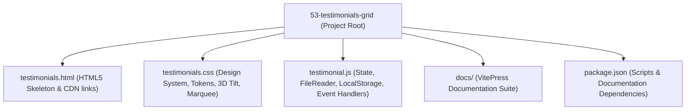

# Project Map & Technical Scan



---

## 1. Complete File & Directory Tree

```
53-testimonials-grid/
├── .git/                                # Git version control repository metadata
├── .gitattributes                       # Git line ending and attribute settings
├── .DS_Store                            # macOS Finder folder view settings (Ignored)
├── package.json                         # Node metadata, npm scripts, and documentation dependencies
├── package-lock.json                    # Deterministic lockfile for installed npm packages
├── testimonials.html                    # Main HTML5 entry point: forms, ticker container, CDN links
├── testimonials.css                     # Design tokens, Glassmorphism, 3D perspective, animations
├── testimonial.js                       # Vanilla JS application controller, state management, event listeners
└── docs/                                # Vue.js-style complete documentation suite
    ├── 00-project-type.md               # Pre-check classification & Track B justification
    ├── 00a-project-analysis.md          # Comprehensive feature traces, diagrams, inventory counts
    ├── 00b-project-pitch.md             # 30-second and 2-minute spoken interview pitches
    ├── 00-project-map.md                # Project file tree, dependencies, tech stack map
    ├── 01-features.md                   # Consolidated feature inventory with code traces & scripts
    ├── 02-build-order.md                # Step-by-step rebuild tutorial with key code snippets
    ├── 03-api-reference.md              # Web Platform & Browser API specifications
    ├── 04-tech-comparisons.md           # Exhaustive architectural comparison tables
    ├── 05-architecture.md               # System design, data flow, scaling bottlenecks
    ├── 06-security.md                   # OWASP Top 10 client-side audit & mitigations
    ├── 07-ai-integration.md             # AI integration specification (sentiment/moderation)
    ├── 08-quality-and-ops.md            # Code quality, profiling, testing, operational readiness
    ├── 09-interview-qa.md               # 150+ project-specific interview questions & answers
    ├── 10-gaps-and-improvements.md      # Prioritized engineering backlog & code fixes
    ├── 11-glossary.md                   # Technical definitions and engineering terms
    ├── 12-confirm-list.md               # Items flagged with [CONFIRM WITH DEVELOPER]
    ├── 13-master-checklist.md           # 275-point exhaustive architectural checklist
    ├── 14-say-it-out-loud.md            # Consolidated spoken scripts & rehearsal checklist
    ├── index.md                         # VitePress landing page hero layout
    ├── README.md                        # Master index & reading order guide
    ├── features/                        # Dedicated deep dive per feature (F1 - F12)
    │   ├── f1-image-upload-preview.md
    │   ├── f2-star-rating-system.md
    │   ├── f3-floating-label-input.md
    │   ├── f4-testimonial-submission-state.md
    │   ├── f5-localstorage-persistence.md
    │   ├── f6-infinite-marquee-ticker.md
    │   ├── f7-dynamic-speed-duration.md
    │   ├── f8-hover-pause-interaction.md
    │   ├── f9-tilt-3d-perspective.md
    │   ├── f10-reduced-motion-accessibility.md
    │   ├── f11-xss-sanitization.md
    │   └── f12-clear-data-management.md
    ├── system-design/                   # Senior system design interview suite
    │   ├── README.md
    │   ├── 14.1-requirements-and-estimation.md
    │   ├── 14.2-architecture-styles.md
    │   ├── 14.3-networking-and-communication.md
    │   ├── 14.4-load-balancing-and-scaling.md
    │   ├── 14.5-databases-and-storage.md
    │   ├── 14.6-caching.md
    │   ├── 14.7-messaging-queues-async.md
    │   ├── 14.8-consistency-concurrency-distributed.md
    │   ├── 14.9-reliability-and-resilience.md
    │   ├── 14.10-api-design-and-rate-limiting.md
    │   ├── 14.11-security-architecture.md
    │   ├── 14.12-search-and-ai-architecture.md
    │   ├── 14.13-real-time-systems.md
    │   ├── 14.14-observability-and-operations.md
    │   ├── 14.15-performance-engineering.md
    │   ├── 14.16-cost-and-tradeoffs.md
    │   ├── 14.17-classic-system-design-questions.md
    │   └── decisions.md
    └── .vitepress/                      # VitePress site configuration and themes
        ├── config.js
        └── theme/
            ├── index.js
            └── custom.css
```

---

## 2. Tech Stack & Version Matrix

| Technology / Component | Version / Standard | Source / Location | Purpose in Project |
| :--- | :--- | :--- | :--- |
| **HTML5** | Living Standard | [`testimonials.html`](file:///Users/avishjain/avishjain9-repos/53-testimonials-grid/testimonials.html) | Semantic structure, input elements, form layout |
| **CSS3** | Level 3 & 4 Specs | [`testimonials.css`](file:///Users/avishjain/avishjain9-repos/53-testimonials-grid/testimonials.css) | Custom variables, Glassmorphism, 3D perspective, animations |
| **JavaScript** | ECMAScript 2020+ (ES6+) | [`testimonial.js`](file:///Users/avishjain/avishjain9-repos/53-testimonials-grid/testimonial.js) | Asynchronous FileReader, LocalStorage, event handling, 3D math |
| **Node.js** | v22.23.2 | Host Environment | Runtime environment for documentation tooling & dev servers |
| **npm** | 10.9.8 | Host Environment | Package management for VitePress and local static server |

---

## 3. Package Dependencies

### Dev Dependencies (via `package.json`)
| Package | Installed Version | Reason It Exists |
| :--- | :--- | :--- |
| **`vitepress`** | `^1.6.3` | Generates modern, performant Vue-style documentation website |
| **`mermaid`** | `^11.4.1` | Core diagram generation engine for architecture & sequence diagrams |
| **`vitepress-plugin-mermaid`** | `^2.0.17` | Seamless VitePress integration for rendering Mermaid code fences |
| **`serve`** | `^14.2.4` | Lightweight static web server to host `testimonials.html` locally |

### Runtime Dependencies
- **None**: The core client application runs natively in all modern web browsers without third-party JavaScript libraries or build tools.

---

## 4. Environment Variables & Secrets
- **None Required**: The project is a pure client-side application. No private API keys or environment variables (`.env`) are required for execution.

---

## 5. Third-Party CDNs & External Assets
1. **Google Fonts (`fonts.googleapis.com`)**: Fetches font weights 400, 500, 600, 700 for the `Inter` font family.
2. **FontAwesome (`cdnjs.cloudflare.com`)**: Stylesheet for FontAwesome 6 icons (`fa-star`).
3. **Placehold.co (`placehold.co`)**: Fallback SVG/PNG placeholder avatar (`https://placehold.co/100x100/E2E8F0/4A5568?text=Photo`).

---

## 6. Entry Points
- **Web Application Entry**: [`testimonials.html`](file:///Users/avishjain/avishjain9-repos/53-testimonials-grid/testimonials.html) (Served on `http://localhost:5173`)
- **Documentation Suite Entry**: [`docs/index.md`](file:///Users/avishjain/avishjain9-repos/53-testimonials-grid/docs/index.md) (Served via VitePress on `http://localhost:5174`)
- **Main JavaScript Script**: [`testimonial.js`](file:///Users/avishjain/avishjain9-repos/53-testimonials-grid/testimonial.js)
- **Main CSS Stylesheet**: [`testimonials.css`](file:///Users/avishjain/avishjain9-repos/53-testimonials-grid/testimonials.css)
