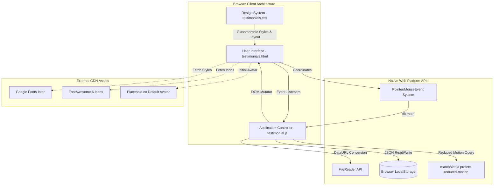
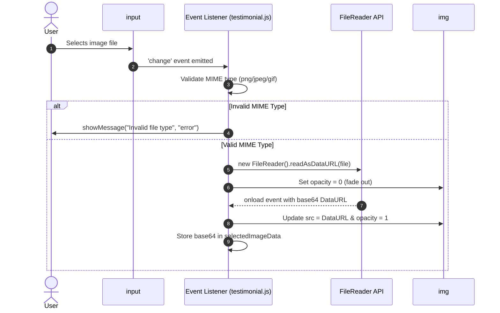
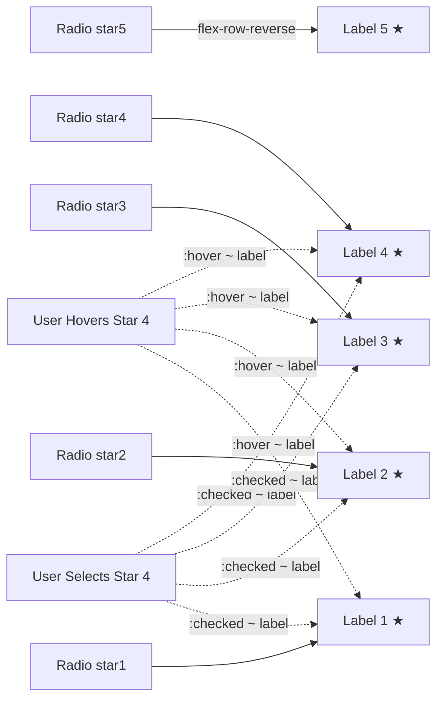
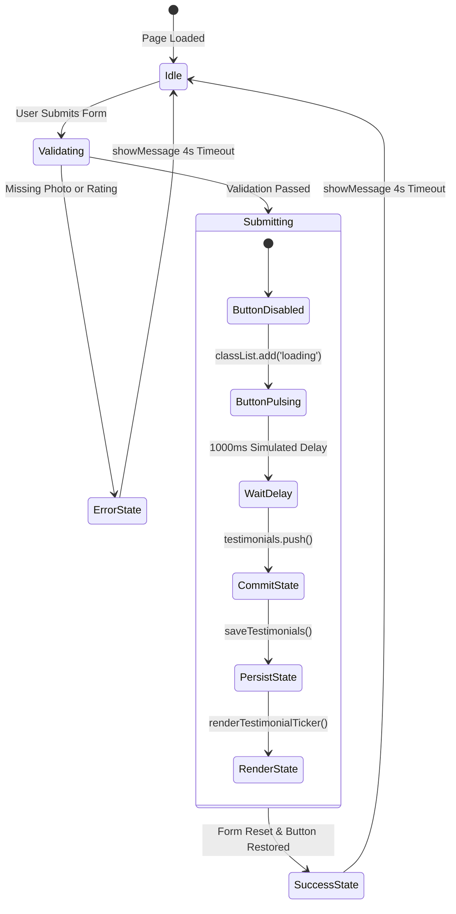
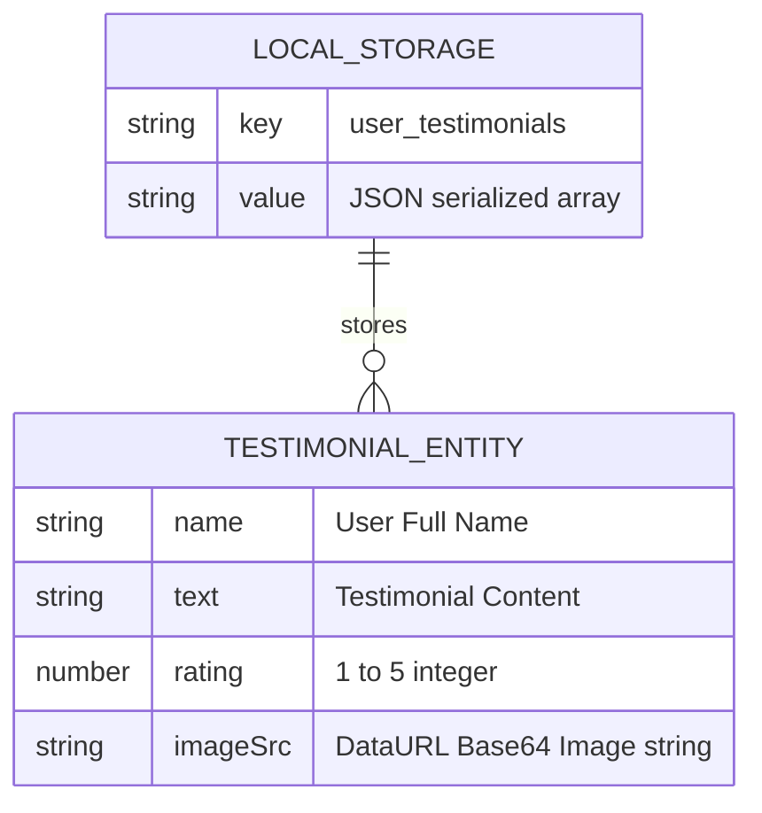
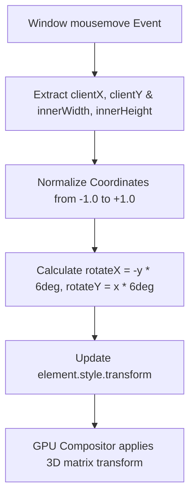
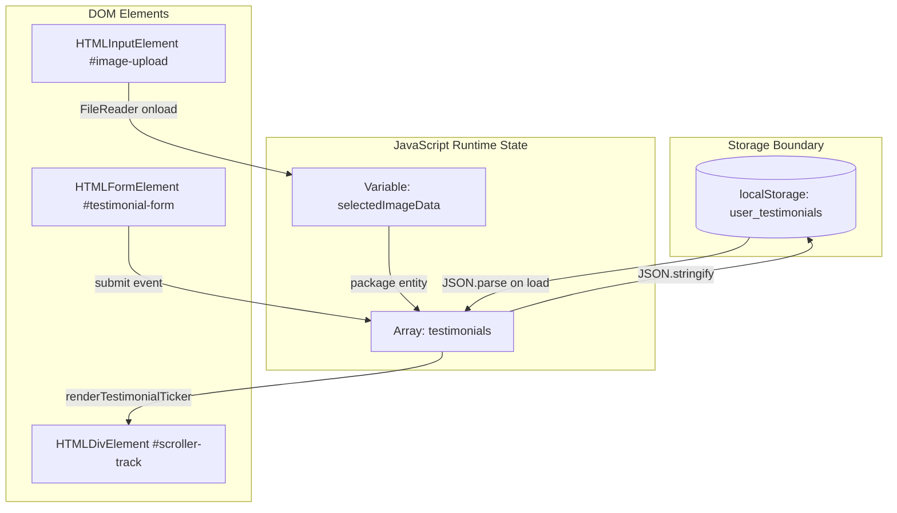
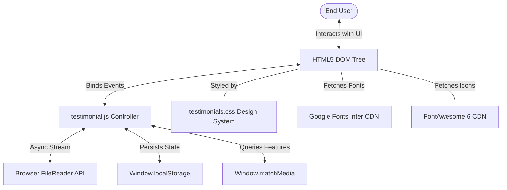

# Full Project Analysis



---

## 0.1 What the Project Is

- **Project Name**: Polished Testimonials (Interactive Testimonial Grid & Scrolling Ticker)
- **Repository**: [AVISHJAIN9/testimonials](https://github.com/AVISHJAIN9/testimonials)
- **Purpose**: A self-contained, high-performance customer testimonial submission portal and continuous auto-scrolling marquee ticker with modern Glassmorphic aesthetics, fluid 3D mouse tracking tilt, client-side image encoding, and offline-ready browser persistence.
- **Problem Solved**: Small businesses, portfolio owners, and modern SaaS landing pages frequently struggle to display social proof without heavy third-party SaaS widgets (which introduce tracker bloat, slow page loads, and recurring subscription costs). This project offers a zero-dependency, lightweight, privacy-focused alternative that runs client-side with zero latency.
- **Target Users**:
  - Website Visitors / Customers: Looking to leave feedback, star ratings, and upload their avatar in a delightful interactive interface.
  - Prospective Clients / Evaluators: Scrolling through social proof testimonials dynamically displayed in an infinite loop.
  - Frontend Engineers & Hiring Managers: Evaluating vanilla JavaScript proficiency, DOM manipulation, asynchronous FileReader streams, CSS keyframe math, and responsive 3D micro-interactions.
- **Main User Journeys**:
  1. **Submission Journey**: Visitor opens portal -> Selects custom profile photo (live preview updates via FileReader) -> Types full name and testimonial text (floating labels elevate) -> Selects 1-5 star rating (interactive hover & checked state) -> Submits form -> Button enters pulsating loading state (1-second artificial UX delay) -> Success banner renders -> Testimonial persists to `localStorage` -> Form resets.
  2. **Ticker Observation Journey**: Visitor observes continuous marquee scrolling horizontally -> Hovers over marquee window (ticker pauses instantly via CSS `animation-play-state: paused`) -> Reads specific card -> Moves mouse across container (form and cards tilt dynamically in 3D space according to cursor position).
  3. **Data Management Journey**: Admin or user clicks "Clear All" button -> All saved testimonials are deleted from `localStorage` -> Marquee ticker gracefully collapses and unmounts from DOM.

---

## 0.2 Comprehensive Feature Inventory & Traces (F1 to F12)

### F1: Profile Photo File Upload & Asynchronous Preview
- **User Action**: Clicks "Choose an Image" button ([`testimonials.html:28-31`](file:///Users/avishjain/avishjain9-repos/53-testimonials-grid/testimonials.html#L28-L31)) and selects a file (`.png`, `.jpg`, `.jpeg`, `.gif`).
- **Code Trace**:
  - Event Listener: [`testimonial.js:125-148`](file:///Users/avishjain/avishjain9-repos/53-testimonials-grid/testimonial.js#L125-L148) `imageUpload.addEventListener('change', (event) => ...)`
  - Validation: Checks `validImageTypes.includes(file.type)` ([`testimonial.js:129`](file:///Users/avishjain/avishjain9-repos/53-testimonials-grid/testimonial.js#L129)). If invalid, triggers `showMessage('Invalid file type...', 'error')` ([`testimonial.js:130`](file:///Users/avishjain/avishjain9-repos/53-testimonials-grid/testimonial.js#L130)).
  - Asynchronous Processing: Instantiates `new FileReader()` ([`testimonial.js:136`](file:///Users/avishjain/avishjain9-repos/53-testimonials-grid/testimonial.js#L136)) and calls `reader.readAsDataURL(file)` ([`testimonial.js:146`](file:///Users/avishjain/avishjain9-repos/53-testimonials-grid/testimonial.js#L146)).
  - Visual Transitions: Sets `imagePreview.style.opacity = '0'` ([`testimonial.js:139`](file:///Users/avishjain/avishjain9-repos/53-testimonials-grid/testimonial.js#L139)), delays 200ms, updates `imagePreview.src = e.target.result`, stores `selectedImageData`, and restores `opacity = '1'` ([`testimonial.js:140-144`](file:///Users/avishjain/avishjain9-repos/53-testimonials-grid/testimonial.js#L140-L144)).



### F2: Interactive 5-Star Rating System
- **User Action**: Hovers over stars to preview rating or clicks to select 1 to 5 stars ([`testimonials.html:39-48`](file:///Users/avishjain/avishjain9-repos/53-testimonials-grid/testimonials.html#L39-L48)).
- **Code Trace**:
  - CSS Architecture: Implemented using reversed flex row (`flex-direction: row-reverse;`) in [`testimonials.css:241`](file:///Users/avishjain/avishjain9-repos/53-testimonials-grid/testimonials.css#L241).
  - General Sibling Combinator: `.star-rating-input input[type="radio"]:checked ~ label` ([`testimonials.css:254`](file:///Users/avishjain/avishjain9-repos/53-testimonials-grid/testimonials.css#L254)) and `:hover ~ label` ([`testimonials.css:256`](file:///Users/avishjain/avishjain9-repos/53-testimonials-grid/testimonials.css#L256)) colors all preceding stars in DOM order with `--clr-accent` (#f59e0b).
  - Micro-Interaction: Star expands on hover with `transform: scale(1.25)` ([`testimonials.css:259`](file:///Users/avishjain/avishjain9-repos/53-testimonials-grid/testimonials.css#L259)).
  - Evaluation: Read via `document.querySelector('input[name="rating"]:checked')` in [`testimonial.js:156`](file:///Users/avishjain/avishjain9-repos/53-testimonials-grid/testimonial.js#L156).



### F3: Floating Label Form Fields
- **User Action**: Focuses input fields or types content into "Your Name" or "Your Testimonial".
- **Code Trace**:
  - CSS Pseudo-class Logic: Uses `:focus + label` and `:not(:placeholder-shown) + label` ([`testimonials.css:168-181`](file:///Users/avishjain/avishjain9-repos/53-testimonials-grid/testimonials.css#L168-L181)).
  - Layout Positioning: Label transforms from centered placeholder (`top: 50%; transform: translateY(-50%)`) to elevated position (`top: 0; transform: translateY(-50%); font-size: 0.75rem; color: var(--clr-primary)`).
  - HTML Contract: Inputs declare `placeholder=" "` ([`testimonials.html:35, 51`](file:///Users/avishjain/avishjain9-repos/53-testimonials-grid/testimonials.html#L35)) to trigger `:not(:placeholder-shown)`.

### F4: Testimonial Form Validation, Submission & Simulated Network Latency
- **User Action**: Clicks "Submit Testimonial" button ([`testimonials.html:55`](file:///Users/avishjain/avishjain9-repos/53-testimonials-grid/testimonials.html#L55)).
- **Code Trace**:
  - Event Handling: `testimonialForm.addEventListener('submit', (event) => ...)` ([`testimonial.js:151`](file:///Users/avishjain/avishjain9-repos/53-testimonials-grid/testimonial.js#L151)).
  - Interception: `event.preventDefault()` halts browser page reload.
  - Validation:
    - Photo check: `if (!selectedImageData)` -> error message ([`testimonial.js:158-161`](file:///Users/avishjain/avishjain9-repos/53-testimonials-grid/testimonial.js#L158-L161)).
    - Rating check: `if (!ratingInput)` -> error message ([`testimonial.js:162-165`](file:///Users/avishjain/avishjain9-repos/53-testimonials-grid/testimonial.js#L162-L165)).
  - Asynchronous State Management: Button disabled (`submitBtn.disabled = true; submitBtn.textContent = 'Submitting...'; submitBtn.classList.add('loading')`) ([`testimonial.js:171-173`](file:///Users/avishjain/avishjain9-repos/53-testimonials-grid/testimonial.js#L171-L173)).
  - Artificial Latency: `setTimeout(..., 1000)` simulates network roundtrip ([`testimonial.js:176-203`](file:///Users/avishjain/avishjain9-repos/53-testimonials-grid/testimonial.js#L176-L203)).
  - Completion: Pushes object `{ name, text, rating, imageSrc }` into `testimonials` array, commits to `localStorage`, re-renders ticker, clears form, resets avatar preview.



### F5: Browser LocalStorage Persistence
- **User Action**: Refreshes the page or returns in a subsequent browser session.
- **Code Trace**:
  - Key Definition: `const STORAGE_KEY = 'user_testimonials'` ([`testimonial.js:15`](file:///Users/avishjain/avishjain9-repos/53-testimonials-grid/testimonial.js#L15)).
  - Save Routine: `saveTestimonials()` calls `localStorage.setItem(STORAGE_KEY, JSON.stringify(testimonials))` ([`testimonial.js:107-109`](file:///Users/avishjain/avishjain9-repos/53-testimonials-grid/testimonial.js#L107-L109)).
  - Load Routine: `loadTestimonials()` checks `localStorage.getItem(STORAGE_KEY)` during `DOMContentLoaded` ([`testimonial.js:114-120`](file:///Users/avishjain/avishjain9-repos/53-testimonials-grid/testimonial.js#L114-L120)).



### F6: Infinite Marquee Ticker with DOM Duplication
- **User Action**: Views cards sliding seamlessly from right to left.
- **Code Trace**:
  - Seamless Wrapping Technique: `scrollerTrack.innerHTML = trackHTML + trackHTML;` duplicates the entire card set ([`testimonial.js:95`](file:///Users/avishjain/avishjain9-repos/53-testimonials-grid/testimonial.js#L95)).
  - CSS Animation: `@keyframes scrollLeft { 0% { transform: translateX(0); } 100% { transform: translateX(-50%); } }` in [`testimonials.css:353-356`](file:///Users/avishjain/avishjain9-repos/53-testimonials-grid/testimonials.css#L353-L356).
  - Masking: Applies `-webkit-mask-image` and `mask-image` linear gradients ([`testimonials.css:341-342`](file:///Users/avishjain/avishjain9-repos/53-testimonials-grid/testimonials.css#L341-L342)) to produce transparent feathered fade edges at 0% and 100%.

### F7: Dynamic Animation Speed & Duration Scaling
- **User Action**: Submits multiple testimonials and observes ticker maintaining a consistent physical scrolling velocity.
- **Code Trace**:
  - Formula: `const scrollSpeed = 25; const minDuration = 30; const duration = Math.max(testimonials.length * scrollSpeed, minDuration);` ([`testimonial.js:97-99`](file:///Users/avishjain/avishjain9-repos/53-testimonials-grid/testimonial.js#L97-L99)).
  - Dynamic Injection: Modifies `scrollerTrack.style.animationDuration = \`${duration}s\`` ([`testimonial.js:101`](file:///Users/avishjain/avishjain9-repos/53-testimonials-grid/testimonial.js#L101)).

### F8: Hover Pause Interaction
- **User Action**: Moves mouse cursor over the scrolling marquee.
- **Code Trace**:
  - CSS Rule: `.scroller-window:hover .scroller-track { animation-play-state: paused; }` ([`testimonials.css:349-351`](file:///Users/avishjain/avishjain9-repos/53-testimonials-grid/testimonials.css#L349-L351)).
  - Performance: Handled entirely on the browser's compositor thread with zero JavaScript execution overhead.

### F9: Interactive 3D Perspective & Mouse Tracking Tilt
- **User Action**: Moves mouse across the screen; form container and ticker cards tilt in response.
- **Code Trace**:
  - Perspective Setup: `.main-wrapper { perspective: 1000px; }` ([`testimonials.css:85`](file:///Users/avishjain/avishjain9-repos/53-testimonials-grid/testimonials.css#L85)).
  - Normalized Coordinates Calculation:
    ```javascript
    const x = (clientX / innerWidth - 0.5) * 2;
    const y = (clientY / innerHeight - 0.5) * 2;
    const maxRotate = 6;
    const rotateX = (y * -maxRotate).toFixed(2);
    const rotateY = (x * maxRotate).toFixed(2);
    ```
    ([`testimonial.js:217-229`](file:///Users/avishjain/avishjain9-repos/53-testimonials-grid/testimonial.js#L217-L229)).
  - DOM Transform: Applies `rotateX(${rotateX}deg) rotateY(${rotateY}deg)` to `.form-container` and all `.ticker-card` elements.
  - Reset: `resetTilt()` restores `rotateX(0deg) rotateY(0deg)` when mouse leaves viewport ([`testimonial.js:238-244`](file:///Users/avishjain/avishjain9-repos/53-testimonials-grid/testimonial.js#L238-L244)).



### F10: Web Accessibility & Prefers-Reduced-Motion Guard
- **User Action**: User with vestibular disorder or motion sensitivity configures operating system to reduce motion.
- **Code Trace**:
  - API Call: `window.matchMedia('(prefers-reduced-motion: reduce)')` ([`testimonial.js:247`](file:///Users/avishjain/avishjain9-repos/53-testimonials-grid/testimonial.js#L247)).
  - Guard Condition: Event listeners for `mousemove` and `mouseleave` are only bound if `!prefersReducedMotion.matches` ([`testimonial.js:249-252`](file:///Users/avishjain/avishjain9-repos/53-testimonials-grid/testimonial.js#L249-L252)).

### F11: Client-Side Input Sanitization (XSS Mitigation)
- **User Action**: Submits testimonial containing HTML tags (e.g., `<script>alert(1)</script>`).
- **Code Trace**:
  - Sanitization Function: `sanitize(str)` executes `str.replace(/</g, "&lt;").replace(/>/g, "&gt;")` ([`testimonial.js:38-40`](file:///Users/avishjain/avishjain9-repos/53-testimonials-grid/testimonial.js#L38-L40)).
  - Execution Point: Called on `testimonial.name` and `testimonial.text` inside `createTickerCardHTML()` ([`testimonial.js:61-62`](file:///Users/avishjain/avishjain9-repos/53-testimonials-grid/testimonial.js#L61-L62)).

### F12: Testimonial Data Clearing & Reset
- **User Action**: Clicks "Clear All" button in ticker header ([`testimonials.html:64`](file:///Users/avishjain/avishjain9-repos/53-testimonials-grid/testimonials.html#L64)).
- **Code Trace**:
  - Event Handling: `clearAllBtn.addEventListener('click', ...)` ([`testimonial.js:206-212`](file:///Users/avishjain/avishjain9-repos/53-testimonials-grid/testimonial.js#L206-L212)).
  - State Flush: Resets `testimonials = []`, calls `saveTestimonials()`, and invokes `renderTestimonialTicker()`.
  - DOM Removal: `tickerSection.style.display = 'none'` and `scrollerTrack.innerHTML = ''` cleans up DOM nodes ([`testimonial.js:81-85`](file:///Users/avishjain/avishjain9-repos/53-testimonials-grid/testimonial.js#L81-L85)).

---

## 0.3 Every API & External Service

### Backend Endpoints
*Not applicable for this project type (Frontend-only client application with local browser persistence).*

### External CDN Services & SDKs
| Provider / CDN | URL / Asset | Purpose | Implementation Location | Authentication / Keys |
| :--- | :--- | :--- | :--- | :--- |
| **Google Fonts** | `https://fonts.googleapis.com/css2?family=Inter...` | Modern typography ('Inter') | [`testimonials.html:8-10`](file:///Users/avishjain/avishjain9-repos/53-testimonials-grid/testimonials.html#L8-L10) | None required (Public) |
| **FontAwesome CDN** | `https://cdnjs.cloudflare.com/.../all.min.css` | Star icon fonts (`fas fa-star`, `far fa-star`) | [`testimonials.html:12`](file:///Users/avishjain/avishjain9-repos/53-testimonials-grid/testimonials.html#L12) | None required (Public) |
| **Placehold.co** | `https://placehold.co/100x100/E2E8F0/4A5568...` | Default avatar image placeholder | [`testimonials.html:27`](file:///Users/avishjain/avishjain9-repos/53-testimonials-grid/testimonials.html#L27) | None required (Public) |

### API Keys & Secrets
*None required. All operations run locally inside the client's web browser environment.*

---

## 0.4 Helper Functions & Utilities Inventory

| Function / Helper | Parameters | Return Value | Purpose | Callers |
| :--- | :--- | :--- | :--- | :--- |
| `showMessage(text, type)` | `text: string`, `type: string` | `void` | Renders floating banner message for 4 seconds | Form validation errors, file type errors, submission success |
| `sanitize(str)` | `str: string` | `string` | Replaces `<` and `>` with HTML entities `&lt;` and `&gt;` | `createTickerCardHTML()` |
| `createStarRatingHTML(rating)` | `rating: number` | `string` (HTML) | Generates FontAwesome star markup for cards | `createTickerCardHTML()` |
| `createTickerCardHTML(testimonial)`| `testimonial: Object` | `string` (HTML) | Returns sanitized HTML markup for a single card | `renderTestimonialTicker()` |
| `renderTestimonialTicker()` | none | `void` | Mounts or unmounts ticker, duplicates cards, sets speed | Init load, form submit, clear all |
| `saveTestimonials()` | none | `void` | Serializes array into browser LocalStorage | Form submit, clear all |
| `loadTestimonials()` | none | `void` | Deserializes array from LocalStorage on load | `DOMContentLoaded` event |
| `handleTilt(event)` | `event: MouseEvent` | `void` | Calculates 3D rotation angles and updates transforms | `document.body` mousemove |
| `resetTilt()` | none | `void` | Restores `rotateX(0deg) rotateY(0deg)` | `document.body` mouseleave |

---

## 0.5 Connections & Data Flows



---

## 0.6 Additional Platform & UI Features

- **Glassmorphic Theme**: Utilizes CSS `backdrop-filter: blur(12px)` combined with semi-transparent alpha backgrounds (`rgba(255, 255, 255, 0.4)`) and subtle border gradients.
- **GPU Accelerated Transitions**: Uses `transform` and `opacity` properties to trigger hardware layer promotion, avoiding layout thrashing.
- **Accessible Color Contrast**: Meets WCAG AA specifications for text on blurred containers.

---

## 0.7 Connection Map



---

## 0.8 Final Inventory Counts

| Item | Count | Exact References |
| :--- | :--- | :--- |
| **Total HTML Pages** | **1** | [`testimonials.html`](file:///Users/avishjain/avishjain9-repos/53-testimonials-grid/testimonials.html) |
| **Major UI Sections** | **4** | Header, Submission Form Container, Rating Input Group, Testimonial Ticker |
| **JavaScript Functions** | **9** | `showMessage`, `sanitize`, `createStarRatingHTML`, `createTickerCardHTML`, `renderTestimonialTicker`, `saveTestimonials`, `loadTestimonials`, `handleTilt`, `resetTilt` |
| **Documented Features** | **12** | F1 through F12 |
| **Backend Endpoints** | **0** | Not applicable (Frontend-only architecture) |
| **Database Models** | **1 Entity** | Client-Side Entity: `Testimonial { name, text, rating, imageSrc }` |
| **Middleware Layers** | **0** | Not applicable |
| **External CDNs / APIs** | **3** | Google Fonts, FontAwesome, Placehold.co |
| **Environment Variables** | **0** | Client-side static application |
| **Project Dependencies** | **4** | Dev dependencies for docs: `vitepress`, `mermaid`, `vitepress-plugin-mermaid`, `serve` |
