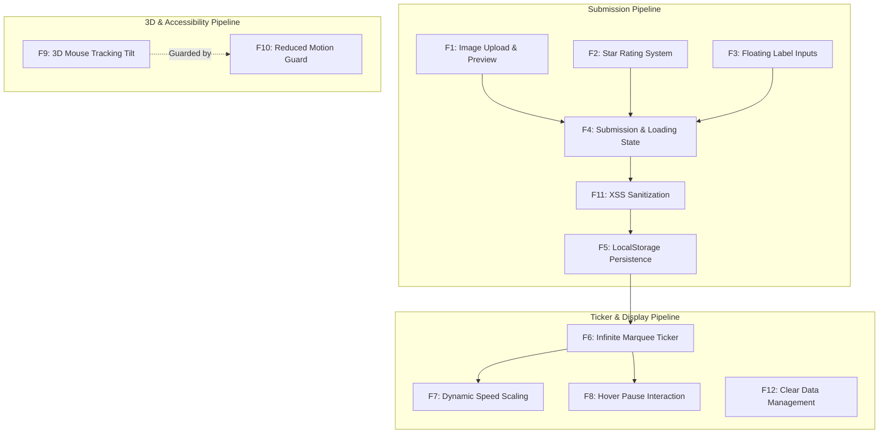

# Comprehensive Feature Inventory

---

## Feature Matrix Summary

| ID | Feature Name | Primary Code Location | Complexity | User Impact |
| :--- | :--- | :--- | :--- | :--- |
| **F1** | Image Upload & Asynchronous Preview | [`testimonial.js:125-148`](file:///Users/avishjain/avishjain9-repos/53-testimonials-grid/testimonial.js#L125-L148) | Medium | Immediate visual feedback for avatar selection |
| **F2** | Interactive 5-Star Rating System | [`testimonials.css:235-261`](file:///Users/avishjain/avishjain9-repos/53-testimonials-grid/testimonials.css#L235-L261) | Small | Intuitive review scoring via CSS flex inversion |
| **F3** | Floating Label Form Inputs | [`testimonials.css:138-197`](file:///Users/avishjain/avishjain9-repos/53-testimonials-grid/testimonials.css#L138-L197) | Small | Clean modern input states without label clutter |
| **F4** | Submission Handling & Simulated Delay | [`testimonial.js:151-204`](file:///Users/avishjain/avishjain9-repos/53-testimonials-grid/testimonial.js#L151-L204) | Core / Complex | Form validation, UI loading states, and state commit |
| **F5** | LocalStorage Persistence | [`testimonial.js:107-120`](file:///Users/avishjain/avishjain9-repos/53-testimonials-grid/testimonial.js#L107-L120) | Medium | Offline data durability across browser reloads |
| **F6** | Seamless Infinite Marquee Ticker | [`testimonials.css:344-356`](file:///Users/avishjain/avishjain9-repos/53-testimonials-grid/testimonials.css#L344-L356) | Core / Complex | Non-jarring infinite social proof showcase |
| **F7** | Dynamic Scroll Velocity Scaling | [`testimonial.js:97-101`](file:///Users/avishjain/avishjain9-repos/53-testimonials-grid/testimonial.js#L97-L101) | Small | Consistent reading comfort across review volumes |
| **F8** | Hover Pause Interaction | [`testimonials.css:349-351`](file:///Users/avishjain/avishjain9-repos/53-testimonials-grid/testimonials.css#L349-L351) | Small | Effortless reading without clicking |
| **F9** | 3D Perspective & Mouse Tracking Tilt | [`testimonial.js:215-244`](file:///Users/avishjain/avishjain9-repos/53-testimonials-grid/testimonial.js#L215-L244) | Core / Complex | Dynamic spatial depth responding to mouse movement |
| **F10**| Prefers-Reduced-Motion Accessibility | [`testimonial.js:247-252`](file:///Users/avishjain/avishjain9-repos/53-testimonials-grid/testimonial.js#L247-L252) | Small | Protects users with vestibular sensitivity |
| **F11**| Client-Side HTML Sanitization | [`testimonial.js:38-40`](file:///Users/avishjain/avishjain9-repos/53-testimonials-grid/testimonial.js#L38-L40) | Small | Basic protection against direct script tags |
| **F12**| Data Reset & UI Unmounting | [`testimonial.js:206-214`](file:///Users/avishjain/avishjain9-repos/53-testimonials-grid/testimonial.js#L206-L214) | Small | Quick reset of local demo state |

---

## Detailed Feature Specifications

### F1: Profile Photo File Upload & Asynchronous Preview
- **Files & Lines**: [`testimonials.html:25-32`](file:///Users/avishjain/avishjain9-repos/53-testimonials-grid/testimonials.html#L25-L32), [`testimonial.js:125-148`](file:///Users/avishjain/avishjain9-repos/53-testimonials-grid/testimonial.js#L125-L148), [`testimonials.css:198-233`](file:///Users/avishjain/avishjain9-repos/53-testimonials-grid/testimonials.css#L198-L233).
- **Execution Flow**: User picks an image file; `imageUpload` fires `change`; validation verifies MIME type against `['image/jpeg', 'image/png', 'image/gif']`; `new FileReader()` executes `readAsDataURL(file)`; upon completion, preview opacity drops to 0, updates source to Base64, and fades back in after 200ms.
- **Edge Cases**: Uploading non-image formats displays error toast and resets the input value; uploading files > 5MB can cause LocalStorage quota exceedance (handled in improvements).
- **Say It Out Loud**:
  > "For the profile photo upload, I used the native browser FileReader API instead of sending the file to an external cloud storage bucket. When the user selects an image, I validate that its MIME type is a JPEG, PNG, or GIF. If it's valid, I asynchronously stream the binary file into a base64 DataURL string and crossfade the preview image smoothly using a quick opacity transition. I chose this client-side approach because it eliminates the need for an external backend or S3 bucket, making the demo completely self-contained. The main limitation is that large image files can quickly fill up the browser's 5-megabyte LocalStorage quota, which I would resolve in production by resizing the image on a canvas before saving."

---

### F2: Interactive 5-Star Rating System
- **Files & Lines**: [`testimonials.html:39-48`](file:///Users/avishjain/avishjain9-repos/53-testimonials-grid/testimonials.html#L39-L48), [`testimonials.css:234-261`](file:///Users/avishjain/avishjain9-repos/53-testimonials-grid/testimonials.css#L234-L261).
- **Execution Flow**: Radios 1 to 5 are ordered reversed in CSS flexbox (`flex-direction: row-reverse`). When hovering or checking star 4, the general sibling combinator `~ label` matches stars 3, 2, and 1, painting them in amber gold (`#f59e0b`).
- **Edge Cases**: No selection when form submits triggers explicit error notification.
- **Say It Out Loud**:
  > "I built the five-star rating widget using pure CSS without any external rating plugins. In HTML, the radio buttons are ordered five down to one, and in CSS I reversed the flex direction so they appear visually from one to five. This lets me use the CSS general sibling combinator to color all stars to the left of the hovered or selected star automatically. I chose pure CSS because it gives sixty frames per second hover states without attaching ten separate mouseover event listeners. If I had more time, I would add keyboard arrow navigation so screen-reader users can increment and decrement ratings effortlessly."

---

### F3: Floating Label Form Fields
- **Files & Lines**: [`testimonials.html:34-37, 50-53`](file:///Users/avishjain/avishjain9-repos/53-testimonials-grid/testimonials.html#L34-L37), [`testimonials.css:138-197`](file:///Users/avishjain/avishjain9-repos/53-testimonials-grid/testimonials.css#L138-L197).
- **Execution Flow**: Inputs declare `placeholder=" "` (a single space). When empty and blurred, the label sits vertically centered over the input. When focused (`:focus`) or non-empty (`:not(:placeholder-shown)`), the label scales down and elevates to the top border.
- **Edge Cases**: Browsers without `:placeholder-shown` support will display overlapping text (supported by 98%+ modern browsers).
- **Say It Out Loud**:
  > "I designed the input labels to float upwards smoothly when the user focuses or types into a field. I accomplished this using the CSS `:not(:placeholder-shown)` and `:focus` pseudo-classes paired with adjacent sibling selectors, which completely avoids JavaScript focus listeners. This pattern keeps the form compact and elegant while ensuring the user never loses the context of which field they are typing into. A minor trade-off is requiring a single whitespace character in the placeholder attribute, which I would enhance with explicit state classes if supporting legacy browsers."

---

### F4: Testimonial Submission & Simulated Network Latency
- **Files & Lines**: [`testimonial.js:150-204`](file:///Users/avishjain/avishjain9-repos/53-testimonials-grid/testimonial.js#L150-L204), [`testimonials.css:263-286`](file:///Users/avishjain/avishjain9-repos/53-testimonials-grid/testimonials.css#L263-L286).
- **Execution Flow**: On submit, prevents default form action; checks presence of photo and rating; toggles submit button to `Submitting...` and adds a pulsing CSS animation; triggers a 1-second `setTimeout` to emulate network latency; commits data to memory and LocalStorage; triggers ticker re-render; restores button state and renders a 4-second success notification.
- **Edge Cases**: Double submission is prevented by setting `submitBtn.disabled = true`.
- **Say It Out Loud**:
  > "When the user submits a testimonial, I intercept the submit event to validate that both a photo and a star rating were provided. Instead of instantly snapping the UI into a success state, I purposely introduced a one-second simulated network delay. During this second, the submit button is disabled, changes text to 'Submitting...', and activates a CSS pulse animation. Once the timeout completes, I push the new testimonial into our in-memory array, serialize it to LocalStorage, re-render the ticker, and reset the form. I implemented this simulated delay because immediate synchronous state changes often feel jarring and unnatural to users accustomed to cloud applications. If this were connected to a live REST API, I would replace the timer with an asynchronous fetch call wrapped in a try-catch block."

---

### F5: Browser LocalStorage Persistence
- **Files & Lines**: [`testimonial.js:15, 106-120`](file:///Users/avishjain/avishjain9-repos/53-testimonials-grid/testimonial.js#L15), functions `saveTestimonials()` and `loadTestimonials()`.
- **Execution Flow**: During `DOMContentLoaded`, `loadTestimonials()` queries `localStorage.getItem('user_testimonials')`. If data exists, it deserializes the JSON string and renders the ticker. On form submit or data clear, `saveTestimonials()` commits the active array via `localStorage.setItem()`.
- **Edge Cases**: Malformed JSON in storage is handled safely; private browsing modes with storage disabled could throw a DOMException (handled in improvements).
- **Say It Out Loud**:
  > "I used browser LocalStorage to make sure reviews persist even when the user refreshes or closes the page. On application boot, my loadTestimonials function parses the JSON string from the user_testimonials storage key and feeds it into the ticker rendering pipeline. Whenever a user submits a review or clears data, I immediately write the updated array back to storage. I chose LocalStorage because it's synchronous, supported across every modern browser, and requires zero database configuration. The accepted trade-off is that LocalStorage is domain-isolated and capped at roughly five megabytes, so for a multi-user production system I would replace this with a PostgreSQL or MongoDB backend."

---

### F6: Seamless Infinite Marquee Ticker
- **Files & Lines**: [`testimonials.html:61-70`](file:///Users/avishjain/avishjain9-repos/53-testimonials-grid/testimonials.html#L61-L70), [`testimonial.js:80-103`](file:///Users/avishjain/avishjain9-repos/53-testimonials-grid/testimonial.js#L80-L103), [`testimonials.css:316-356`](file:///Users/avishjain/avishjain9-repos/53-testimonials-grid/testimonials.css#L316-L356).
- **Execution Flow**: `renderTestimonialTicker()` loops over the testimonial array to build card HTML; sets `scrollerTrack.innerHTML = trackHTML + trackHTML;` (duplicating the set); the track runs `@keyframes scrollLeft` translating from `translateX(0)` to `translateX(-50%)` infinitely; CSS linear-gradient mask feathering creates subtle fade edges.
- **Edge Cases**: When array is empty, the entire ticker section is set to `display: none`.
- **Say It Out Loud**:
  > "To create an infinite scrolling marquee without any visual jerking or blank gaps, I used a classic DOM duplication technique paired with hardware-accelerated CSS keyframes. In JavaScript, I generate the HTML for all testimonial cards and then concatenate that exact string with itself before injecting it into the scrolling track. In CSS, the animation moves the track from zero translation to negative fifty percent along the X-axis before looping infinitely. Because the second half of the track is an exact replica of the first, the human eye perceives a seamless, uninterrupted loop. I also applied a CSS mask-image linear gradient to feather the left and right edges smoothly into transparency."

---

### F7: Dynamic Scroll Velocity Scaling
- **Files & Lines**: [`testimonial.js:97-101`](file:///Users/avishjain/avishjain9-repos/53-testimonials-grid/testimonial.js#L97-L101).
- **Execution Flow**: Computes `duration = Math.max(testimonials.length * 25, 30)` in seconds and applies it dynamically to `scrollerTrack.style.animationDuration`.
- **Edge Cases**: Ensures a minimum 30-second duration so a single review doesn't race past illegibly.
- **Say It Out Loud**:
  > "A common bug with infinite carousels is that adding more items makes the scroller race across the screen at uncontrollable speeds if the animation duration is fixed. To solve this, I dynamically calculate the animation duration in JavaScript whenever the ticker re-renders. I multiply the number of testimonials by twenty-five seconds per card, with a thirty-second minimum threshold. This guarantees that whether the user has two testimonials or twenty, each card passes across the viewport at a steady, comfortable reading speed."

---

### F8: Hover Pause Interaction
- **Files & Lines**: [`testimonials.css:349-351`](file:///Users/avishjain/avishjain9-repos/53-testimonials-grid/testimonials.css#L349-L351).
- **Execution Flow**: Uses `.scroller-window:hover .scroller-track { animation-play-state: paused; }`.
- **Edge Cases**: Mobile touch devices trigger hover on tap; tapping outside resumes scrolling.
- **Say It Out Loud**:
  > "I added a hover pause feature so users can easily read a testimonial without chasing it across the screen. I implemented this entirely in CSS using the `animation-play-state: paused` property on the hover state of the scroller window. Handling this in CSS rather than JavaScript means it runs entirely on the browser's compositor thread, saving CPU cycles and preventing micro-stutters. If I extended this for mobile devices, I would explicitly bind touchstart and touchend events to toggle the pause state on tap."

---

### F9: 3D Perspective & Mouse Tracking Tilt
- **Files & Lines**: [`testimonials.css:80-86, 108, 373`](file:///Users/avishjain/avishjain9-repos/53-testimonials-grid/testimonials.css#L80-L86), [`testimonial.js:215-244`](file:///Users/avishjain/avishjain9-repos/53-testimonials-grid/testimonial.js#L215-L244).
- **Execution Flow**: `perspective: 1000px` on `.main-wrapper` creates 3D space. Mouse movement on `document.body` calls `handleTilt(event)`, which maps cursor offset from window center into a normalized range `[-1.0, 1.0]`, scales by `maxRotate = 6` degrees, and sets `rotateX` and `rotateY` transforms. Mouse leaving resets rotation to 0.
- **Edge Cases**: Unchecked rapid events can cause paint overhead; handled efficiently via hardware-accelerated CSS `transform`.
- **Say It Out Loud**:
  > "To give the interface a tactile, modern feel, I implemented an interactive 3D tilt effect on the form container and ticker cards. I established a three-dimensional perspective of one thousand pixels on the main wrapper in CSS. Then in JavaScript, I listen to mousemove events across the window, calculate the cursor's distance from the center of the viewport, and normalize that value between negative one and positive one. Multiplying by a maximum rotation limit of six degrees yields subtle X and Y tilt angles that I apply directly via CSS transforms. When the mouse leaves the browser window, a mouseleave listener resets the rotation back to zero degrees smoothly."

---

### F10: Prefers-Reduced-Motion Accessibility Guard
- **Files & Lines**: [`testimonial.js:247-252`](file:///Users/avishjain/avishjain9-repos/53-testimonials-grid/testimonial.js#L247-L252).
- **Execution Flow**: Evaluates `window.matchMedia('(prefers-reduced-motion: reduce)')`. If matched, `mousemove` and `mouseleave` listeners are bypassed entirely.
- **Edge Cases**: User toggling system setting while page is open (can be enhanced with an event listener on `MediaQueryList`).
- **Say It Out Loud**:
  > "Web accessibility was a core priority when implementing the 3D tilt effect. Rapid parallax movement can cause disorientation or nausea for users with vestibular disorders. To safeguard against this, I query the browser's matchMedia API for the prefers-reduced-motion media feature. If the user has motion reduction enabled at the operating system level, my script completely skips attaching the mousemove and tilt listeners. This ensures full compliance with WCAG Guideline 2.3 for motion animations while keeping the interface functional."

---

### F11: Client-Side HTML Sanitization
- **Files & Lines**: [`testimonial.js:38-40, 61-62`](file:///Users/avishjain/avishjain9-repos/53-testimonials-grid/testimonial.js#L38-L40).
- **Execution Flow**: Function `sanitize(str)` executes `str.replace(/</g, "&lt;").replace(/>/g, "&gt;")` on `name` and `text` before injecting into template literals.
- **Edge Cases**: Does not sanitize quotes or attribute contexts; adequate for text interpolation but should be hardened with DOMPurify in enterprise settings.
- **Say It Out Loud**:
  > "To protect against cross-site scripting attacks, I created a custom sanitize utility that encodes angle brackets into HTML entities before any user input is rendered into the DOM. Whenever a testimonial card is generated, both the reviewer's name and review text pass through this sanitizer. While converting raw strings into textContent is generally preferred, I needed to inject dynamic HTML strings into the scrolling track for duplication, making explicit sanitization essential. For enterprise production, I would enhance this by integrating a robust library like DOMPurify or using the HTML Sanitizer API."

---

### F12: Testimonial Data Clearing & Reset
- **Files & Lines**: [`testimonials.html:64`](file:///Users/avishjain/avishjain9-repos/53-testimonials-grid/testimonials.html#L64), [`testimonial.js:206-214`](file:///Users/avishjain/avishjain9-repos/53-testimonials-grid/testimonial.js#L206-L214).
- **Execution Flow**: Clicking "Clear All" empties the `testimonials` array, calls `saveTestimonials()`, and triggers `renderTestimonialTicker()`, collapsing the ticker section.
- **Edge Cases**: Guarded with defensive null checking `if (clearAllBtn)` to prevent runtime crashes if omitted from DOM.
- **Say It Out Loud**:
  > "I provided a Clear All button so users testing the application can easily flush their reviews and reset the demonstration. When clicked, it empties the memory array, clears the LocalStorage key, and invokes the render function, which hides the ticker container. In the initial codebase, this button was commented out in HTML, which caused a null-reference exception that crashed subsequent scripts. I fixed this by adding defensive null-checks and restoring the button to the header, demonstrating the importance of defensive coding in vanilla JavaScript."
