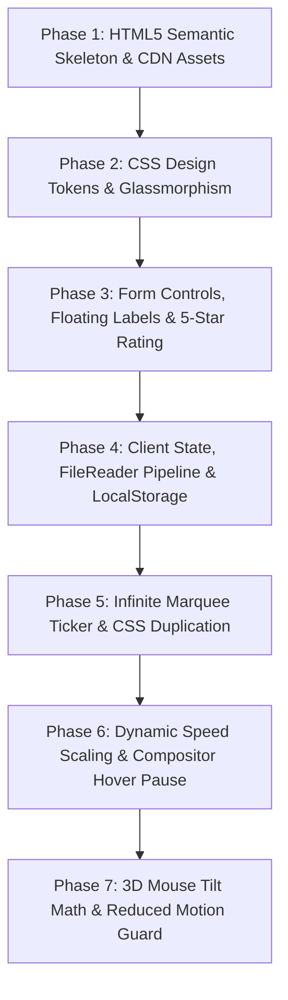

# Step-by-Step Build Order & Rebuilding Guide



---

## Phase 1: HTML5 Semantic Skeleton & External CDNs
Create the primary document structure, link the Inter Google Font and FontAwesome stylesheet, and establish the main wrappers.

### Key Code Snippet (`testimonials.html`)
```html
<!DOCTYPE html>
<html lang="en">
<head>
    <meta charset="UTF-8">
    <meta name="viewport" content="width=device-width, initial-scale=1.0">
    <title>Polished Testimonials</title>
    <link rel="preconnect" href="https://fonts.googleapis.com">
    <link rel="preconnect" href="https://fonts.gstatic.com" crossorigin>
    <link href="https://fonts.googleapis.com/css2?family=Inter:wght@400;500;600;700&display=swap" rel="stylesheet">
    <link rel="stylesheet" href="https://cdnjs.cloudflare.com/ajax/libs/font-awesome/6.0.0-beta3/css/all.min.css">
    <link rel="stylesheet" href="testimonials.css">
    <script src="testimonial.js" defer></script>
</head>
<body>
    <div class="main-wrapper">
        <div class="form-container">...</div>
        <div class="testimonial-ticker" id="ticker-section">...</div>
    </div>
</body>
</html>
```
### Line-by-Line Breakdown
- Lines 8-10: Preconnects and fetches the `Inter` font weights 400-700 to prevent layout shift during font swapping.
- Line 12: Loads FontAwesome 6 icon glyphs for rendering solid and regular star ratings.
- Line 15: Links `testimonial.js` with `defer` to allow non-blocking DOM parsing.
- Line 19: `.main-wrapper` creates the isolated bounding box where the 3D CSS perspective is rooted.

---

## Phase 2: Design Tokens & Glassmorphism
Define CSS custom properties (variables) on `:root` and construct the frosted-glass backdrop aesthetic.

### Key Code Snippet (`testimonials.css`)
```css
:root {
    --font-primary: 'Inter', sans-serif;
    --clr-primary: #2563eb;
    --clr-accent: #f59e0b;
    --clr-glass-bg: rgba(255, 255, 255, 0.4);
    --clr-glass-border: 1px solid rgba(255, 255, 255, 0.2);
    --glass-blur: 12px;
    --shadow-form: 0 10px 30px rgba(0, 0, 0, 0.1);
}

.form-container {
    background-color: var(--clr-glass-bg);
    border-radius: 0.75rem;
    border: var(--clr-glass-border);
    box-shadow: var(--shadow-form);
    backdrop-filter: blur(var(--glass-blur));
    -webkit-backdrop-filter: blur(var(--glass-blur));
}
```
### Line-by-Line Breakdown
- Lines 5-8: Encapsulates color palettes and translucent rgba white values for centralized theme maintenance.
- Line 9: Specifies 12px blur radius used by hardware filters.
- Lines 17-18: Applies `backdrop-filter: blur()`, instructing the GPU to sample and blur pixels immediately behind the element's bounding box.

---

## Phase 3: Form Controls: Floating Labels & Star Ratings
Implement CSS-driven micro-interactions without relying on JavaScript event listeners for styling.

### Key Code Snippet (`testimonials.css`)
```css
.form-field input[type="text"]:focus + label,
.form-field input[type="text"]:not(:placeholder-shown) + label {
    top: 0;
    left: 0.75rem;
    font-size: 0.75rem;
    color: var(--clr-primary);
    transform: translateY(-50%);
}

.star-rating-input {
    display: flex;
    flex-direction: row-reverse;
    justify-content: center;
}
.star-rating-input input[type="radio"]:checked ~ label,
.star-rating-input label:hover,
.star-rating-input label:hover ~ label {
    color: var(--clr-accent);
}
```
### Line-by-Line Breakdown
- Lines 1-7: Elevates label to top border whenever input has focus or contains non-whitespace text.
- Lines 9-13: Inverts flex direction so DOM radio #5 renders on the far right visually.
- Lines 14-18: Uses general sibling combinator `~` to traverse leftwards across all preceding stars on hover or selection.

---

## Phase 4: Client State, FileReader Pipeline & LocalStorage
Wire up DOM elements, handle file selection, convert to Base64, and manage persistence.

### Key Code Snippet (`testimonial.js`)
```javascript
const STORAGE_KEY = 'user_testimonials';
let testimonials = [];
let selectedImageData = null;

imageUpload.addEventListener('change', (e) => {
    const file = e.target.files[0];
    if (file && ['image/jpeg', 'image/png', 'image/gif'].includes(file.type)) {
        const reader = new FileReader();
        reader.onload = (event) => {
            imagePreview.src = event.target.result;
            selectedImageData = event.target.result;
        };
        reader.readAsDataURL(file);
    }
});

function saveTestimonials() {
    localStorage.setItem(STORAGE_KEY, JSON.stringify(testimonials));
}
```
### Line-by-Line Breakdown
- Line 1: Declares the isolated namespace key for browser storage.
- Line 7: Validates MIME type to prevent script or binary injection.
- Line 8: Instantiates `FileReader` which reads client files asynchronously off the main thread.
- Line 12: Converts binary image buffer into a compact base64 DataURL string.
- Line 17: Serializes JavaScript array directly into LocalStorage string format.

---

## Phase 5: Infinite Marquee Ticker & CSS Duplication
Duplicate cards in JavaScript and move them via hardware-accelerated CSS keyframes.

### Key Code Snippet (`testimonial.js` & `testimonials.css`)
```javascript
function renderTestimonialTicker() {
    let trackHTML = testimonials.map(item => createTickerCardHTML(item)).join('');
    scrollerTrack.innerHTML = trackHTML + trackHTML; // Duplicate for continuous loop
}
```
```css
.scroller-track {
    display: flex;
    width: max-content;
    animation: scrollLeft linear infinite;
}
@keyframes scrollLeft {
    0% { transform: translateX(0); }
    100% { transform: translateX(-50%); }
}
```
### Line-by-Line Breakdown
- Line 3: Appends duplicate HTML so that when the track shifts by -50%, the visual layout seamlessly resets to 0% with zero visible artifacting.
- Line 8: `width: max-content` ensures the flex container does not shrink-wrap or wrap cards to multiple lines.
- Lines 11-14: Runs on GPU compositor thread via `transform: translateX()`, completely avoiding browser layout reflow.

---

## Phase 6: Dynamic Duration Scaling & Hover Pause
Calculate keyframe animation timing dynamically based on array count and pause on hover.

### Key Code Snippet (`testimonial.js` & `testimonials.css`)
```javascript
const scrollSpeed = 25;
const minDuration = 30;
const duration = Math.max(testimonials.length * scrollSpeed, minDuration);
scrollerTrack.style.animationDuration = `${duration}s`;
```
```css
.scroller-window:hover .scroller-track {
    animation-play-state: paused;
}
```
### Line-by-Line Breakdown
- Lines 1-4: Computes duration proportionally to review volume so reading velocity remains constant.
- Lines 7-9: Directly tells the browser compositor to freeze keyframe progress when pointer hovers over `.scroller-window`.

---

## Phase 7: 3D Mouse Tilt Math & Reduced Motion Guard
Bind mouse tracking within normalized coordinates and safeguard users with vestibular sensitivities.

### Key Code Snippet (`testimonial.js`)
```javascript
const prefersReducedMotion = window.matchMedia('(prefers-reduced-motion: reduce)');

if (!prefersReducedMotion.matches) {
    document.body.addEventListener('mousemove', (e) => {
        const x = (e.clientX / window.innerWidth - 0.5) * 2;
        const y = (e.clientY / window.innerHeight - 0.5) * 2;
        const rotateX = (y * -6).toFixed(2);
        const rotateY = (x * 6).toFixed(2);
        formContainer.style.transform = `rotateX(${rotateX}deg) rotateY(${rotateY}deg)`;
    });
    document.body.addEventListener('mouseleave', () => {
        formContainer.style.transform = `rotateX(0deg) rotateY(0deg)`;
    });
}
```
### Line-by-Line Breakdown
- Line 1: Queries browser media features for operating system accessibility toggles.
- Lines 3-10: Computes normalized offsets between -1.0 and +1.0 relative to window center and applies clamped 6-degree rotational transforms.
- Lines 11-13: Resets matrix rotation smoothly back to 0 degrees when cursor exits viewport.
