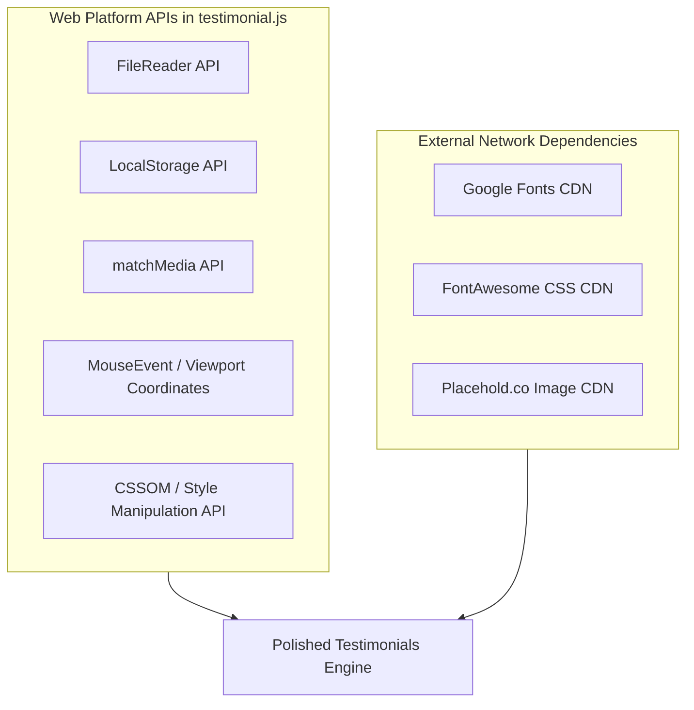

# Web Platform & API Reference

---

## 1. Backend REST Endpoints
*Not applicable for this project type (Frontend-only architecture without a custom backend server).*

---

## 2. Browser & Web Platform APIs

### 2.1 Browser FileReader API (`FileReader`)
- **Specification**: W3C File API
- **Usage Location**: [`testimonial.js:136-146`](file:///Users/avishjain/avishjain9-repos/53-testimonials-grid/testimonial.js#L136-L146)
- **Method Called**: `reader.readAsDataURL(file)`
  - Parameter: `file: File` (Blob obtained from `<input type="file">`)
  - Asynchronous Output: `reader.onload = (e) => ...` where `e.target.result` is a Base64 encoded string (`data:image/jpeg;base64,...`).
- **Error Handling**: Missing or non-matching MIME types are intercepted before instantiation.
- **Performance Characteristics**: Operates asynchronously in background thread; does not block the UI or main event loop.

### 2.2 Web Storage API (`Window.localStorage`)
- **Specification**: HTML5 Web Storage Standard
- **Usage Location**: [`testimonial.js:107-120`](file:///Users/avishjain/avishjain9-repos/53-testimonials-grid/testimonial.js#L107-L120)
- **Methods Called**:
  - `localStorage.setItem(key, value)`: Serializes object array to JSON string.
  - `localStorage.getItem(key)`: Retrieves serialized string on startup.
- **Key Used**: `'user_testimonials'`
- **Quota Limit**: ~5 MB per origin (synchronous disk write).
- **Error Modes**: Throws `QuotaExceededError` (DOMException code 22) if image strings exceed allocated space.

### 2.3 Window MatchMedia API (`Window.matchMedia`)
- **Specification**: CSSOM View Module
- **Usage Location**: [`testimonial.js:247`](file:///Users/avishjain/avishjain9-repos/53-testimonials-grid/testimonial.js#L247)
- **Query Called**: `window.matchMedia('(prefers-reduced-motion: reduce)')`
  - Returns: `MediaQueryList` object containing boolean `.matches`.
- **Purpose**: Evaluates user preference for motion sickness and vestibular safety before binding cursor listeners.

### 2.4 Pointer & Viewport Metrics (`MouseEvent` & `Window`)
- **Properties Read**:
  - `event.clientX`, `event.clientY`: Coordinates of the mouse pointer relative to the viewport.
  - `window.innerWidth`, `window.innerHeight`: Viewport dimensions used to compute normalized vectors:
    $$\Delta x = \left(\frac{\text{clientX}}{\text{innerWidth}} - 0.5\right) \times 2$$
    $$\Delta y = \left(\frac{\text{clientY}}{\text{innerHeight}} - 0.5\right) \times 2$$

### 2.5 CSS Object Model API (`CSSOM`)
- **Usage**:
  - `scrollerTrack.style.animationDuration = \`${duration}s\``: Injects dynamic runtime duration into CSS animation engine.
  - `formContainer.style.transform = \`rotateX(${rotateX}deg) rotateY(${rotateY}deg)\``: Updates hardware transform matrix.

---

## 3. External CDN Assets & Network Dependencies

### 3.1 Google Fonts
- **Request URL**: `https://fonts.googleapis.com/css2?family=Inter:wght@400;500;600;700&display=swap`
- **Method**: `GET`
- **Purpose**: High-contrast, modern geometric sans-serif typography.
- **Caching**: Google Fonts stylesheets have `Cache-Control: private, max-age=86400`, font binaries have `max-age=31536000` (1 year immutable).
- **Fallback**: Declared in CSS as `sans-serif` system fallback.

### 3.2 FontAwesome Icons
- **Request URL**: `https://cdnjs.cloudflare.com/ajax/libs/font-awesome/6.0.0-beta3/css/all.min.css`
- **Method**: `GET`
- **Purpose**: Vector glyphs for star rating system (`fas fa-star`, `far fa-star`).
- **Caching**: Cloudflare CDN provides edge-cached immutable assets.

### 3.3 Placehold.co Avatar
- **Request URL**: `https://placehold.co/100x100/E2E8F0/4A5568?text=Photo`
- **Method**: `GET`
- **Purpose**: Default placeholder image before custom photo upload.
- **Offline Resilience**: If offline, browser displays default broken image glyph unless cached in service worker.
