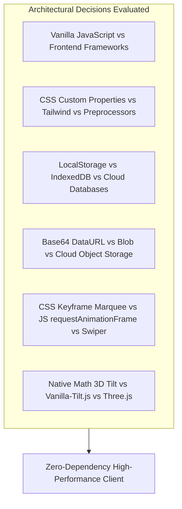

# Architectural Technology Comparisons

---

## 1. Vanilla JavaScript (ES6+) vs Frameworks (React, Vue, Svelte, Angular)

### 1. What I Used
Pure Vanilla JavaScript (ECMAScript 2020+) utilizing standard DOM APIs ([`testimonial.js:1-257`](file:///Users/avishjain/avishjain9-repos/53-testimonials-grid/testimonial.js#L1-L257)).

### 2. What It Does in This Project
Manages local application state (`testimonials` array), listens for form events, handles file reading via `FileReader`, performs client-side input sanitization, and controls dynamic CSS properties.

### 3. Comparison Table

| Technology | Bundle Size Overhead | Initial Parse Time | Reactivity Model | External Dependencies | Maintenance Cost | Fit for This Project |
| :--- | :--- | :--- | :--- | :--- | :--- | :--- |
| **Vanilla JS (Chosen)** | **0 KB (Zero)** | **< 1 ms** | **Direct DOM Mutation** | **None** | **Very Low** | **Optimal** |
| **React 18** | ~45 KB min+gzip | 15-30 ms | Virtual DOM Reconciliation | Node / npm / Bundler | Medium (Hooks lifecycle) | Overkill |
| **Vue 3** | ~33 KB min+gzip | 10-20 ms | Proxy-based Reactive System | Bundler / SFC toolchain | Low-Medium | Overkill |
| **Svelte 4** | ~2-5 KB compiled | 2-5 ms | Compile-time Reactivity | Compiler / Vite | Low | Viable alternative |
| **Angular** | ~60-100 KB+ | 30-60 ms | Zone.js / Signals Change Detection | Heavy CLI / TypeScript | High | Heavy Overkill |

### 4. Why I Used This
Chosen because the application consists of a single interactive view with a small, localized state tree. Loading a 45 KB runtime for a single-page review widget degrades Core Web Vitals (INP and LCP) and introduces unnecessary build toolchain complexity. [CONFIRM WITH DEVELOPER]

### 5. Why I Did NOT Use Each Alternative
- **React**: Added 45 KB of JavaScript runtime and required an external build bundler for a component that updates only on explicit user form submission.
- **Vue**: Required setup of single-file components and template compilation for a lightweight 250-line script.
- **Svelte**: While compiled and lightweight, still demanded a Node build environment and file compilation pipeline.
- **Angular**: Introduces massive enterprise boilerplate, TypeScript decorators, and Zone.js change detection for a single widget.

### 6. Benefits Provided
Zero download payload, instantaneous execution, zero dependency vulnerabilities, and complete transparency in the browser dev tools.

### 7. Drawbacks & Trade-offs Accepted
Manual DOM reconciliation (`innerHTML` string concatenation) and imperatively updating UI states instead of declarative data-binding.

### 8. When I Would Switch
I would switch to React or Vue if the application expanded to include user authentication, paginated filtering, admin dashboards, and complex multi-page routing.

### 9. 30-Second Spoken Interview Answer
> "I chose pure vanilla JavaScript over React or Vue because this is a focused, single-view review component. Pulling in a 45-kilobyte framework bundle to manage an array of reviews would unnecessarily penalize initial page load and Google Core Web Vitals. Vanilla JS provides near-instant execution, zero build tooling overhead, and gives me direct control over DOM performance."

---

## 2. CSS Custom Properties vs Tailwind CSS vs Preprocessors (Sass)

### 1. What I Used
Native CSS3 Custom Properties (Design Tokens) on `:root` ([`testimonials.css:1-39`](file:///Users/avishjain/avishjain9-repos/53-testimonials-grid/testimonials.css#L1-L39)).

### 2. What It Does in This Project
Provides centralized design tokens for color palettes, spacing units, border radii, glassmorphic alpha layers, and animation transitions.

### 3. Comparison Table

| Tool | Build Step Required | Runtime Dynamic Updates | CSS File Size | DevTools Inspectability | Glassmorphic Token Flexibility |
| :--- | :--- | :--- | :--- | :--- | :--- |
| **CSS Variables (Chosen)**| **None (Native)** | **Instant (CSSOM)** | **10 KB raw** | **Clean & Semantic** | **Exceptional** |
| **Tailwind CSS** | Yes (PostCSS / JIT) | Difficult without inline styles| ~5-15 KB purged | Utility class soup in markup | High |
| **Sass / SCSS** | Yes (Sass compiler) | No (Static compile) | 10 KB | Requires SourceMaps | Static only |
| **CSS Modules** | Yes (Bundler) | Static compile | 10 KB | Obfuscated class names | High |

### 4. Why I Used This
Native CSS custom properties allow instant runtime styling modifications through JavaScript (`element.style.setProperty`), need no preprocessing or Node build steps, and natively cascade down the DOM tree. [CONFIRM WITH DEVELOPER]

### 5. Why I Did NOT Use Each Alternative
- **Tailwind CSS**: Would clutter the clean semantic HTML markup with dozens of repetitive utility strings and required a PostCSS build setup.
- **Sass**: Variables are resolved at compile time and cannot be dynamically manipulated by JavaScript at runtime.
- **CSS Modules**: Requires a bundler like Webpack or Vite to hash class names, complicating static distribution.

### 6. Benefits Provided
Zero compilation latency, native browser support, full CSSOM integration, and clean separation between markup and styling.

### 7. Drawbacks & Trade-offs Accepted
Manual authoring of prefix rules and lack of compile-time linting for mistyped token names.

### 8. When I Would Switch
I would adopt Tailwind CSS if collaborating across a large engineering team that requires standardized design tokens across hundreds of disparate components.

### 9. 30-Second Spoken Interview Answer
> "I chose native CSS Custom Properties because they require zero compilation tools and can be updated dynamically at runtime via the CSS Object Model. While preprocessors like Sass resolve variables at build time, native CSS variables cascade through the live DOM tree, allowing me to maintain a clean design system without PostCSS dependencies."

---

## 3. Browser LocalStorage vs IndexedDB vs Cookies vs Remote Cloud Databases

### 1. What I Used
`Window.localStorage` with JSON serialization ([`testimonial.js:107-120`](file:///Users/avishjain/avishjain9-repos/53-testimonials-grid/testimonial.js#L107-L120)).

### 2. What It Does in This Project
Persists customer testimonials across page reloads and browser sessions without requiring a database server.

### 3. Comparison Table

| Storage Medium | Capacity Quota | Access Paradigm | Network Overhead | Server Required | Setup Complexity | Fit for Demo |
| :--- | :--- | :--- | :--- | :--- | :--- | :--- |
| **LocalStorage (Chosen)**| **~5 MB** | **Synchronous Key-Value**| **Zero** | **No** | **Minimal** | **Optimal** |
| **IndexedDB** | > 50 MB - 1 GB+ | Asynchronous Transactions | Zero | No | High (Event callbacks) | Overkill |
| **HTTP Cookies** | 4 KB | Synchronous | Sent with every HTTP request | No | Low | Inappropriate |
| **MongoDB / Postgres** | Terabytes | Async Network REST / GraphQL| Network roundtrips | Yes (Node/Express) | High | Overkill for client demo |

### 4. Why I Used This
LocalStorage provides a synchronous, zero-configuration key-value storage engine that persists data across reboots while keeping the project 100% serverless and client-isolated. [CONFIRM WITH DEVELOPER]

### 5. Why I Did NOT Use Each Alternative
- **IndexedDB**: Required cumbersome transaction and cursor boilerplate code for storing a simple array of review objects.
- **Cookies**: 4 KB limit is too small to store even a single Base64 image string, and cookies are wastefully transmitted in every HTTP request header.
- **MongoDB / Postgres**: Demanded provisioning cloud databases, API routers, connection pools, and hosting infrastructure.

### 6. Benefits Provided
Dead-simple key-value persistence, zero network latency, and complete user privacy since data never leaves the client machine.

### 7. Drawbacks & Trade-offs Accepted
LocalStorage operations are synchronous on the main thread and limited to approximately 5 MB per origin.

### 8. When I Would Switch
I would switch to PostgreSQL or MongoDB as soon as reviews need to be shared across different users or aggregated on a live production SaaS site.

### 9. 30-Second Spoken Interview Answer
> "I chose LocalStorage because it provides immediate, offline-capable persistence without spinning up a database server. Storing the reviews locally keeps the demo completely client-contained and latency-free. If we scaled this to a multi-user production environment, I would transition to a PostgreSQL database behind a REST API."

---

## 4. In-Memory Base64 DataURL vs Blob URL vs Cloud Object Storage (S3 / Cloudinary)

### 1. What I Used
`FileReader.prototype.readAsDataURL()` ([`testimonial.js:136-146`](file:///Users/avishjain/avishjain9-repos/53-testimonials-grid/testimonial.js#L136-L146)).

### 2. What It Does in This Project
Encodes uploaded image binaries directly into self-contained Base64 ASCII strings stored in memory and LocalStorage.

### 3. Comparison Table

| Method | Persistence Across Sessions | Cloud Infrastructure | Memory Overhead | Complexity | Quota Footprint |
| :--- | :--- | :--- | :--- | :--- | :--- |
| **Base64 DataURL (Chosen)**| **Yes (Stored in LocalStorage)**| **None** | **+33% size inflation** | **Low** | **High per image** |
| **URL.createObjectURL (Blob)**| No (Revoked on page reload)| None | Minimal | Very Low | Zero |
| **AWS S3 / Cloudinary** | Yes (Permanent Cloud URL) | High (Bucket & API keys) | Zero on client | High | Zero on client |

### 4. Why I Used This
Base64 strings can be directly serialized into JSON and saved to LocalStorage, ensuring avatar images remain visible after page refreshes without needing remote file storage. [CONFIRM WITH DEVELOPER]

### 5. Why I Did NOT Use Each Alternative
- **Blob URLs (`URL.createObjectURL`)**: Are scoped strictly to the current document lifecycle and become invalid broken links as soon as the page is refreshed.
- **AWS S3 / Cloudinary**: Requires backend signed upload URLs, AWS IAM credentials, and paid cloud infrastructure.

### 6. Benefits Provided
100% self-contained data portability: an entire testimonial record (name, text, rating, image) is represented as a single flat JSON object.

### 7. Drawbacks & Trade-offs Accepted
Base64 increases binary file size by approximately 33%, consuming LocalStorage quota faster.

### 8. When I Would Switch
In a production web application, I would upload raw image binaries directly to an AWS S3 bucket with CloudFront CDN distribution.

### 9. 30-Second Spoken Interview Answer
> "I used FileReader's readAsDataURL to convert uploaded images into base64 strings so they could be directly serialized into LocalStorage alongside the review text. While Blob URLs offer better memory performance during a single session, they expire on page reload. Base64 gives us persistent offline avatars without needing an AWS S3 bucket."

---

## 5. CSS Keyframe Marquee vs JavaScript requestAnimationFrame vs Swiper.js

### 1. What I Used
Hardware-accelerated CSS keyframe `@keyframes scrollLeft` combined with DOM duplication ([`testimonials.css:344-356`](file:///Users/avishjain/avishjain9-repos/53-testimonials-grid/testimonials.css#L344-L356), [`testimonial.js:94-95`](file:///Users/avishjain/avishjain9-repos/53-testimonials-grid/testimonial.js#L94-L95)).

### 2. What It Does in This Project
Powers the continuous horizontal scrolling ticker that displays reviews in an infinite loop.

### 3. Comparison Table

| Animation Mechanism | Thread Execution | GPU Compositor Layer | CPU Utilization | Dropped Frames Risk | External Dependency |
| :--- | :--- | :--- | :--- | :--- | :--- |
| **CSS Keyframes (Chosen)** | **Compositor Thread** | **Yes (`transform`)** | **< 1%** | **Virtually Zero** | **None** |
| **JS requestAnimationFrame** | Main JavaScript Thread | Manual style updates | 5-10% | Moderate under main thread load | None |
| **Swiper.js / Slick** | Main JS + CSS | Yes | 8-15% | Moderate | 40-100 KB library |

### 4. Why I Used This
CSS keyframe transforms are executed directly by the browser's GPU compositor process. Even if the main thread is busy executing complex JavaScript, the scrolling marquee continues gliding at a smooth 60 frames per second without stuttering. [CONFIRM WITH DEVELOPER]

### 5. Why I Did NOT Use Each Alternative
- **JavaScript `requestAnimationFrame`**: Runs on the main JavaScript thread; any heavy calculation or garbage collection causes dropped frames and micro-stutters.
- **Swiper.js**: Adds a 40 KB external library dependency with hundreds of carousel features not required for a simple continuous marquee.

### 6. Benefits Provided
Guaranteed 60fps / 120fps fluid scrolling, instant hover-pause via `animation-play-state: paused`, and zero main-thread CPU burden.

### 7. Drawbacks & Trade-offs Accepted
Requires duplicating the card array in the DOM (`trackHTML + trackHTML`) so that translating by -50% creates an unnoticeable infinite loop.

### 8. When I Would Switch
I would switch to Swiper.js if users required bidirectional touch-swipe gestures, pagination dots, or slide snapping.

### 9. 30-Second Spoken Interview Answer
> "I used CSS keyframes instead of JavaScript requestAnimationFrame because CSS transforms run entirely on the browser's GPU compositor thread. This means the marquee scrolls at a locked sixty frames per second without stuttering, even during heavy JavaScript execution. Combining DOM duplication with a negative fifty percent translation creates a flawless infinite loop with zero external libraries."

---

## 6. Native Normalized MouseEvent Math vs Three.js vs Vanilla-Tilt.js

### 1. What I Used
Native `mousemove` event tracking with normalized coordinate calculations ([`testimonial.js:215-244`](file:///Users/avishjain/avishjain9-repos/53-testimonials-grid/testimonial.js#L215-L244)).

### 2. What It Does in This Project
Tilts the form card and ticker cards in 3D perspective space based on the user's cursor position.

### 3. Comparison Table

| Implementation | Bundle Overhead | WebGL Context Required | Memory Footprint | Math Transparency | Accessibility Guard Integration |
| :--- | :--- | :--- | :--- | :--- | :--- |
| **Native Math (Chosen)** | **0 KB** | **No** | **< 1 MB** | **Direct & Editable** | **Native matchMedia check** |
| **Vanilla-Tilt.js** | ~5 KB | No | 2-3 MB | Abstracted library | Manual wrapper required |
| **Three.js** | ~600 KB | Yes | 50-100 MB | 3D Scene Graph | Overwhelming overkill |

### 4. Why I Used This
A subtle 3D tilt requires only basic trigonometry: calculating distance from window center, normalizing between -1 and +1, and scaling by a maximum angle of 6 degrees. Writing this directly eliminated an external library while keeping complete control over accessibility guards. [CONFIRM WITH DEVELOPER]

### 5. Why I Did NOT Use Each Alternative
- **Vanilla-Tilt.js**: While compact, it introduces an external script dependency for 15 lines of elementary coordinate math.
- **Three.js**: Demands initializing a complete WebGL canvas context, lighting rig, and 3D camera for a simple card tilt.

### 6. Benefits Provided
Zero dependencies, complete customization over rotation damping, and native integration with `prefers-reduced-motion`.

### 7. Drawbacks & Trade-offs Accepted
Requires manual reset logic on `mouseleave` and careful capping of rotation angles to prevent disorienting distortion.

### 8. When I Would Switch
I would switch to Three.js if the cards featured true 3D meshes, directional specular lighting reflections, or particle physics.

### 9. 30-Second Spoken Interview Answer
> "I implemented the 3D tilt effect with pure vanilla math rather than importing Vanilla-Tilt.js or Three.js. By simply normalizing mouse coordinates between negative one and positive one relative to window center, I calculate dynamic X and Y rotation angles in just fifteen lines of code. This gives us tactile glassmorphic depth while keeping our bundle at zero dependencies."
