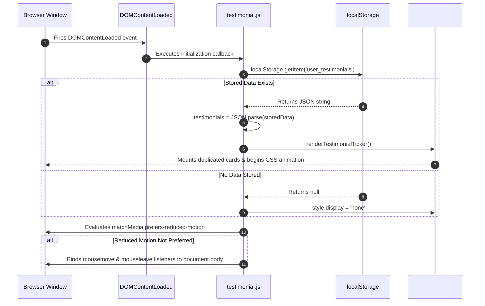
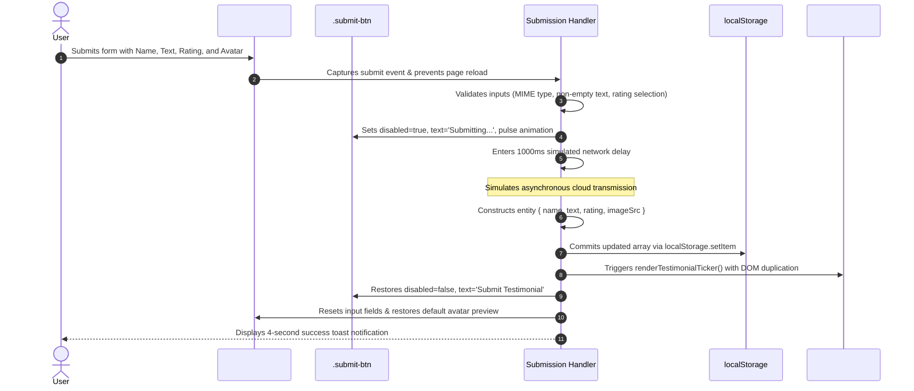
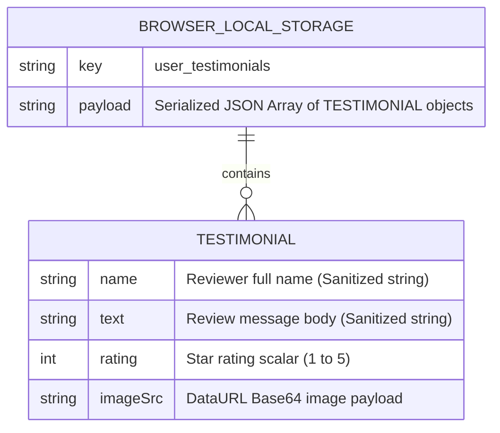

# High-Level Architecture & Client-Side System Design

```mermaid
flowchart TB
    subgraph BrowserProcess [Web Browser Runtime Environment]
        subgraph DOMTree [Document Object Model]
            HTMLNode[HTML Document Body]
            FormNode[form#testimonial-form]
            PreviewNode[img#image-preview]
            TrackNode[div#scroller-track]
        end

        subgraph JSController [testimonial.js Controller]
            StateMemory[(In-Memory testimonials Array)]
            EventListeners[Event Listeners: change, submit, mousemove]
            TemplateEngine[createTickerCardHTML & sanitize]
            TiltMath[handleTilt & Matrix Transforms]
        end

        subgraph CSSPipeline [Compositor & Render Pipeline]
            PerspectiveContext[3D Perspective 1000px]
            GlassFilter[Backdrop Filter Blur 12px]
            MarqueeKeyframes[@keyframes scrollLeft -50%]
        end

        subgraph LocalStore [Client Persistence Engine]
            WebStorage[(localStorage: user_testimonials)]
        end
    end

    HTMLNode --> FormNode & TrackNode
    FormNode -->|Events| EventListeners
    EventListeners --> StateMemory
    StateMemory -->|JSON Serialization| WebStorage
    WebStorage -->|JSON Deserialization on Init| StateMemory
    StateMemory --> TemplateEngine
    TemplateEngine --> TrackNode
    EventListeners --> TiltMath
    TiltMath --> PerspectiveContext
    TrackNode --> MarqueeKeyframes
```

---

## 1. High-Level Architecture Overview

Polished Testimonials is structured as an **Event-Driven Client-Side Model-View-Controller (MVC)** application running entirely within the browser's execution sandbox:

1. **Model (Data Layer)**:
   - In-memory state maintained within the `testimonials` array in [`testimonial.js:16`](file:///Users/avishjain/avishjain9-repos/53-testimonials-grid/testimonial.js#L16).
   - Long-term durability is provided by the Web Storage API (`localStorage`), which serializes the state to a JSON string.
2. **View (Presentation Layer)**:
   - Semantic HTML5 structure defined in [`testimonials.html`](file:///Users/avishjain/avishjain9-repos/53-testimonials-grid/testimonials.html).
   - Hardware-accelerated styling and layout provided by [`testimonials.css`](file:///Users/avishjain/avishjain9-repos/53-testimonials-grid/testimonials.css), including 3D perspective, CSS keyframe transformations, and Glassmorphic filters.
3. **Controller (Logic & Coordination Layer)**:
   - Event listeners bound in [`testimonial.js`](file:///Users/avishjain/avishjain9-repos/53-testimonials-grid/testimonial.js) coordinate DOM input events, validate data formats, orchestrate asynchronous `FileReader` streams, invoke input sanitization, and inject dynamically generated markup into the DOM.

---

## 2. Request & Execution Lifecycles

### 2.1 Application Bootstrapping Lifecycle


### 2.2 Testimonial Submission Lifecycle


---

## 3. Data Schema & Collection Architecture



### Data Fields Specification
- `name` (String, required): Full name of the user leaving the review. Sanitized via entity replacement for `<` and `>`.
- `text` (String, required): The testimonial narrative. Sanitized for script prevention.
- `rating` (Integer 1-5, required): Extracted from checked radio button (`input[name="rating"]:checked`).
- `imageSrc` (String, required): Base64 DataURL representation of uploaded image file, prefixed with MIME specifier (e.g., `data:image/png;base64,iVBORw0KGgo...`).

---

## 4. Scaling Bottlenecks & Evolution to 100x Traffic

If this application experienced 100x traffic (from single-user local demo to tens of thousands of concurrent public visitors):

```mermaid
flowchart TD
    subgraph CurrentClient [Current Architecture (Single-User)]
        A[Client Browser] -->|Direct Store| B[(LocalStorage 5MB Quota)]
    end

    subgraph ScaledArchitecture [100x Scaled Cloud Architecture]
        C[Global Users] -->|Route 53 DNS| D[Cloudflare CDN Edge Caching]
        D -->|Static HTML/CSS/JS| E[AWS S3 Static Web Hosting]
        D -->|REST /reviews| F[Application Load Balancer]
        F --> G[Node.js / Express Auto-Scaling Cluster]
        G --> H[(PostgreSQL Database with Read Replicas)]
        G -->|Direct Upload Signed URLs| I[AWS S3 Bucket for Avatars]
        G -->|Cache Review Feeds| J[(Redis Edge Cache)]
    end
```

### The Top 3 Immediate Bottlenecks in Current Architecture:
1. **LocalStorage Domain Isolation**: Reviews entered on one device are completely invisible to other visitors. To make this a multi-user social proof widget, reviews must sync to a centralized remote database.
2. **LocalStorage 5 MB Quota Exhaustion**: Storing Base64-encoded avatars in LocalStorage will trigger a `QuotaExceededError` exception after roughly 10-15 high-resolution mobile photos. Solution: Offload avatar uploads to AWS S3 or Cloudinary and store only lightweight CDN URL strings in the database.
3. **DOM Layout Thrashing with Hundreds of Reviews**: Injecting 500+ reviews into a single duplicated flex track would create thousands of heavy DOM nodes, causing memory bloat and frame drops during 3D tilt calculations. Solution: Implement virtualized rendering or server-side pagination limiting the marquee to the top 20 most recent high-rating reviews.
