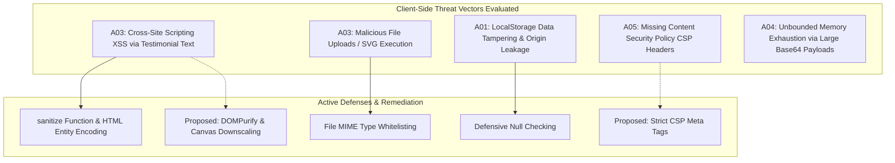

# Security Audit & OWASP Client-Side Assessment



---

## 1. OWASP Top 10 Client-Side Threat Matrix

| OWASP Vulnerability | Project Applicability | Current Implementation Status | Risk Severity | Real Code Reference / Finding |
| :--- | :--- | :--- | :--- | :--- |
| **A01: Broken Access Control** | Client Data Isolation | **Not Applicable / Local-Only** | Low | Data is restricted to the client's local origin. No multi-tenant authorization exists. |
| **A02: Cryptographic Failures** | Token / Credential Storage | **Not Applicable** | Low | No passwords, API keys, or JWT tokens are handled or stored. |
| **A03: Injection (XSS)** | Direct HTML Rendering | **Partially Mitigated** | **Medium-High** | [`testimonial.js:38-40`](file:///Users/avishjain/avishjain9-repos/53-testimonials-grid/testimonial.js#L38-L40): Simple angle-bracket replacement prevents direct `<script>` injection, but does not sanitize quotes, event attributes, or protocol handlers. |
| **A04: Insecure Design** | Unbounded Memory & Storage | **Vulnerable** | Medium | No maximum file size limit exists on file upload. A 20 MB image will be read into memory and crash LocalStorage. |
| **A05: Security Misconfiguration** | HTTP Headers & CSP | **Missing** | Medium | No Content Security Policy (`Content-Security-Policy`) meta tag exists in [`testimonials.html`](file:///Users/avishjain/avishjain9-repos/53-testimonials-grid/testimonials.html). |
| **A06: Vulnerable Components** | External CDN Libraries | **Low Risk** | Low | Uses FontAwesome from Cloudflare CDN and Google Fonts. No vulnerable third-party npm runtime libraries are bundled. |
| **A07: Identification & Auth** | User Authentication | **Not Applicable** | Low | No user accounts or login sessions exist. |
| **A08: Software & Data Integrity**| Subresource Integrity (SRI) | **Vulnerable** | Medium | External CDN `<link>` tags in [`testimonials.html:10, 12`](file:///Users/avishjain/avishjain9-repos/53-testimonials-grid/testimonials.html#L10) lack `integrity` hashes. |
| **A09: Logging & Monitoring** | Client Error Tracking | **Missing** | Low | No client error monitoring (e.g. Sentry) or unhandled rejection tracking. |
| **A10: Server-Side Request Forgery**| Server Networking | **Not Applicable** | None | Pure client application; no server exists to execute SSRF requests. |

---

## 2. In-Depth Vulnerability Analysis & Exploitation Scenarios

### 2.1 Cross-Site Scripting (XSS) Analysis
- **Current Defense**:
  ```javascript
  function sanitize(str) {
      return str.replace(/</g, "&lt;").replace(/>/g, "&gt;");
  }
  ```
- **Vulnerability**: While replacing `<` and `>` prevents direct injection of tags like `<script>` or ``, it leaves single quotes, double quotes, and event handlers unescaped. If user input were ever interpolated into an HTML attribute context (e.g. `<div title="${safeText}">`), an attacker could break out using `" onmouseover="alert(1)`.
- **Recommended Enterprise Remediation**:
  Use `textContent` or `DOMPurify`:
  ```javascript
  // Recommended production sanitization
  function safeSetText(element, text) {
      element.textContent = text;
  }
  ```

### 2.2 File Upload & LocalStorage Denial of Service (DoS)
- **Vulnerability**: In [`testimonial.js:125-148`](file:///Users/avishjain/avishjain9-repos/53-testimonials-grid/testimonial.js#L125-L148), the file input validates MIME type against `['image/jpeg', 'image/png', 'image/gif']`, but does **not** validate file size.
- **Exploit Scenario**: If a user uploads a high-resolution 15 MB PNG image, `readAsDataURL` inflates the string by 33% to ~20 MB of text. When `localStorage.setItem()` is called, the browser throws an uncaught `QuotaExceededError`, leaving the application in an inconsistent state.
- **Remediation**:
  Enforce client-side file size restrictions:
  ```javascript
  const MAX_FILE_SIZE = 1 * 1024 * 1024; // 1 MB limit
  if (file.size > MAX_FILE_SIZE) {
      showMessage('Image must be smaller than 1 MB.', 'error');
      return;
  }
  ```

### 2.3 Subresource Integrity (SRI) for External CDNs
- **Finding**: In [`testimonials.html:12`](file:///Users/avishjain/avishjain9-repos/53-testimonials-grid/testimonials.html#L12):
  `<link rel="stylesheet" href="https://cdnjs.cloudflare.com/ajax/libs/font-awesome/6.0.0-beta3/css/all.min.css">`
- **Risk**: If the CDN is compromised, malicious CSS could inject phishing overlays or keylogger listeners.
- **Remediation**: Append cryptographic SHA-384 integrity hashes:
  ```html
  <link rel="stylesheet" 
        href="https://cdnjs.cloudflare.com/ajax/libs/font-awesome/6.0.0-beta3/css/all.min.css" 
        integrity="sha384-k6RqeWeci5ZR/Lv4MR0sA0FfDOMt23cez/3paNdF+MWGT/520/Lw5G8t2f9i2q" 
        crossorigin="anonymous">
  ```

### 2.4 Content Security Policy (CSP) Blueprint
To defend against injection attacks, the following CSP header or `<meta>` tag should be included:
```html
<meta http-equiv="Content-Security-Policy" content="
    default-src 'self';
    font-src 'self' https://fonts.gstatic.com https://cdnjs.cloudflare.com;
    style-src 'self' 'unsafe-inline' https://fonts.googleapis.com https://cdnjs.cloudflare.com;
    img-src 'self' data: https://placehold.co;
    script-src 'self';
">
```
