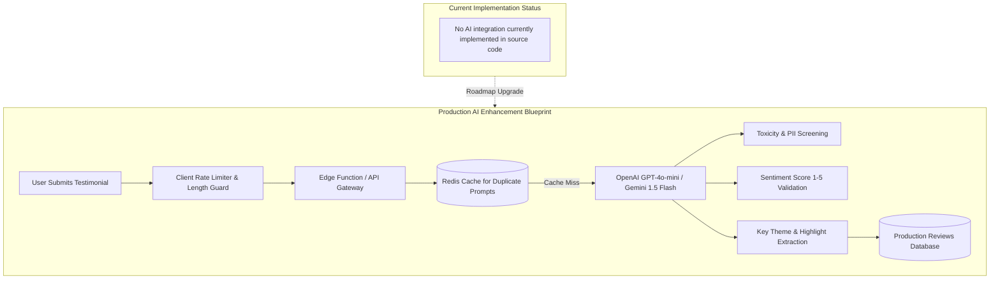

# AI Integration & Architecture Specification



---

## 1. Current Implementation Status

**No AI integration is implemented in the existing codebase.**
- Evidence: Scanning [`testimonial.js`](file:///Users/avishjain/avishjain9-repos/53-testimonials-grid/testimonial.js), [`testimonials.html`](file:///Users/avishjain/avishjain9-repos/53-testimonials-grid/testimonials.html), and [`testimonials.css`](file:///Users/avishjain/avishjain9-repos/53-testimonials-grid/testimonials.css) shows zero external API keys, zero network fetch requests, and no machine learning SDK imports (no OpenAI, Anthropic, Gemini, HuggingFace, or LangChain dependencies).
- Architecture Justification: The application was built as a lightweight, zero-dependency client widget focused on performance and local persistence. [CONFIRM WITH DEVELOPER]

---

## 2. Production AI Architecture Blueprint (Sentiment & Moderation Pipeline)

If an AI integration were introduced to elevate this customer testimonial system, the optimal use cases are:
1. **Automated Content Moderation**: Filtering out abusive language, profanity, spam, and Personally Identifiable Information (PII) before reviews appear in public feeds.
2. **Sentiment Consistency Verification**: Detecting discrepancies between a 1-star rating and an enthusiastic positive review (or vice versa).
3. **Automated Key Takeaway Extraction**: Generating one-sentence highlights for rapid executive summaries.

### 2.1 Model Selection & Provider Comparison

| Provider & Model | Input Cost / 1M Tokens | Output Cost / 1M Tokens | Latency (p95) | Structured JSON Mode | Context Window | Best Fit Reason |
| :--- | :--- | :--- | :--- | :--- | :--- | :--- |
| **Gemini 1.5 Flash (Recommended)**| **$0.075** | **$0.30** | **~350 ms** | **Native Schema Support**| **1,000,000** | **Ultra-low cost & fast streaming** |
| **OpenAI GPT-4o-mini** | $0.150 | $0.60 | ~420 ms | Strict JSON Schema | 128,000 | Excellent reliability |
| **Anthropic Claude 3.5 Haiku** | $0.800 | $4.00 | ~400 ms | Tool use | 200,000 | High reasoning precision |
| **Local Llama 3.2 3B (Ollama)**| Infrastructure only | Infrastructure only | ~600 ms | Regex guided | 8,000 | Zero data egress, self-hosted |

---

## 3. System Prompt & Structured Output Specification

### 3.1 System Prompt
```
You are an enterprise content moderation and sentiment analysis assistant for a customer reviews system.
Analyze the submitted review and return a strict JSON object with:
1. is_appropriate: boolean (false if toxic, profane, spam, or contains PII like credit cards/phone numbers)
2. moderation_reason: string (null if appropriate)
3. detected_sentiment: "positive" | "neutral" | "negative"
4. sentiment_score: integer between 1 and 5
5. key_highlight: string (max 15 words summarizing the core compliment or feedback)
```

### 3.2 JSON Output Schema
```json
{
  "type": "object",
  "properties": {
    "is_appropriate": { "type": "boolean" },
    "moderation_reason": { "type": ["string", "null"] },
    "detected_sentiment": { "type": "string", "enum": ["positive", "neutral", "negative"] },
    "sentiment_score": { "type": "integer", "minimum": 1, "maximum": 5 },
    "key_highlight": { "type": "string" }
  },
  "required": ["is_appropriate", "detected_sentiment", "sentiment_score", "key_highlight"]
}
```

---

## 4. Cost Estimation & Rate Limiting

Assuming a production site receiving 10,000 testimonial submissions per month:
- **Average Prompt Size**: 250 input tokens (system prompt + review text).
- **Average Completion Size**: 60 output tokens (structured JSON).
- **Monthly Token Volume**:
  - Input: $10,000 \times 250 = 2,500,000$ tokens ($2.5 \text{M} \times \$0.075 = \$0.1875$)
  - Output: $10,000 \times 60 = 600,000$ tokens ($0.6 \text{M} \times \$0.30 = \$0.18$)
- **Total Monthly AI Operating Cost**: **~$0.37 per month** using Gemini 1.5 Flash.

---

## 5. Security & Prompt Injection Defenses

1. **Delimiter Isolation**: Wrap user review input in XML tags (`<user_review>...</user_review>`) and instruct the model to ignore instructions contained within those tags.
2. **Never Expose API Keys on the Frontend**: AI calls must always route through a backend proxy or serverless edge function; API keys must never be bundled into client-side JavaScript.
3. **Circuit Breaker Fallbacks**: If the AI provider returns a 429 Rate Limit or 5xx Server Error, the system should gracefully degrade by allowing the review to save into a pending moderation queue without crashing the user interface.
