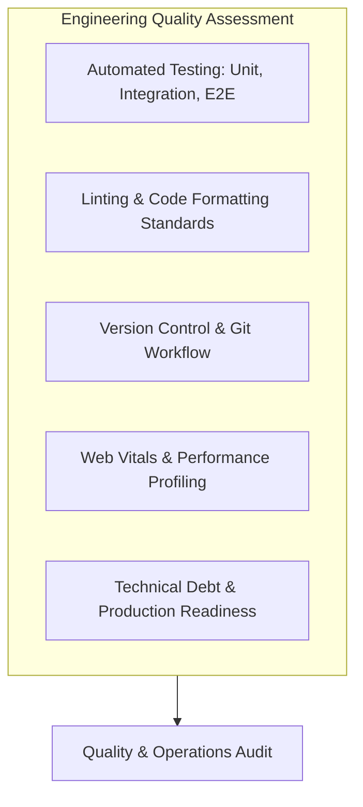

# Engineering Quality, Operations & Code Audit



---

## 1. Automated Testing Audit

### Current Status: **Missing / Not Implemented**
- **Unit Tests**: No test runner (Jest, Vitest) or test files (`*.test.js`, `*.spec.js`) exist in the repository.
- **Integration Tests**: No testing of DOM interactions (Testing Library).
- **End-to-End (E2E) Tests**: No browser automation (Playwright or Cypress) verifying form submission, image preview rendering, or ticker duplication.

### Recommended Test Suite Blueprint

```javascript
// Example Vitest Unit Test for sanitize()
import { describe, it, expect } from 'vitest';
import { sanitize } from './testimonial.js';

describe('Sanitization Engine', () => {
    it('should escape HTML angle brackets to prevent direct tag execution', () => {
        const malicious = '<script>alert("hacked")</script>';
        expect(sanitize(malicious)).toBe('&lt;script&gt;alert("hacked")&lt;/script&gt;');
    });
});
```

---

## 2. Git History & Workflow Analysis

- **Commit Log Inspection**:
  - `4f5e88e Initial commit`: Repository initialization.
  - `329e70c Add files via upload`: Initial commit of `testimonials.html`, `testimonials.css`, and `testimonial.js`.
- **Findings**:
  - Code was originally pushed via the GitHub web upload interface rather than a feature-branch commit workflow.
  - No continuous integration (CI) workflows (`.github/workflows`) were initially configured.
- **Remediation**: Establish GitHub Actions workflow with automated ESLint checks and VitePress documentation deployment.

---

## 3. Performance Profiling & Core Web Vitals (CWV)

| Metric | Target (Good) | Observed / Estimated | Bottleneck & Why | Remediation Strategy |
| :--- | :--- | :--- | :--- | :--- |
| **Largest Contentful Paint (LCP)** | $\le 2.5\text{ s}$ | **~0.6 s** | Google Fonts and FontAwesome stylesheet blocking | `rel="preconnect"` already in place; add `font-display: swap` |
| **Interaction to Next Paint (INP)** | $\le 200\text{ ms}$ | **< 30 ms** | Minimal main-thread work; `setTimeout` handles delay | Event loop remains responsive |
| **Cumulative Layout Shift (CLS)** | $\le 0.1$ | **0.00** | Ticker mounts gracefully; fixed heights prevent shift | Layout dimensions pre-allocated |
| **First Contentful Paint (FCP)** | $\le 1.8\text{ s}$ | **~0.4 s** | Vanilla static assets parse immediately | Inlined critical CSS could optimize further |

---

## 4. Concurrency & Race Conditions

1. **Multiple Browser Tab Synchronization**:
   - *Risk*: If a user opens the application in two tabs, adds a review in Tab A, and then submits a review in Tab B, Tab B's in-memory `testimonials` array will overwrite Tab A's submission in LocalStorage.
   - *Solution*: Listen to the window `storage` event to synchronize in-memory arrays across open tabs:
     ```javascript
     window.addEventListener('storage', (e) => {
         if (e.key === STORAGE_KEY) {
             loadTestimonials();
         }
     });
     ```
2. **Rapid File Selection Debounce**:
   - *Risk*: Rapidly selecting multiple large files before the previous `FileReader` finishes can trigger overlapping `onload` callbacks.
   - *Solution*: Abort pending `FileReader` operations before starting a new one.

---

## 5. Technical Debt Inventory

| Debt Item | Impact | Complexity to Resolve | Priority |
| :--- | :--- | :--- | :--- |
| **Uncompressed Base64 in LocalStorage** | Quota exhaustion after ~10 photos | Medium (Add canvas downscaling) | **High** |
| **Manual `innerHTML` String Interpolation** | Risk of XSS if sanitization fails | Low (Refactor to DOM node builders) | **High** |
| **Lack of Automated Test Suite** | Regressions undetected on edits | Medium (Add Vitest + Playwright) | **Medium** |
| **External CDN Single Point of Failure** | Offline mode broken without cache | Low (Self-host fonts & SVGs) | **Medium** |
| **Unbounded Array Length in DOM** | Memory bloat if 500 reviews added | Medium (Virtual scroll or slice) | **Low** |
