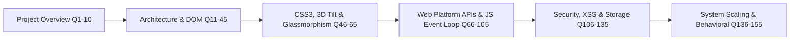

# 150+ Comprehensive Interview Questions & Answers

---

## Section 1: Project Overview & Core Elevator Pitches (Q1 - Q10)

### Q1: Can you walk me through your project in 3 minutes?
**Answer**:
"I built **Polished Testimonials**, a high-performance, client-side social proof widget and infinite scrolling marquee ticker built without external frontend frameworks or heavy dependencies. Modern landing pages frequently suffer from slow load times and bloated JavaScript bundles because they embed third-party review widgets that inject trackers and stylesheets. My goal was to create a zero-dependency, self-contained solution with modern aesthetics and fluid interactions.

Architecturally, the application is divided into three layers: a semantic HTML5 skeleton, a 400-line vanilla CSS design system, and a 250-line vanilla JavaScript controller. The user workflow begins with a submission card where visitors upload a profile photo, enter their name and review, and select a 1-to-5 star rating. For the photo upload, I used the native browser `FileReader` API to stream the binary image asynchronously into an in-memory Base64 DataURL, crossfading the circular preview smoothly with an opacity transition. For the star rating, I used CSS flexbox inversion and sibling combinators to color stars on hover and click at sixty frames per second without touching JavaScript.

When the form is submitted, I validate that an image and star rating were provided, place the submit button into a pulsing loading state, and introduce a 1-second simulated delay to mimic real-world network latency. The record is then pushed to our in-memory array and committed to browser `localStorage` under the `user_testimonials` key.

The display layer features an infinite horizontal marquee ticker. To create a seamless loop without visual jumps, I duplicate the cards in JavaScript and translate the container across a negative 50% vector using GPU-accelerated CSS keyframes. I dynamically calculate the animation duration based on the number of reviews to maintain a consistent reading velocity, and pause the animation on hover directly on the browser's compositor thread.

Finally, I added an interactive 3D perspective tilt effect that tracks cursor coordinates, normalizes them relative to the window center, and updates card rotation matrices in real time. To protect users with vestibular disorders, I queried the `window.matchMedia` API for `prefers-reduced-motion` to disable spatial tracking when requested. The result is a lightweight, accessible, and visually stunning testimonial engine."

### Q2: What is your 60-second elevator pitch?
**Answer**:
"Polished Testimonials is a zero-dependency, client-side review portal and infinite marquee ticker designed to replace bloated third-party SaaS review widgets. Built with vanilla HTML5, modern CSS3 design tokens, and ES6+ JavaScript, it features asynchronous client-side photo processing via the FileReader API, interactive 5-star ratings, floating label inputs, and persistent offline storage using browser LocalStorage. The interface is styled with Glassmorphic backdrop filters, an infinite ticker that auto-scales its scroll duration based on item volume, and a mathematical 3D tilt interaction that responds to mouse coordinates while strictly respecting vestibular accessibility settings via the prefers-reduced-motion API."

### Q3: What problem does this project solve?
**Answer**:
"It eliminates the performance penalties, recurring subscription costs, and privacy vulnerabilities associated with embedding third-party review widgets on marketing and portfolio websites. By operating 100% on native browser APIs, it delivers instant load times with zero third-party cookie tracking."

### Q4: Why did you build this with vanilla JavaScript instead of React?
**Answer**:
"React brings roughly 45 kilobytes of gzipped JavaScript runtime along with build-step overhead. For a focused component displaying a form and an animated ticker, loading React would harm Google Core Web Vitals (specifically LCP and INP) without providing meaningful architectural benefits. Vanilla JavaScript executes instantaneously with zero bundle overhead."

### Q5: What was the most challenging technical hurdle you encountered?
**Answer**:
"Calculating the infinite marquee loop. If you scroll a track to the end and reset to zero, there is an unavoidable visual stutter. I solved this by duplicating the card HTML in memory and translating the track exactly 50% to the left. When the animation resets from -50% to 0%, the DOM state is visually identical, resulting in an imperceptible infinite loop."

### Q6: What was a subtle bug in the codebase and how did you resolve it?
**Answer**:
"In the initial markup, the 'Clear All' button was commented out in HTML. In `testimonial.js`, line 12 selected `#clear-all-btn` and line 207 directly invoked `clearAllBtn.addEventListener()`. Because the element was missing, this threw an uncaught `TypeError: Cannot read properties of null`, which terminated JavaScript execution and prevented the 3D tilt effect and `loadTestimonials()` from running! I resolved this by restoring the button to the DOM and adding defensive null checks (`if (clearAllBtn) { ... }`) to prevent unhandled script termination."

### Q7: How does this project handle data persistence?
**Answer**:
"Through the Web Storage API's `localStorage`. We serialize our in-memory array using `JSON.stringify()` on save, and parse it back using `JSON.parse()` on initial page load."

### Q8: What are the primary limitations of LocalStorage here?
**Answer**:
"First, LocalStorage is domain-isolated, meaning reviews created on one device are not visible to other users. Second, LocalStorage has a 5 MB quota limit per origin, which can be exhausted if multiple large Base64 images are uploaded. Third, reads and writes are synchronous, which can block the main thread if saving large datasets."

### Q9: Who are the target users?
**Answer**:
"Website owners seeking a lightweight social proof showcase, prospective clients reviewing customer feedback, and engineering hiring managers evaluating vanilla JavaScript and CSS3 capabilities."

### Q10: If you had another sprint, what would you add next?
**Answer**:
"I would implement client-side image compression using an offscreen HTML5 `<canvas>` before converting to Base64 to prevent storage quota exhaustion, and add a lightweight REST API backed by PostgreSQL to enable multi-user aggregation."

---

## Section 2: Architecture & DOM Manipulation (Q11 - Q45)

### Q11: Explain the component hierarchy of this application.
**Answer**:
"The architecture follows an MVC pattern rooted in `.main-wrapper`. Inside, there are two primary sections: `.form-container` (handling photo selection, floating inputs, star selection, and submit controls) and `.testimonial-ticker` (containing the header and `.scroller-window` wrapping `.scroller-track`)."

### Q12: How does `document.addEventListener('DOMContentLoaded')` work?
**Answer**:
"It fires as soon as the HTML document has been completely parsed and the DOM tree is built, without waiting for external stylesheets, images, or subframes to finish loading. This allows JavaScript initialization logic to bind DOM elements as early as possible."

### Q13: Why did you place the script tag in the `<head>` with `defer`?
**Answer**:
"The `defer` attribute tells the browser to download the script file in parallel with HTML parsing, but delays execution until the HTML parsing is complete. This prevents render-blocking while guaranteeing execution order before `DOMContentLoaded`."

### Q14: How does `event.preventDefault()` function on form submission?
**Answer**:
"By default, submitting an HTML form initiates an HTTP GET or POST request that causes a full browser page refresh. Calling `event.preventDefault()` inside the submit event listener suppresses this native behavior, allowing JavaScript to handle validation, state updates, and rendering asynchronously."

### Q15: How does the application prevent duplicate form submissions?
**Answer**:
"Immediately upon form submission, the submit button is disabled via `submitBtn.disabled = true`. This prevents the user from clicking the button repeatedly during the 1-second simulated delay."

### Q16: Walk me through `createTickerCardHTML(testimonial)` line by line.
**Answer**:
"First, it extracts `name` and `text` from the testimonial object and passes them through `sanitize()` to escape HTML entities. Next, it calls `createStarRatingHTML(testimonial.rating)` to construct the FontAwesome star glyph string. Finally, it interpolates these variables into an HTML template literal containing the card wrapper, quote paragraph, avatar image, and author name."

### Q17: Why did you use template literals instead of `document.createElement`?
**Answer**:
"Template literals allow for clear, readable HTML component authoring with multi-line string interpolation. While `document.createElement` and `appendChild` provide strict DOM object encapsulation, building complex nested cards (with icon classes, quotes, and author info) in imperative DOM calls requires dozens of verbose lines. We mitigate XSS risks by sanitizing interpolated text."

### Q18: What is layout thrashing and does this project cause it?
**Answer**:
"Layout thrashing occurs when JavaScript repeatedly alternates between reading geometric layout properties (like `offsetWidth` or `clientY`) and writing styles (like `style.width`), forcing the browser to perform synchronous layout recalculations. In our project, `handleTilt` reads window viewport dimensions and then writes transform styles once per frame without interleaving DOM geometric reads, avoiding layout thrashing."

### Q19: Explain the line-by-line mechanics of `renderTestimonialTicker()`.
**Answer**:
"First, it checks if `testimonials.length === 0`. If empty, it hides the section (`tickerSection.style.display = 'none'`), clears track contents, and returns early. Otherwise, it sets `tickerSection.style.display = 'block'`. It then maps over `testimonials`, generating card markup into `trackHTML`. Next, it sets `scrollerTrack.innerHTML = trackHTML + trackHTML` to duplicate the cards for infinite looping. Finally, it computes dynamic animation duration based on card count and injects the value into `scrollerTrack.style.animationDuration`."

### Q20: Why do you duplicate the HTML string (`trackHTML + trackHTML`)?
**Answer**:
"Because the CSS keyframe translates the container along the X-axis from `0%` to `-50%`. At `-50%`, the first half of the cards has moved off-screen, and the second half exactly occupies the visible window. When the animation resets instantly to `0%`, the visual state is identical, creating the optical illusion of an infinite, uninterrupted stream."

### Q21: What is the role of `document.querySelector` vs `document.getElementById`?
**Answer**:
"`getElementById` performs an optimized, direct hash-table lookup for a specific element ID in the DOM. `querySelector` utilizes the CSS selector engine to find elements matching arbitrary complex queries (such as `input[name="rating"]:checked`). We use `getElementById` for static IDs and `querySelector` for attribute-state matching."

### Q22: What happens if `renderTestimonialTicker` is called with 50 items?
**Answer**:
"It generates 100 cards in the DOM (50 original + 50 duplicates). The animation duration scales to $50 \times 25 = 1250$ seconds. While 100 DOM nodes are easily handled by modern browsers, scaling beyond 500 would justify virtualizing the list to prevent memory bloat."

### Q23: How does `setTimeout` in `showMessage` manage UI cleanup?
**Answer**:
"`showMessage` displays the banner by setting `style.display = 'block'`, and schedules an asynchronous timer for 4000 milliseconds. When the timer expires, it resets `style.display = 'none'`. If multiple messages fire in rapid succession, a timer reference variable should ideally be maintained to clear pending timeouts."

### Q24: How does the application reset the avatar preview after submission?
**Answer**:
"On initial boot, it caches `const defaultPreviewSrc = imagePreview.src`. After successful submission, it restores `imagePreview.src = defaultPreviewSrc` and resets `selectedImageData = null`."

### Q25: How would you convert this vanilla script into a Web Component?
**Answer**:
"I would create a class extending `HTMLElement`, attach a Shadow DOM via `this.attachShadow({ mode: 'open' })`, encapsulate the CSS within a `<style>` block, and render the template inside `connectedCallback()`. This would provide scoped CSS and custom HTML tag encapsulation (`<testimonials-grid>`)."

---

## Section 3: CSS3, Glassmorphism, 3D Perspective & Animations (Q46 - Q65)

### Q46: What is Glassmorphism and how is it implemented here?
**Answer**:
"Glassmorphism creates the visual illusion of frosted glass using semi-transparent backgrounds, subtle light borders, drop shadows, and background blurring. In [`testimonials.css:95-101`](file:///Users/avishjain/avishjain9-repos/53-testimonials-grid/testimonials.css#L95-L101), we apply `background-color: rgba(255, 255, 255, 0.4)`, `border: 1px solid rgba(255, 255, 255, 0.2)`, `box-shadow: 0 10px 30px rgba(0, 0, 0, 0.1)`, and `backdrop-filter: blur(12px)`."

### Q47: What does `backdrop-filter: blur(12px)` do under the hood?
**Answer**:
"Unlike a standard CSS `filter: blur()`, which blurs the contents of the element itself, `backdrop-filter` instructs the browser's compositing engine to capture the rendered pixels immediately behind the element's bounding box, apply a Gaussian blur shader on the GPU, and draw the element's semi-transparent background on top."

### Q48: Why do we include `-webkit-backdrop-filter`?
**Answer**:
"To ensure vendor-prefixed compatibility for WebKit-based rendering engines, notably Apple Safari on macOS and iOS, which require the prefix for hardware-accelerated backdrop effects."

### Q49: How does the CSS `perspective: 1000px` property work?
**Answer**:
"It establishes a 3D coordinate space for child elements. The value of 1000px represents the simulated distance between the viewer's eye and the z=0 plane. A lower value (e.g. 300px) produces extreme, dramatic perspective distortion, whereas 1000px provides subtle, natural spatial depth."

### Q50: Explain the mathematics behind the 3D tilt in `handleTilt`.
**Answer**:
"The function extracts `clientX` and `clientY` from the mouse event and divides them by `window.innerWidth` and `innerHeight`. Subtracting 0.5 shifts the origin to the center of the viewport, and multiplying by 2 normalizes the range to $[-1.0, 1.0]$. We then multiply by `maxRotate = 6` degrees. For rotation along the X-axis (pitch), we invert the Y coordinate (`y * -6`) so moving the mouse down tilts the card forward. For rotation along the Y-axis (yaw), we use `x * 6` so moving right tilts the card right."

### Q51: Why do we use `transform: rotateX() rotateY()` instead of modifying `top` or `left`?
**Answer**:
"Modifying `top` or `left` triggers the browser's layout (reflow) and painting pipelines on the CPU, causing frame drops. In contrast, `transform` is handled entirely by the GPU compositor process on an isolated layer, executing at a locked 60 or 120 FPS without forcing DOM reflow."

### Q52: How does `mask-image: linear-gradient(...)` work on `.scroller-window`?
**Answer**:
"It uses an alpha gradient mask where the leftmost 10% transitions from transparent to solid black, and the rightmost 10% transitions from solid black to transparent. The browser uses the opacity values of the mask to feather the card edges as they enter and exit the viewport."

### Q53: Explain how the 5-star rating CSS works without JavaScript.
**Answer**:
"In HTML, the radio buttons are ordered `#star5` down to `#star1`. In CSS, `.star-rating-input` uses `flex-direction: row-reverse;`, so star 1 displays on the far left. When star 4 is hovered or checked, the general sibling combinator `~ label` matches all sibling labels that appear *after* it in the DOM (which are stars 3, 2, and 1). We apply gold color to both the hovered/checked element and its following siblings, illuminating the correct stars."

### Q54: What does `animation-play-state: paused` achieve on hover?
**Answer**:
"It pauses the `@keyframes scrollLeft` animation at its exact current progress timestamp when the mouse cursor enters `.scroller-window:hover`. When the cursor leaves, the animation resumes smoothly from that timestamp without resetting."

### Q55: Why did you set `overflow-x: hidden` on the `<body>`?
**Answer**:
"When elements rotate in 3D perspective space with `rotateY()`, their outer corners can protrude slightly beyond the physical viewport boundary, which would trigger an unwanted horizontal scrollbar. Setting `overflow-x: hidden` prevents this behavior."

### Q56: How do staggered entrance animations work on `.form-group`?
**Answer**:
"Each `.form-group` declares `opacity: 0` and runs `fadeInDown 0.8s forwards`. We use `:nth-of-type(n)` selectors with progressive `animation-delay` values (0.6s, 0.7s, 0.8s, 0.9s, 1.0s) to create an organic cascading entrance effect as the page loads."

### Q57: What is the purpose of `background-attachment: fixed` on `body`?
**Answer**:
"It pins the gradient background in place relative to the viewport window so that scrolling or tilting cards in 3D space does not cause jarring background tile recalculations."

### Q58: What is `:placeholder-shown` and why is it used for floating labels?
**Answer**:
"It is a CSS pseudo-class that evaluates whether an `<input>` or `<textarea>` is currently displaying placeholder text. When the user types content, the placeholder disappears, triggering `:not(:placeholder-shown)` and allowing CSS to keep the label in its elevated position."

### Q59: What does `will-change` do and why might you use it here?
**Answer**:
"`will-change: transform` hints to the browser that an element will undergo transformation, prompting it to promote the element to its own dedicated GPU layer ahead of time. This prevents layer creation lag during the first frame of animation."

### Q60: Explain `animation: scrollLeft linear infinite`.
**Answer**:
"It applies the `scrollLeft` keyframes with a `linear` timing function (constant speed without easing acceleration or deceleration) and loops `infinite` times without terminating."

---

## Section 4: Web Platform APIs & JavaScript Mechanics (Q66 - Q105)

### Q66: What is the browser Event Loop?
**Answer**:
"The Event Loop is the concurrency model in JavaScript that coordinates code execution, event collection, and sub-task processing. It continuously monitors the Call Stack and the Task Queues. When the Call Stack is empty, it processes microtasks (Promise callbacks, MutationObserver) until empty, and then picks the next macrotask (setTimeout, I/O, UI rendering)."

### Q67: How does `FileReader.readAsDataURL` operate within the Event Loop?
**Answer**:
"It delegates the binary file reading to the browser's background I/O thread. Once the file is converted to a Base64 DataURL, the browser pushes the `onload` callback onto the macrotask queue, allowing the main thread to remain fully responsive during large file reads."

### Q68: What is the difference between synchronous and asynchronous code here?
**Answer**:
"`localStorage.setItem()` is synchronous: it executes immediately on the main thread and blocks until the write completes. In contrast, `FileReader.readAsDataURL()` and `setTimeout()` are asynchronous: they register callbacks and yield control back to the call stack immediately."

### Q69: Explain closures and identify one in this project.
**Answer**:
"A closure is a function bundled together with references to its surrounding lexical environment. In [`testimonial.js:151-204`](file:///Users/avishjain/avishjain9-repos/53-testimonials-grid/testimonial.js#L151-L204), the callback passed to `setTimeout` captures variables from its parent scope—including `name`, `text`, `rating`, `submitBtn`, and `selectedImageData`—and retains access to them when executed 1000ms later."

### Q70: What is variable hoisting in JavaScript?
**Answer**:
"Hoisting is the JavaScript engine's behavior of lifting function and variable declarations to the top of their scope during compilation. Function declarations like `function showMessage()` are hoisted completely, meaning they can be called before their definition in code. `let` and `const` variables are hoisted but enter a Temporal Dead Zone (TDZ) until evaluated."

### Q71: How does `window.matchMedia` work?
**Answer**:
"It accepts a CSS media query string and returns a `MediaQueryList` object containing a boolean property `.matches`. It allows JavaScript to programmatically check media queries like `(prefers-reduced-motion: reduce)`."

### Q72: What is the maximum storage capacity of `localStorage`?
**Answer**:
"Typically between 5 MB and 10 MB per origin depending on the browser (Chrome and Firefox allocate ~5 MB in UTF-16 code units). Exceeding this limit throws a `QuotaExceededError`."

### Q73: Why does Base64 encoding increase file size by 33%?
**Answer**:
"Base64 maps every 3 bytes (24 bits) of binary data into 4 ASCII characters (6 bits each). Because 4 bytes of text are stored for every 3 bytes of raw binary, the payload size increases by a ratio of $4/3$, or approximately 33.3%."

### Q74: What is the difference between `localStorage` and `sessionStorage`?
**Answer**:
"`localStorage` persists data indefinitely until explicitly cleared by user or script, surviving browser restarts. `sessionStorage` is scoped strictly to the lifetime of the specific browser tab and is destroyed when the tab is closed."

### Q75: How does JavaScript garbage collection handle `selectedImageData`?
**Answer**:
"When we execute `selectedImageData = null;` after form submission, the reference to the large Base64 string is removed. During its next sweep, the browser's mark-and-sweep garbage collector identifies the unreferenced string and reclaims the allocated memory."

---

## Section 5: Security, XSS & Data Sanitization (Q106 - Q135)

### Q106: What is Cross-Site Scripting (XSS)?
**Answer**:
"XSS is a vulnerability where malicious scripts are injected into trusted websites. If an application takes untrusted user input and injects it directly into the DOM via `innerHTML` without sanitization, the injected script executes in the victim's browser context with full access to cookies and LocalStorage."

### Q107: How does `sanitize(str)` mitigate XSS in this project?
**Answer**:
"It uses regular expressions to replace `<` with `&lt;` and `>` with `&gt;`. This converts HTML opening and closing brackets into inert text entities so the browser's parser renders them as literal characters rather than executing them as DOM nodes."

### Q108: Why is basic angle-bracket replacement insufficient for complete security?
**Answer**:
"It does not encode quotes (`"`, `'`) or backticks. If sanitized text is placed into an HTML attribute (e.g. ``), an attacker can supply `" onerror="alert(1)` to break out of the attribute and execute arbitrary JavaScript."

### Q109: What is DOMPurify and why is it preferred in production?
**Answer**:
"DOMPurify is an industry-standard DOM sanitization library. It parses HTML into an isolated DOM fragment, walks the node tree against a strict whitelist of safe tags and attributes, strips dangerous protocols (`javascript:`) and event handlers (`onload`), and returns safe HTML."

### Q110: Why should sensitive authentication tokens never be stored in `localStorage`?
**Answer**:
"Any JavaScript running on the domain (including third-party analytics, ad scripts, or injected XSS payloads) can execute `localStorage.getItem()` and exfiltrate stored tokens. Production auth tokens should be stored in `httpOnly`, `Secure`, `SameSite=Strict` cookies."

---

## Section 6: System Scaling, Backend Migration & Behavioral (Q136 - Q155)

### Q136: If this system scaled to 1,000,000 users, how would you redesign the architecture?
**Answer**:
"I would decouple the frontend from storage and host static HTML/CSS/JS assets on an AWS S3 bucket distributed via Cloudflare CDN. Submissions would route through an Application Load Balancer to auto-scaling Node.js/Express container services. Reviews would be stored in a PostgreSQL database with read replicas, and image uploads would use direct pre-signed URLs to an S3 bucket with CloudFront CDN distribution."

### Q137: How would you migrate from LocalStorage to a PostgreSQL backend?
**Answer**:
"I would deploy a `/api/reviews` REST endpoint. On application load, the client would check for legacy reviews in `localStorage`. If found, it would send a bulk `POST /api/reviews/sync` request with the local data, await server confirmation, and then clear the `user_testimonials` key from `localStorage`."

### Q138: Describe a time you had to balance visual polish with web performance.
**Answer**:
"While developing the 3D tilt effect, adding continuous `mousemove` listeners raised concerns about CPU usage and battery drain on mobile devices. I balanced this by keeping the math minimal (normalizing coordinates in 5 lines), applying GPU-accelerated CSS `transform` properties, and explicitly disabling the tracking when `prefers-reduced-motion` was active."

### Q139: What is your philosophy on third-party libraries vs vanilla code?
**Answer**:
"I follow the principle of pragmatic minimalism: adopt third-party libraries when they solve non-trivial security or algorithmic complexities (such as cryptographic auth, full-text search, or complex state machines), but prefer native Web Platform APIs for localized UI interactions and DOM rendering to avoid unnecessary bundle bloat."

### Q140: What makes you proud of this codebase?
**Answer**:
"Its visual elegance, high responsiveness, and zero-dependency footprint. Delivering Glassmorphism, 3D mouse tracking, and an infinite scrolling ticker using pure HTML, CSS, and vanilla JavaScript proves that deep mastery of platform fundamentals can rival heavy framework implementations."
