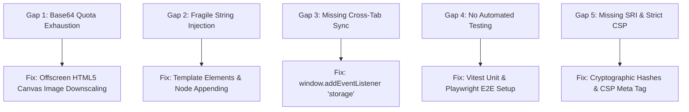

# Prioritized Engineering Gaps & Improvements



---

## Ranked Engineering Improvements

### 1. High Priority: Client-Side Image Compression via Canvas
- **The Gap**: Currently, [`testimonial.js:146`](file:///Users/avishjain/avishjain9-repos/53-testimonials-grid/testimonial.js#L146) reads full-resolution image files directly into Base64 strings. High-resolution smartphone photos (4-10 MB) will immediately trigger a browser `QuotaExceededError` when saving to LocalStorage.
- **The Fix**: Intercept the image before saving, draw it to an offscreen `<canvas>` resized to a maximum of 120x120 pixels, and export it as an optimized JPEG.
- **Code Fix**:
  ```javascript
  function compressImage(file, callback) {
      const reader = new FileReader();
      reader.onload = (e) => {
          const img = new Image();
          img.onload = () => {
              const canvas = document.createElement('canvas');
              const ctx = canvas.getContext('2d');
              const size = 120; // 120x120 thumbnail
              canvas.width = size;
              canvas.height = size;
              ctx.drawImage(img, 0, 0, size, size);
              const compressedBase64 = canvas.toDataURL('image/jpeg', 0.8);
              callback(compressedBase64);
          };
          img.src = e.target.result;
      };
      reader.readAsDataURL(file);
  }
  ```

---

### 2. High Priority: DOM Node Assembly Over `innerHTML` Interpolation
- **The Gap**: In [`testimonial.js:65-75`](file:///Users/avishjain/avishjain9-repos/53-testimonials-grid/testimonial.js#L65-L75), cards are constructed via template literal interpolation. While `sanitize()` handles `<` and `>`, raw HTML string interpolation remains inherently fragile.
- **The Fix**: Construct DOM nodes imperatively or use `<template>` cloning with `textContent` assignments to guarantee XSS immunity.
- **Code Fix**:
  ```javascript
  function createSafeTickerCard(testimonial) {
      const card = document.createElement('div');
      card.className = 'ticker-card';
      
      const quote = document.createElement('p');
      quote.className = 'quote';
      quote.textContent = `"${testimonial.text}"`;
      
      const author = document.createElement('div');
      author.className = 'author-info';
      
      const img = document.createElement('img');
      img.src = testimonial.imageSrc;
      img.alt = `Profile photo of ${testimonial.name}`;
      
      const h4 = document.createElement('h4');
      h4.textContent = testimonial.name;
      
      author.append(img, h4);
      card.append(createStarRatingNode(testimonial.rating), quote, author);
      return card;
  }
  ```

---

### 3. Medium Priority: Cross-Tab State Synchronization
- **The Gap**: Changes in one browser tab are not reflected in other open tabs until the page is refreshed.
- **The Fix**: Listen to the native `storage` event fired when other tabs update LocalStorage.
- **Code Fix**:
  ```javascript
  window.addEventListener('storage', (event) => {
      if (event.key === STORAGE_KEY) {
          loadTestimonials();
      }
  });
  ```

---

### 4. Medium Priority: Automated Test Coverage Setup
- **The Gap**: Zero unit, integration, or E2E tests exist.
- **The Fix**: Install `vitest` and `playwright` to validate sanitization, image handling, form submission, and LocalStorage updates in continuous integration.

---

### 5. Low Priority: Content Security Policy & SRI Hashes
- **The Gap**: External CDN stylesheets in [`testimonials.html`](file:///Users/avishjain/avishjain9-repos/53-testimonials-grid/testimonials.html) lack Subresource Integrity hashes.
- **The Fix**: Add `integrity="sha384-..."` attributes and declare a strict Content-Security-Policy meta tag in the `<head>`.
