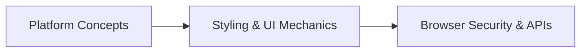

# Technical Glossary & Architecture Terms

---

## Technical Definitions

### 1. Base64 DataURL
A representation of binary data (such as JPEG or PNG images) formatted as an ASCII text string with the prefix `data:image/jpeg;base64,...`. Allows images to be directly embedded within HTML attributes or JSON objects without needing a standalone image file hosted on a server.

### 2. Backdrop Filter (`backdrop-filter`)
A CSS property that applies graphical filters—most notably Gaussian blurring (`blur()`)—to the visual area located directly behind an element. It is the cornerstone of modern Glassmorphic web design.

### 3. CSS Custom Properties (CSS Variables)
Entities defined by CSS authors (prefixed with `--`, such as `--clr-primary`) that contain specific values to be reused throughout a document. They cascade through the DOM tree and can be read or mutated dynamically at runtime via JavaScript.

### 4. DOM (Document Object Model)
A programming interface for HTML and XML documents. It represents the page as a structured tree of objects that can be manipulated by programming languages such as JavaScript.

### 5. FileReader API
A standard W3C Web Platform API that enables web applications to asynchronously read the contents of files stored on the client machine using `File` or `Blob` objects.

### 6. General Sibling Combinator (`~`)
A CSS selector combinator that matches all sibling elements that appear *after* a specified element in the HTML DOM structure, sharing the same parent.

### 7. Glassmorphism
A modern visual design trend characterized by translucent frosted-glass containers, background blurring, multi-layered shadows, and vibrant background gradients.

### 8. Layout Thrashing (Reflow)
A severe browser performance bottleneck caused when JavaScript repeatedly alternates between reading geometric layout properties (e.g. `offsetWidth`) and writing styles, forcing the browser engine to prematurely recalculate layout positions.

### 9. LocalStorage
A key-value data storage mechanism provided by the browser's Web Storage API that persists up to ~5 MB of stringified data per domain across browser sessions with zero server dependency.

### 10. Prefers-Reduced-Motion
A CSS media feature and JavaScript media query (`window.matchMedia`) used to detect if the user has requested that the operating system minimize non-essential animations and parallax motion due to vestibular or motion sensitivity.

### 11. Perspective (`perspective: 1000px`)
A CSS property that determines the distance between the z=0 plane and the user's viewport in order to give a 3D-positioned element perspective depth.

### 12. Subresource Integrity (SRI)
A security feature that enables browsers to verify that resources fetched from external Content Delivery Networks (CDNs) have not been modified or compromised by verifying a cryptographic base64 hash.

### 13. XSS (Cross-Site Scripting)
A security vulnerability that enables attackers to inject malicious client-side scripts into web pages viewed by other users.
