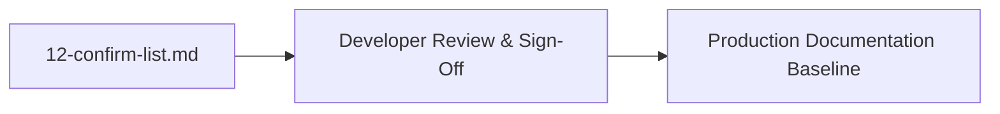

# Developer Confirmation Items

This document aggregates all assumptions and technical rationales flagged with `[CONFIRM WITH DEVELOPER]` throughout the documentation set. The developer can verify these items quickly.

---

## Confirmation Checklist

| ID | Topic / Decision | Section | Assumed Rationale in Docs | Status |
| :--- | :--- | :--- | :--- | :--- |
| **C1** | **Choice of Vanilla JS over Frameworks** | `04-tech-comparisons.md` | Chosen to eliminate bundle overhead and maximize Core Web Vitals for a lightweight widget. | `[CONFIRM WITH DEVELOPER]` |
| **C2** | **CSS Variables over Tailwind** | `04-tech-comparisons.md` | Chosen to keep HTML markup clean and avoid Node/PostCSS build dependencies. | `[CONFIRM WITH DEVELOPER]` |
| **C3** | **LocalStorage over Backend Database** | `04-tech-comparisons.md` | Chosen to provide zero-latency, serverless persistence suitable for a standalone demonstration. | `[CONFIRM WITH DEVELOPER]` |
| **C4** | **Base64 DataURL over Object URL** | `04-tech-comparisons.md` | Chosen because Base64 strings persist across page reloads in LocalStorage, unlike Blob URLs. | `[CONFIRM WITH DEVELOPER]` |
| **C5** | **CSS Keyframes over JS Carousel** | `04-tech-comparisons.md` | Chosen to offload animation translation directly to the GPU compositor thread at 60 FPS. | `[CONFIRM WITH DEVELOPER]` |
| **C6** | **Absence of AI Integration** | `07-ai-integration.md` | Kept deliberately absent to maintain a zero-dependency, private client application. | `[CONFIRM WITH DEVELOPER]` |
| **C7** | **Commented Clear All Button** | `01-features.md` | Assumed to be an accidental omission during UI refactoring rather than deliberate feature deprecation. | `[CONFIRM WITH DEVELOPER]` |
| **C8** | **Nonexistent `script.js` Reference** | `00-project-analysis.md`| Assumed to be an obsolete script tag leftover from early file restructuring. | `[CONFIRM WITH DEVELOPER]` |
