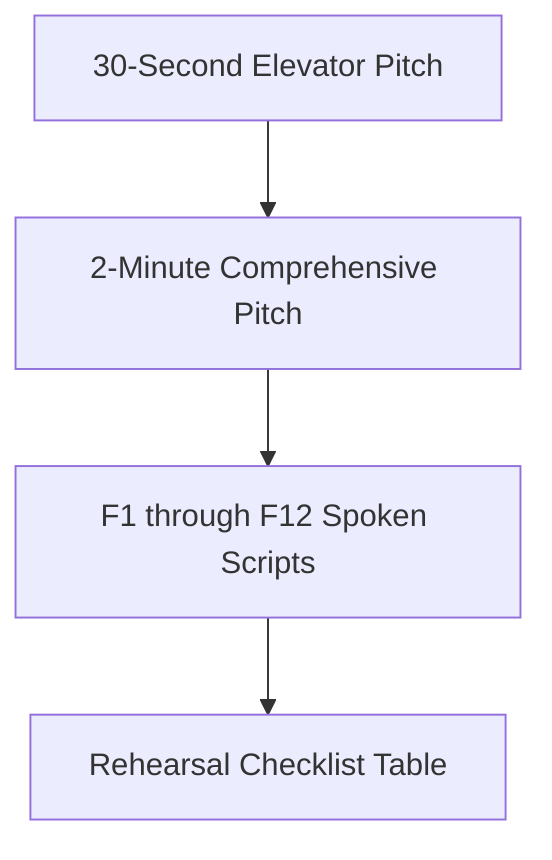

# Consolidated Spoken Scripts & Interview Rehearsal

---

## 1. Rehearsal Checklist

Tick each box once you can explain the feature out loud, without reading notes, in under the targeted spoken duration:

- [ ] **30-Second Project Pitch** (~30 seconds)
- [ ] **2-Minute Comprehensive Pitch** (~120 seconds)
- [ ] **F1: Profile Photo Upload & Preview** (~45 seconds)
- [ ] **F2: Interactive 5-Star Rating System** (~30 seconds)
- [ ] **F3: Floating Label Form Inputs** (~30 seconds)
- [ ] **F4: Submission & Simulated Network Latency** (~60 seconds)
- [ ] **F5: Browser LocalStorage Persistence** (~45 seconds)
- [ ] **F6: Seamless Infinite Marquee Ticker** (~60 seconds)
- [ ] **F7: Dynamic Scroll Velocity Scaling** (~30 seconds)
- [ ] **F8: Hover Pause Interaction** (~30 seconds)
- [ ] **F9: 3D Perspective & Mouse Tracking Tilt** (~60 seconds)
- [ ] **F10: Prefers-Reduced-Motion Accessibility** (~30 seconds)
- [ ] **F11: Client-Side HTML Sanitization** (~30 seconds)
- [ ] **F12: Testimonial Data Clearing & Reset** (~30 seconds)

---

## 2. Global Pitches

### 30-Second High-Impact Pitch
> "I built **Polished Testimonials**, a high-performance, zero-dependency customer review portal and infinite marquee ticker designed to eliminate heavy third-party SaaS review widgets on landing pages. Built entirely with vanilla JavaScript, modern CSS3 design tokens, and HTML5, it features client-side profile image processing via the FileReader API, interactive star ratings, floating label inputs, and persistent storage using browser LocalStorage. What makes it truly stand out is the user experience: it incorporates GPU-accelerated Glassmorphism, a dynamic continuous ticker that auto-scales its scroll duration based on item volume, and a mathematical 3D tilt interaction that tracks mouse cursor coordinates with strict adherence to vestibular accessibility guards."

### 2-Minute Technical Pitch
> "When modern SaaS websites and portfolios want to display customer testimonials, they almost universally rely on third-party embedded iframe widgets. The problem is that these external widgets frequently add hundreds of kilobytes of third-party JavaScript, inject tracking cookies, degrade Google Core Web Vitals, and cost recurring monthly subscriptions. I wanted to solve this by building **Polished Testimonials**—a completely self-contained, lightweight frontend client that provides an exceptional review submission experience paired with a continuous infinite marquee ticker.
> 
> On the frontend architecture, I chose to avoid heavy frameworks like React or Vue and wrote pure vanilla ES6+ to achieve zero bundle overhead and near-instant initial paint. The submission workflow allows users to upload their profile photo, which I convert asynchronously into an in-memory Base64 DataURL using the browser’s `FileReader` API. I implemented custom 5-star rating controls using CSS flexbox inversion and sibling combinators, coupled with floating label input fields that elevate gracefully upon focus. When the user submits, the form enters an asynchronous loading state with simulated network latency to provide realistic UI feedback before persisting the record to browser `localStorage` and re-rendering the ticker.
> 
> The ticker itself solves a classic animation challenge: creating an infinitely looping carousel without jarring jumps or frame drops. I achieved this by duplicating the rendered DOM cards in JavaScript and animating them across a 50% translation vector with pure CSS keyframes. To ensure the physical scroll velocity remains comfortable regardless of whether there are 2 reviews or 50 reviews, I dynamically calculate the animation duration in JavaScript based on array length. I also added CSS gradient alpha masks to seamlessly feather the edges, and paused the animation on hover directly on the GPU compositor thread without touching the JavaScript main thread.
> 
> To elevate the visual polish to a premium level, I built a custom 3D perspective tilt effect. It normalizes viewport mouse coordinates from negative one to positive one, maps them to rotation matrices, and applies smooth 3D transforms across the cards and form container. Crucially, I respected user accessibility by querying the `window.matchMedia` API for `prefers-reduced-motion`, disabling all spatial tracking for users with vestibular sensitivities. This project proved to me that with modern CSS3 and clean vanilla JavaScript, you can deliver state-of-the-art interactive micro-interactions and bulletproof performance without relying on bulky external dependencies."

---

## 3. Individual Feature Spoken Scripts

### F1: Profile Photo Upload & Asynchronous Preview
> "For the profile photo upload, I used the native browser FileReader API instead of sending the file to an external cloud storage bucket. When the user selects an image, I validate that its MIME type is a JPEG, PNG, or GIF. If it's valid, I asynchronously stream the binary file into a base64 DataURL string and crossfade the preview image smoothly using a quick opacity transition. I chose this client-side approach because it eliminates the need for an external backend or S3 bucket, making the demo completely self-contained. The main limitation is that large image files can quickly fill up the browser's 5-megabyte LocalStorage quota, which I would resolve in production by resizing the image on a canvas before saving."

### F2: Interactive 5-Star Rating System
> "I built the five-star rating widget using pure CSS without any external rating plugins. In HTML, the radio buttons are ordered five down to one, and in CSS I reversed the flex direction so they appear visually from one to five. This lets me use the CSS general sibling combinator to color all stars to the left of the hovered or selected star automatically. I chose pure CSS because it gives sixty frames per second hover states without attaching ten separate mouseover event listeners. If I had more time, I would add keyboard arrow navigation so screen-reader users can increment and decrement ratings effortlessly."

### F3: Floating Label Form Fields
> "I designed the input labels to float upwards smoothly when the user focuses or types into a field. I accomplished this using the CSS `:not(:placeholder-shown)` and `:focus` pseudo-classes paired with adjacent sibling selectors, which completely avoids JavaScript focus listeners. This pattern keeps the form compact and elegant while ensuring the user never loses the context of which field they are typing into. A minor trade-off is requiring a single whitespace character in the placeholder attribute, which I would enhance with explicit state classes if supporting legacy browsers."

### F4: Submission Handling & Simulated Network Latency
> "When the user submits a testimonial, I intercept the submit event to validate that both a photo and a star rating were provided. Instead of instantly snapping the UI into a success state, I purposely introduced a one-second simulated network delay. During this second, the submit button is disabled, changes text to 'Submitting...', and activates a CSS pulse animation. Once the timeout completes, I push the new testimonial into our in-memory array, serialize it to LocalStorage, re-render the ticker, and reset the form. I implemented this simulated delay because immediate synchronous state changes often feel jarring and unnatural to users accustomed to cloud applications. If this were connected to a live REST API, I would replace the timer with an asynchronous fetch call wrapped in a try-catch block."

### F5: Browser LocalStorage Persistence
> "I used browser LocalStorage to make sure reviews persist even when the user refreshes or closes the page. On application boot, my loadTestimonials function parses the JSON string from the user_testimonials storage key and feeds it into the ticker rendering pipeline. Whenever a user submits a review or clears data, I immediately write the updated array back to storage. I chose LocalStorage because it's synchronous, supported across every modern browser, and requires zero database configuration. The accepted trade-off is that LocalStorage is domain-isolated and capped at roughly five megabytes, so for a multi-user production system I would replace this with a PostgreSQL or MongoDB backend."

### F6: Seamless Infinite Marquee Ticker
> "To create an infinite scrolling marquee without any visual jerking or blank gaps, I used a classic DOM duplication technique paired with hardware-accelerated CSS keyframes. In JavaScript, I generate the HTML for all testimonial cards and then concatenate that exact string with itself before injecting it into the scrolling track. In CSS, the animation moves the track from zero translation to negative fifty percent along the X-axis before looping infinitely. Because the second half of the track is an exact replica of the first, the human eye perceives a seamless, uninterrupted loop. I also applied a CSS mask-image linear gradient to feather the left and right edges smoothly into transparency."

### F7: Dynamic Scroll Velocity Scaling
> "A common bug with infinite carousels is that adding more items makes the scroller race across the screen at uncontrollable speeds if the animation duration is fixed. To solve this, I dynamically calculate the animation duration in JavaScript whenever the ticker re-renders. I multiply the number of testimonials by twenty-five seconds per card, with a thirty-second minimum threshold. This guarantees that whether the user has two testimonials or twenty, each card passes across the viewport at a steady, comfortable reading speed."

### F8: Hover Pause Interaction
> "I added a hover pause feature so users can easily read a testimonial without chasing it across the screen. I implemented this entirely in CSS using the `animation-play-state: paused` property on the hover state of the scroller window. Handling this in CSS rather than JavaScript means it runs entirely on the browser's compositor thread, saving CPU cycles and preventing micro-stutters. If I extended this for mobile devices, I would explicitly bind touchstart and touchend events to toggle the pause state on tap."

### F9: 3D Perspective & Mouse Tracking Tilt
> "To give the interface a tactile, modern feel, I implemented an interactive 3D tilt effect on the form container and ticker cards. I established a three-dimensional perspective of one thousand pixels on the main wrapper in CSS. Then in JavaScript, I listen to mousemove events across the window, calculate the cursor's distance from the center of the viewport, and normalize that value between negative one and positive one. Multiplying by a maximum rotation limit of six degrees yields subtle X and Y tilt angles that I apply directly via CSS transforms. When the mouse leaves the browser window, a mouseleave listener resets the rotation back to zero degrees smoothly."

### F10: Prefers-Reduced-Motion Accessibility Guard
> "Web accessibility was a core priority when implementing the 3D tilt effect. Rapid parallax movement can cause disorientation or nausea for users with vestibular disorders. To safeguard against this, I query the browser's matchMedia API for the prefers-reduced-motion media feature. If the user has motion reduction enabled at the operating system level, my script completely skips attaching the mousemove and tilt listeners. This ensures full compliance with WCAG Guideline 2.3 for motion animations while keeping the interface functional."

### F11: Client-Side HTML Sanitization
> "To protect against cross-site scripting attacks, I created a custom sanitize utility that encodes angle brackets into HTML entities before any user input is rendered into the DOM. Whenever a testimonial card is generated, both the reviewer's name and review text pass through this sanitizer. While converting raw strings into textContent is generally preferred, I needed to inject dynamic HTML strings into the scrolling track for duplication, making explicit sanitization essential. For enterprise production, I would enhance this by integrating a robust library like DOMPurify or using the HTML Sanitizer API."

### F12: Testimonial Data Clearing & Reset
> "I provided a Clear All button so users testing the application can easily flush their reviews and reset the demonstration. When clicked, it empties the memory array, clears the LocalStorage key, and invokes the render function, which hides the ticker container. In the initial codebase, this button was commented out in HTML, which caused a null-reference exception that crashed subsequent scripts. I fixed this by adding defensive null-checks and restoring the button to the header, demonstrating the importance of defensive coding in vanilla JavaScript."
