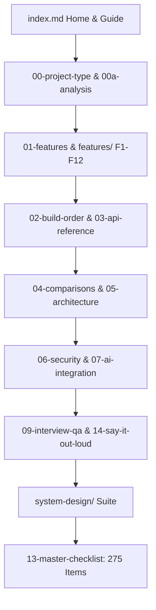

# Polished Testimonials Documentation Index

Welcome to the comprehensive, interview-ready documentation suite for **Polished Testimonials**—an interactive, zero-dependency customer review portal and infinite scrolling marquee ticker built with Vanilla JavaScript, HTML5, and CSS3 Glassmorphism.

---

## Recommended Sequential Reading Order

### 1. Foundation & Orientation
1. **[00-project-type.md](file:///Users/avishjain/avishjain9-repos/53-testimonials-grid/docs/00-project-type.md)**: Project Type Pre-Check and Track B (Frontend-Only) Classification.
2. **[00a-project-analysis.md](file:///Users/avishjain/avishjain9-repos/53-testimonials-grid/docs/00a-project-analysis.md)**: Full Project Analysis, feature traces, connection maps, and inventory counts.
3. **[00b-project-pitch.md](file:///Users/avishjain/avishjain9-repos/53-testimonials-grid/docs/00b-project-pitch.md)**: 30-Second Elevator Pitch and 2-Minute Technical Walkthrough.
4. **[00-project-map.md](file:///Users/avishjain/avishjain9-repos/53-testimonials-grid/docs/00-project-map.md)**: Complete file tree, dependencies, tech stack matrix, and CDN entry points.

### 2. Feature Inventory & Individual Feature Traces
5. **[01-features.md](file:///Users/avishjain/avishjain9-repos/53-testimonials-grid/docs/01-features.md)**: Master Feature Inventory with code traces, error handling, and spoken scripts.
   - [F1: Profile Photo File Upload & Preview](file:///Users/avishjain/avishjain9-repos/53-testimonials-grid/docs/features/f1-image-upload-preview.md)
   - [F2: Interactive 5-Star Rating System](file:///Users/avishjain/avishjain9-repos/53-testimonials-grid/docs/features/f2-star-rating-system.md)
   - [F3: Floating Label Form Fields](file:///Users/avishjain/avishjain9-repos/53-testimonials-grid/docs/features/f3-floating-label-input.md)
   - [F4: Testimonial Submission & Simulated Delay](file:///Users/avishjain/avishjain9-repos/53-testimonials-grid/docs/features/f4-testimonial-submission-state.md)
   - [F5: Browser LocalStorage Persistence](file:///Users/avishjain/avishjain9-repos/53-testimonials-grid/docs/features/f5-localstorage-persistence.md)
   - [F6: Seamless Infinite Marquee Ticker](file:///Users/avishjain/avishjain9-repos/53-testimonials-grid/docs/features/f6-infinite-marquee-ticker.md)
   - [F7: Dynamic Scroll Velocity Scaling](file:///Users/avishjain/avishjain9-repos/53-testimonials-grid/docs/features/f7-dynamic-speed-duration.md)
   - [F8: Hover Pause Interaction](file:///Users/avishjain/avishjain9-repos/53-testimonials-grid/docs/features/f8-hover-pause-interaction.md)
   - [F9: 3D Perspective & Mouse Tracking Tilt](file:///Users/avishjain/avishjain9-repos/53-testimonials-grid/docs/features/f9-tilt-3d-perspective.md)
   - [F10: Prefers-Reduced-Motion Accessibility Guard](file:///Users/avishjain/avishjain9-repos/53-testimonials-grid/docs/features/f10-reduced-motion-accessibility.md)
   - [F11: Client-Side Input Sanitization](file:///Users/avishjain/avishjain9-repos/53-testimonials-grid/docs/features/f11-xss-sanitization.md)
   - [F12: Testimonial Data Clearing & Reset](file:///Users/avishjain/avishjain9-repos/53-testimonials-grid/docs/features/f12-clear-data-management.md)

### 3. Engineering Implementation & API Reference
6. **[02-build-order.md](file:///Users/avishjain/avishjain9-repos/53-testimonials-grid/docs/02-build-order.md)**: 7-Phase Rebuild Tutorial with key code snippets and line-by-line breakdowns.
7. **[03-api-reference.md](file:///Users/avishjain/avishjain9-repos/53-testimonials-grid/docs/03-api-reference.md)**: Browser Web Platform APIs and CDN asset specifications.
8. **[04-tech-comparisons.md](file:///Users/avishjain/avishjain9-repos/53-testimonials-grid/docs/04-tech-comparisons.md)**: Architectural technology comparisons with exhaustive alternative tables.

### 4. System Architecture, Security & AI
9. **[05-architecture.md](file:///Users/avishjain/avishjain9-repos/53-testimonials-grid/docs/05-architecture.md)**: High-Level Architecture, DOM lifecycles, and 100x scaling bottlenecks.
10. **[06-security.md](file:///Users/avishjain/avishjain9-repos/53-testimonials-grid/docs/06-security.md)**: OWASP Top 10 client-side audit, XSS evaluation, and CSP blueprints.
11. **[07-ai-integration.md](file:///Users/avishjain/avishjain9-repos/53-testimonials-grid/docs/07-ai-integration.md)**: AI Status & Production Moderation/Sentiment Architecture.
12. **[08-quality-and-ops.md](file:///Users/avishjain/avishjain9-repos/53-testimonials-grid/docs/08-quality-and-ops.md)**: Testing strategy, Core Web Vitals profiling, git history, and technical debt.

### 5. Interview Preparation & Spoken Rehearsal
13. **[09-interview-qa.md](file:///Users/avishjain/avishjain9-repos/53-testimonials-grid/docs/09-interview-qa.md)**: 150+ project-specific interview questions and in-depth answers across 6 core domains.
14. **[10-gaps-and-improvements.md](file:///Users/avishjain/avishjain9-repos/53-testimonials-grid/docs/10-gaps-and-improvements.md)**: Ranked engineering backlog with concrete code fixes.
15. **[11-glossary.md](file:///Users/avishjain/avishjain9-repos/53-testimonials-grid/docs/11-glossary.md)**: Plain-language definitions for every technical term.
16. **[12-confirm-list.md](file:///Users/avishjain/avishjain9-repos/53-testimonials-grid/docs/12-confirm-list.md)**: Complete list of items marked `[CONFIRM WITH DEVELOPER]`.
17. **[13-master-checklist.md](file:///Users/avishjain/avishjain9-repos/53-testimonials-grid/docs/13-master-checklist.md)**: All 275 architectural checklist items with 7-part coverage and final status table.
18. **[14-say-it-out-loud.md](file:///Users/avishjain/avishjain9-repos/53-testimonials-grid/docs/14-say-it-out-loud.md)**: Consolidated first-person spoken scripts and rehearsal checklist.

### 6. Senior System Design Suite (`/docs/system-design/`)
19. **[system-design/README.md](file:///Users/avishjain/avishjain9-repos/53-testimonials-grid/docs/system-design/README.md)**: Navigation index for the 18 system design topics.
20. **[14.1 Requirements & Estimation](file:///Users/avishjain/avishjain9-repos/53-testimonials-grid/docs/system-design/14.1-requirements-and-estimation.md)**
21. **[14.2 Architecture Styles](file:///Users/avishjain/avishjain9-repos/53-testimonials-grid/docs/system-design/14.2-architecture-styles.md)**
22. **[14.3 Networking & Communication](file:///Users/avishjain/avishjain9-repos/53-testimonials-grid/docs/system-design/14.3-networking-and-communication.md)**
23. **[14.4 Load Balancing & Scaling](file:///Users/avishjain/avishjain9-repos/53-testimonials-grid/docs/system-design/14.4-load-balancing-and-scaling.md)**
24. **[14.5 Databases & Storage](file:///Users/avishjain/avishjain9-repos/53-testimonials-grid/docs/system-design/14.5-databases-and-storage.md)**
25. **[14.6 Caching Architectures](file:///Users/avishjain/avishjain9-repos/53-testimonials-grid/docs/system-design/14.6-caching.md)**
26. **[14.7 Messaging & Queues](file:///Users/avishjain/avishjain9-repos/53-testimonials-grid/docs/system-design/14.7-messaging-queues-async.md)**
27. **[14.8 Consistency & Concurrency](file:///Users/avishjain/avishjain9-repos/53-testimonials-grid/docs/system-design/14.8-consistency-concurrency-distributed.md)**
28. **[14.9 Reliability & Resilience](file:///Users/avishjain/avishjain9-repos/53-testimonials-grid/docs/system-design/14.9-reliability-and-resilience.md)**
29. **[14.10 API Design & Rate Limiting](file:///Users/avishjain/avishjain9-repos/53-testimonials-grid/docs/system-design/14.10-api-design-and-rate-limiting.md)**
30. **[14.11 Security Architecture](file:///Users/avishjain/avishjain9-repos/53-testimonials-grid/docs/system-design/14.11-security-architecture.md)**
31. **[14.12 Search & AI Integration](file:///Users/avishjain/avishjain9-repos/53-testimonials-grid/docs/system-design/14.12-search-and-ai-architecture.md)**
32. **[14.13 Real-Time Systems](file:///Users/avishjain/avishjain9-repos/53-testimonials-grid/docs/system-design/14.13-real-time-systems.md)**
33. **[14.14 Observability & Operations](file:///Users/avishjain/avishjain9-repos/53-testimonials-grid/docs/system-design/14.14-observability-and-operations.md)**
34. **[14.15 Performance Engineering](file:///Users/avishjain/avishjain9-repos/53-testimonials-grid/docs/system-design/14.15-performance-engineering.md)**
35. **[14.16 Cost & Trade-offs](file:///Users/avishjain/avishjain9-repos/53-testimonials-grid/docs/system-design/14.16-cost-and-tradeoffs.md)**
36. **[14.17 Classic System Design Questions](file:///Users/avishjain/avishjain9-repos/53-testimonials-grid/docs/system-design/14.17-classic-system-design-questions.md)**
37. **[decisions.md Design Decisions Log](file:///Users/avishjain/avishjain9-repos/53-testimonials-grid/docs/system-design/decisions.md)**
