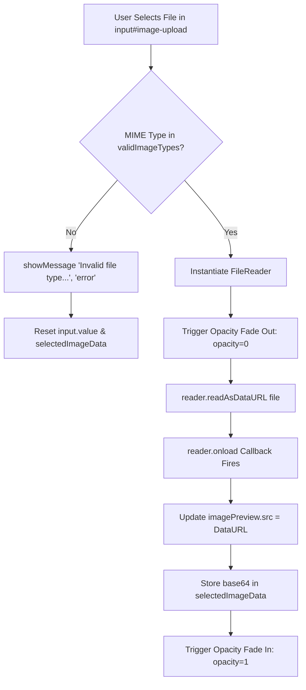

# Feature F1: Profile Photo File Upload & Asynchronous Preview



---

## 1. Description & User-Facing Behavior
Users can personalize their testimonial by uploading an avatar. Clicking "Choose an Image" triggers the native OS file picker. When an image (`.jpeg`, `.png`, or `.gif`) is selected, the circular preview smoothly fades out and crossfades to the newly chosen image without submitting the form or refreshing the page.

---

## 2. Technical Code Trace & Implementation

- **Markup Elements**: [`testimonials.html:25-32`](file:///Users/avishjain/avishjain9-repos/53-testimonials-grid/testimonials.html#L25-L32)
  - Hidden file input `<input type="file" id="image-upload" accept="image/png, image/jpeg, image/gif">`
  - Styled `<label for="image-upload" class="file-upload-label">Choose an Image</label>`
  - Image element ``
- **JavaScript Handler**: [`testimonial.js:125-148`](file:///Users/avishjain/avishjain9-repos/53-testimonials-grid/testimonial.js#L125-L148)
  ```javascript
  imageUpload.addEventListener('change', (event) => {
      const file = event.target.files[0];
      if (file) {
          if (!validImageTypes.includes(file.type)) {
              showMessage('Invalid file type. Please use .png, .jpg, or .gif.', 'error');
              imageUpload.value = '';
              selectedImageData = null;
              return;
          }
          const reader = new FileReader();
          reader.onload = (e) => {
              imagePreview.style.opacity = '0';
              setTimeout(() => {
                  imagePreview.src = e.target.result;
                  selectedImageData = e.target.result;
                  imagePreview.style.opacity = '1';
              }, 200);
          };
          reader.readAsDataURL(file);
      }
  });
  ```
- **CSS Transitions**: [`testimonials.css:203-216`](file:///Users/avishjain/avishjain9-repos/53-testimonials-grid/testimonials.css#L203-L216)
  `#image-preview { transition: transform 0.3s ease, opacity 0.4s ease; }`

---

## 3. Data Touched & Flow
- Variable: `selectedImageData` holds the Base64 DataURL in memory.
- Target Object: Injected into `newTestimonial.imageSrc` on submission.

---

## 4. Edge Cases & Error Handling
1. **Invalid MIME Type**: If an SVG, WebP, or non-image is selected, input is wiped and toast notifies the user.
2. **Cancelled File Dialog**: If the user opens and cancels the dialog, `event.target.files[0]` is undefined and gracefully ignored.

---

## 5. Security & Performance
- **Client Processing**: Zero server CPU spent processing or decoding images.
- **Quota Risk**: LocalStorage is limited to 5MB. Large uncompressed images (e.g. 8MB iPhone photos) will exceed quota on submit.

---

## 6. Say It Out Loud
> "For the profile photo upload, I used the native browser FileReader API instead of sending the file to an external cloud storage bucket. When the user selects an image, I validate that its MIME type is a JPEG, PNG, or GIF. If it's valid, I asynchronously stream the binary file into a base64 DataURL string and crossfade the preview image smoothly using a quick opacity transition. I chose this client-side approach because it eliminates the need for an external backend or S3 bucket, making the demo completely self-contained. The main limitation is that large image files can quickly fill up the browser's 5-megabyte LocalStorage quota, which I would resolve in production by resizing the image on a canvas before saving."
