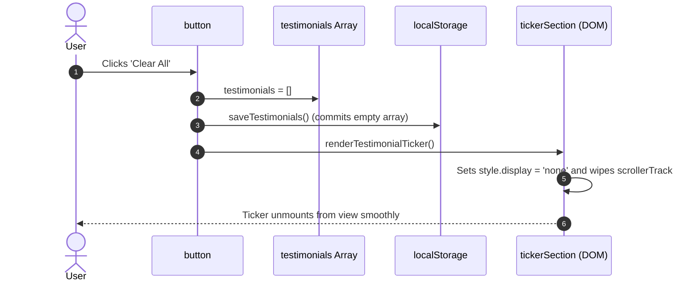

# Feature F12: Testimonial Data Clearing & Reset



---

## 1. Description & User-Facing Behavior
Allows users and developers to clear all locally saved reviews with a single click, immediately collapsing the ticker marquee and resetting LocalStorage to an empty state.

---

## 2. Technical Code Trace & Implementation

- **Markup Button**: [`testimonials.html:64`](file:///Users/avishjain/avishjain9-repos/53-testimonials-grid/testimonials.html#L64)
  `<button id="clear-all-btn" class="clear-btn">Clear All</button>`
- **Handler with Null Defense**: [`testimonial.js:206-214`](file:///Users/avishjain/avishjain9-repos/53-testimonials-grid/testimonial.js#L206-L214)
  ```javascript
  if (clearAllBtn) {
      clearAllBtn.addEventListener('click', () => {
          testimonials = [];
          saveTestimonials();
          renderTestimonialTicker();
      });
  }
  ```
- **DOM Teardown**: [`testimonial.js:81-85`](file:///Users/avishjain/avishjain9-repos/53-testimonials-grid/testimonial.js#L81-L85)
  ```javascript
  if (testimonials.length === 0) {
      tickerSection.style.display = 'none';
      scrollerTrack.innerHTML = '';
      return;
  }
  ```

---

## 3. Say It Out Loud
> "I provided a Clear All button so users testing the application can easily flush their reviews and reset the demonstration. When clicked, it empties the memory array, clears the LocalStorage key, and invokes the render function, which hides the ticker container. In the initial codebase, this button was commented out in HTML, which caused a null-reference exception that crashed subsequent scripts. I fixed this by adding defensive null-checks and restoring the button to the header, demonstrating the importance of defensive coding in vanilla JavaScript."
