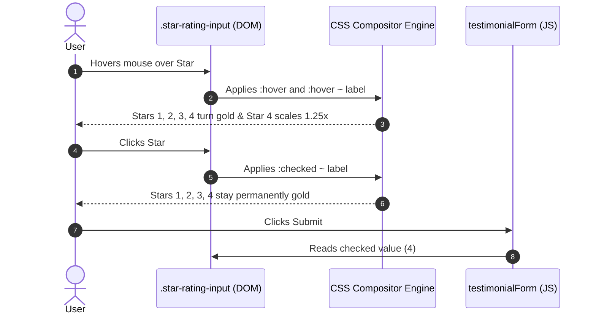

# Feature F2: Interactive 5-Star Rating System



---

## 1. Description & User-Facing Behavior
Users can rate their experience from 1 to 5 stars. As the cursor hovers across the stars, each star expands slightly with a pop animation, and all stars up to the hovered star illuminate in golden amber. Clicking locks in the selection.

---

## 2. Technical Code Trace & Implementation

- **HTML Structure**: [`testimonials.html:39-48`](file:///Users/avishjain/avishjain9-repos/53-testimonials-grid/testimonials.html#L39-L48)
  Contains 5 radio inputs (`#star5` down to `#star1`) paired with corresponding `<label>` tags enclosing FontAwesome star icons `<i class="fas fa-star"></i>`.
- **CSS Flex Inversion & Sibling Magic**: [`testimonials.css:234-261`](file:///Users/avishjain/avishjain9-repos/53-testimonials-grid/testimonials.css#L234-L261)
  ```css
  .star-rating-input {
      display: flex;
      flex-direction: row-reverse;
      justify-content: center;
  }
  .star-rating-input input[type="radio"] { display: none; }
  .star-rating-input label {
      font-size: 1.75rem;
      color: var(--clr-border-light);
      cursor: pointer;
      margin: 0 0.25rem;
      transition: all 0.15s ease-out;
  }
  .star-rating-input input[type="radio"]:checked ~ label { color: var(--clr-accent); }
  .star-rating-input label:hover,
  .star-rating-input label:hover ~ label { color: var(--clr-accent); }
  .star-rating-input label:hover { transform: scale(1.25); }
  ```
- **JavaScript Extraction**: [`testimonial.js:156, 167`](file:///Users/avishjain/avishjain9-repos/53-testimonials-grid/testimonial.js#L156)
  `const ratingInput = document.querySelector('input[name="rating"]:checked');`

---

## 3. Data Touched
- Stored as integer `1..5` in `newTestimonial.rating`.
- Rendered on cards by `createStarRatingHTML(rating)` ([`testimonial.js:45-55`](file:///Users/avishjain/avishjain9-repos/53-testimonials-grid/testimonial.js#L45-L55)).

---

## 4. Say It Out Loud
> "I built the five-star rating widget using pure CSS without any external rating plugins. In HTML, the radio buttons are ordered five down to one, and in CSS I reversed the flex direction so they appear visually from one to five. This lets me use the CSS general sibling combinator to color all stars to the left of the hovered or selected star automatically. I chose pure CSS because it gives sixty frames per second hover states without attaching ten separate mouseover event listeners. If I had more time, I would add keyboard arrow navigation so screen-reader users can increment and decrement ratings effortlessly."
