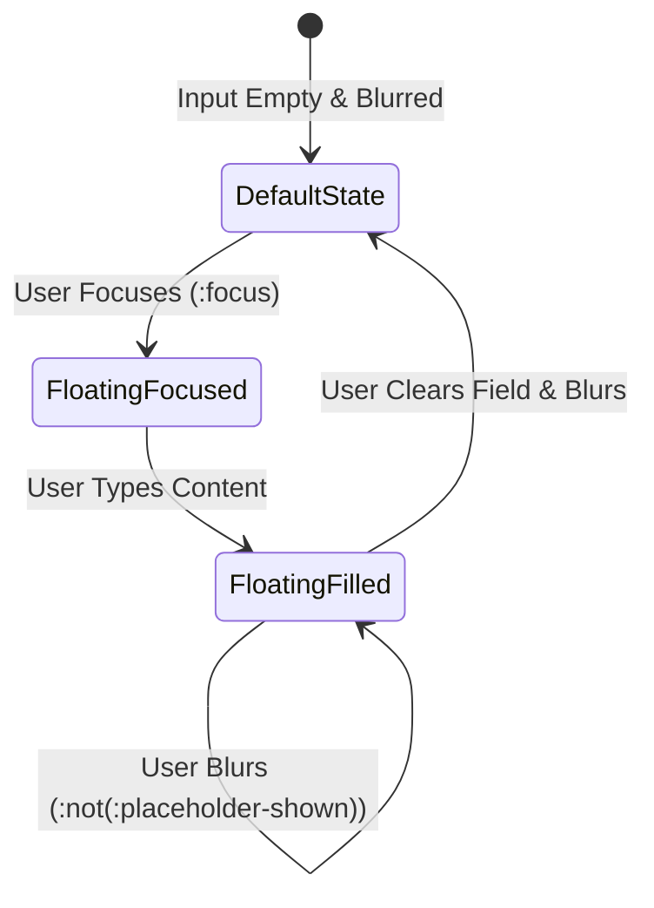

# Feature F3: Floating Label Form Fields



---

## 1. Description & User-Facing Behavior
Input fields for "Your Name" and "Your Testimonial" feature smooth, floating label micro-interactions. The label acts as an initial centered placeholder. When clicked or filled with text, the label smoothly scales down to 75% size and floats upwards to the top border, ensuring the user always knows what field they are editing.

---

## 2. Technical Code Trace & Implementation

- **Markup Contract**: [`testimonials.html:34-37, 50-53`](file:///Users/avishjain/avishjain9-repos/53-testimonials-grid/testimonials.html#L34-L37)
  ```html
  <div class="form-group form-field">
      <input type="text" id="user-name" placeholder=" " required>
      <label for="user-name">Your Name</label>
  </div>
  ```
  *Crucial detail*: `placeholder=" "` contains a single space character so the browser knows a placeholder exists, allowing `:not(:placeholder-shown)` to activate when text is entered.
- **CSS Selectors**: [`testimonials.css:138-197`](file:///Users/avishjain/avishjain9-repos/53-testimonials-grid/testimonials.css#L138-L197)
  ```css
  .form-field input[type="text"]:focus + label,
  .form-field textarea:focus + label,
  .form-field input[type="text"]:not(:placeholder-shown) + label,
  .form-field textarea:not(:placeholder-shown) + label {
      top: 0;
      left: 0.75rem;
      font-size: 0.75rem;
      color: var(--clr-primary);
      padding: 0 0.25rem;
      background-color: var(--clr-glass-bg);
      transform: translateY(-50%);
      border-radius: 0.25rem;
  }
  ```

---

## 3. Say It Out Loud
> "I designed the input labels to float upwards smoothly when the user focuses or types into a field. I accomplished this using the CSS `:not(:placeholder-shown)` and `:focus` pseudo-classes paired with adjacent sibling selectors, which completely avoids JavaScript focus listeners. This pattern keeps the form compact and elegant while ensuring the user never loses the context of which field they are typing into. A minor trade-off is requiring a single whitespace character in the placeholder attribute, which I would enhance with explicit state classes if supporting legacy browsers."
