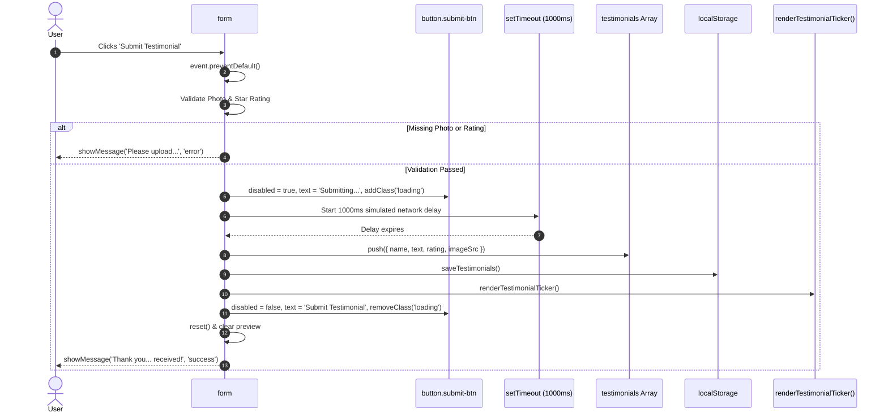

# Feature F4: Testimonial Submission & Simulated Network Delay



---

## 1. Description & User-Facing Behavior
When the user submits a testimonial, the system validates the form, locks the submit button into an animated loading state (`Submitting...`), simulates a 1-second asynchronous network transmission, persists the data, updates the ticker, and presents a 4-second success toast banner.

---

## 2. Technical Code Trace & Implementation

- **Handler**: [`testimonial.js:151-204`](file:///Users/avishjain/avishjain9-repos/53-testimonials-grid/testimonial.js#L151-L204)
- **Key Code**:
  ```javascript
  submitBtn.disabled = true;
  submitBtn.textContent = 'Submitting...';
  submitBtn.classList.add('loading');

  setTimeout(() => {
      const newTestimonial = { name, text, rating, imageSrc: selectedImageData };
      testimonials.push(newTestimonial);
      saveTestimonials();
      renderTestimonialTicker();
      
      submitBtn.disabled = false;
      submitBtn.textContent = 'Submit Testimonial';
      submitBtn.classList.remove('loading');
      
      showMessage(`Thank you, ${name}! Your testimonial has been received.`, 'success');
      testimonialForm.reset();
      imagePreview.src = defaultPreviewSrc;
      selectedImageData = null;
  }, 1000);
  ```
- **CSS Pulse Animation**: [`testimonials.css:53-56, 278-282`](file:///Users/avishjain/avishjain9-repos/53-testimonials-grid/testimonials.css#L53-L56)
  `@keyframes pulse { 0%, 100% { opacity: 1; } 50% { opacity: 0.6; } }`

---

## 3. Say It Out Loud
> "When the user submits a testimonial, I intercept the submit event to validate that both a photo and a star rating were provided. Instead of instantly snapping the UI into a success state, I purposely introduced a one-second simulated network delay. During this second, the submit button is disabled, changes text to 'Submitting...', and activates a CSS pulse animation. Once the timeout completes, I push the new testimonial into our in-memory array, serialize it to LocalStorage, re-render the ticker, and reset the form. I implemented this simulated delay because immediate synchronous state changes often feel jarring and unnatural to users accustomed to cloud applications. If this were connected to a live REST API, I would replace the timer with an asynchronous fetch call wrapped in a try-catch block."
