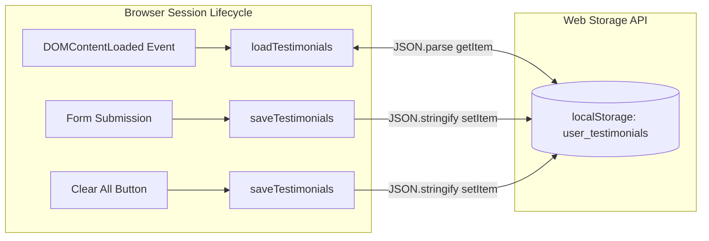

# Feature F5: LocalStorage Persistence



---

## 1. Description & User-Facing Behavior
Data entered by users persists permanently on the client device. Closing the tab, reloading the page, or restarting the browser maintains the complete list of reviews and displays them immediately in the scrolling ticker.

---

## 2. Technical Code Trace & Implementation

- **Storage Key**: `const STORAGE_KEY = 'user_testimonials';` ([`testimonial.js:15`](file:///Users/avishjain/avishjain9-repos/53-testimonials-grid/testimonial.js#L15))
- **Save Function**: [`testimonial.js:107-109`](file:///Users/avishjain/avishjain9-repos/53-testimonials-grid/testimonial.js#L107-L109)
  ```javascript
  function saveTestimonials() {
      localStorage.setItem(STORAGE_KEY, JSON.stringify(testimonials));
  }
  ```
- **Load Function**: [`testimonial.js:114-120`](file:///Users/avishjain/avishjain9-repos/53-testimonials-grid/testimonial.js#L114-L120)
  ```javascript
  function loadTestimonials() {
      const storedData = localStorage.getItem(STORAGE_KEY);
      if (storedData) {
          testimonials = JSON.parse(storedData);
          renderTestimonialTicker();
      }
  }
  ```

---

## 3. Say It Out Loud
> "I used browser LocalStorage to make sure reviews persist even when the user refreshes or closes the page. On application boot, my loadTestimonials function parses the JSON string from the user_testimonials storage key and feeds it into the ticker rendering pipeline. Whenever a user submits a review or clears data, I immediately write the updated array back to storage. I chose LocalStorage because it's synchronous, supported across every modern browser, and requires zero database configuration. The accepted trade-off is that LocalStorage is domain-isolated and capped at roughly five megabytes, so for a multi-user production system I would replace this with a PostgreSQL or MongoDB backend."
