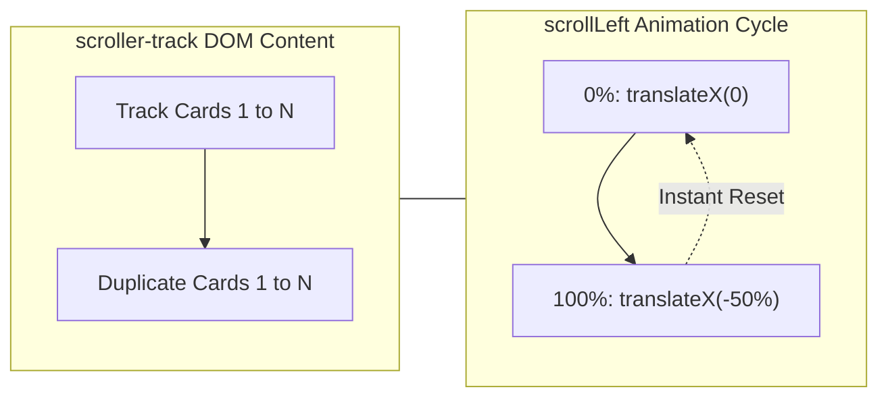

# Feature F6: Seamless Infinite Marquee Ticker



---

## 1. Description & User-Facing Behavior
Saved testimonials are showcased in a continuous horizontal scrolling ticker. The animation loops indefinitely without any abrupt jumps, blank spaces, or pauses when restarting the loop.

---

## 2. Technical Code Trace & Implementation

- **Markup Duplication in JavaScript**: [`testimonial.js:94-95`](file:///Users/avishjain/avishjain9-repos/53-testimonials-grid/testimonial.js#L94-L95)
  `scrollerTrack.innerHTML = trackHTML + trackHTML;`
- **CSS Keyframe Motion**: [`testimonials.css:344-356`](file:///Users/avishjain/avishjain9-repos/53-testimonials-grid/testimonials.css#L344-L356)
  ```css
  .scroller-track {
      display: flex;
      width: max-content;
      animation: scrollLeft linear infinite;
  }
  @keyframes scrollLeft {
      0% { transform: translateX(0); }
      100% { transform: translateX(-50%); }
  }
  ```
- **Feathered Fade Masks**: [`testimonials.css:341-342`](file:///Users/avishjain/avishjain9-repos/53-testimonials-grid/testimonials.css#L341-L342)
  `-webkit-mask-image: linear-gradient(to right, transparent, black 10%, black 90%, transparent);`

---

## 3. Say It Out Loud
> "To create an infinite scrolling marquee without any visual jerking or blank gaps, I used a classic DOM duplication technique paired with hardware-accelerated CSS keyframes. In JavaScript, I generate the HTML for all testimonial cards and then concatenate that exact string with itself before injecting it into the scrolling track. In CSS, the animation moves the track from zero translation to negative fifty percent along the X-axis before looping infinitely. Because the second half of the track is an exact replica of the first, the human eye perceives a seamless, uninterrupted loop. I also applied a CSS mask-image linear gradient to feather the left and right edges smoothly into transparency."
