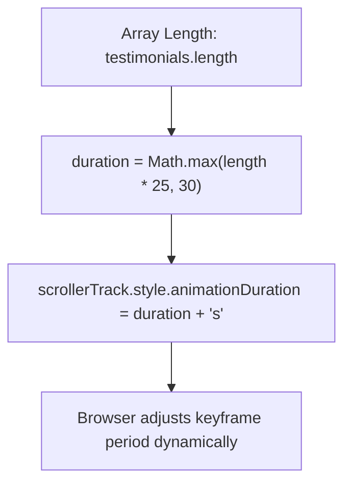

# Feature F7: Dynamic Scroll Velocity Scaling



---

## 1. Description & User-Facing Behavior
As more testimonials are added to the list, the scrolling ticker automatically adjusts its cycle duration so that cards continue gliding by at a calm, readable physical velocity rather than accelerating rapidly.

---

## 2. Technical Code Trace & Implementation

- **Velocity Calculation**: [`testimonial.js:97-101`](file:///Users/avishjain/avishjain9-repos/53-testimonials-grid/testimonial.js#L97-L101)
  ```javascript
  const scrollSpeed = 25; // 25 seconds per card
  const minDuration = 30; // minimum duration threshold
  const duration = Math.max(testimonials.length * scrollSpeed, minDuration);
  scrollerTrack.style.animationDuration = `${duration}s`;
  ```

---

## 3. Say It Out Loud
> "A common bug with infinite carousels is that adding more items makes the scroller race across the screen at uncontrollable speeds if the animation duration is fixed. To solve this, I dynamically calculate the animation duration in JavaScript whenever the ticker re-renders. I multiply the number of testimonials by twenty-five seconds per card, with a thirty-second minimum threshold. This guarantees that whether the user has two testimonials or twenty, each card passes across the viewport at a steady, comfortable reading speed."
