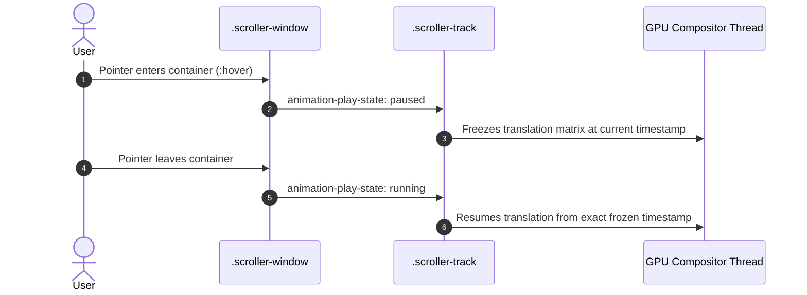

# Feature F8: Hover Pause Interaction



---

## 1. Description & User-Facing Behavior
When a visitor points their mouse cursor over any card in the scrolling ticker, the entire marquee halts in place immediately, allowing the user to comfortably read the quote without clicking or dragging. Moving the mouse away resumes the motion.

---

## 2. Technical Code Trace & Implementation

- **CSS Rule**: [`testimonials.css:349-351`](file:///Users/avishjain/avishjain9-repos/53-testimonials-grid/testimonials.css#L349-L351)
  ```css
  .scroller-window:hover .scroller-track {
      animation-play-state: paused;
  }
  ```

---

## 3. Say It Out Loud
> "I added a hover pause feature so users can easily read a testimonial without chasing it across the screen. I implemented this entirely in CSS using the `animation-play-state: paused` property on the hover state of the scroller window. Handling this in CSS rather than JavaScript means it runs entirely on the browser's compositor thread, saving CPU cycles and preventing micro-stutters. If I extended this for mobile devices, I would explicitly bind touchstart and touchend events to toggle the pause state on tap."
