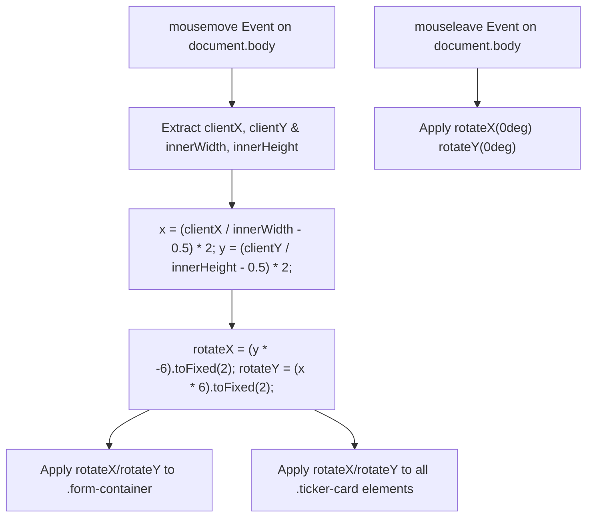

# Feature F9: 3D Perspective & Mouse Tracking Tilt



---

## 1. Description & User-Facing Behavior
As the user moves their cursor over the webpage, the main form card and the individual testimonial cards tilt organically in 3D space, following the cursor's spatial position to deliver a tactile, physical glassmorphic appearance.

---

## 2. Technical Code Trace & Implementation

- **CSS 3D Context**: [`testimonials.css:80-86, 108, 373`](file:///Users/avishjain/avishjain9-repos/53-testimonials-grid/testimonials.css#L80-L86)
  `.main-wrapper { perspective: 1000px; }`
  `transition: transform 0.1s ease-out;`
- **Coordinate Math**: [`testimonial.js:215-244`](file:///Users/avishjain/avishjain9-repos/53-testimonials-grid/testimonial.js#L215-L244)
  ```javascript
  function handleTilt(event) {
      const { clientX, clientY } = event;
      const { innerWidth, innerHeight } = window;
      
      const x = (clientX / innerWidth - 0.5) * 2;
      const y = (clientY / innerHeight - 0.5) * 2;
      const maxRotate = 6;

      const rotateX = (y * -maxRotate).toFixed(2);
      const rotateY = (x * maxRotate).toFixed(2);

      formContainer.style.transform = `rotateX(${rotateX}deg) rotateY(${rotateY}deg)`;
      const tickerCards = document.querySelectorAll('.ticker-card');
      tickerCards.forEach(card => {
          card.style.transform = `rotateX(${rotateX}deg) rotateY(${rotateY}deg)`;
      });
  }
  ```

---

## 3. Say It Out Loud
> "To give the interface a tactile, modern feel, I implemented an interactive 3D tilt effect on the form container and ticker cards. I established a three-dimensional perspective of one thousand pixels on the main wrapper in CSS. Then in JavaScript, I listen to mousemove events across the window, calculate the cursor's distance from the center of the viewport, and normalize that value between negative one and positive one. Multiplying by a maximum rotation limit of six degrees yields subtle X and Y tilt angles that I apply directly via CSS transforms. When the mouse leaves the browser window, a mouseleave listener resets the rotation back to zero degrees smoothly."
