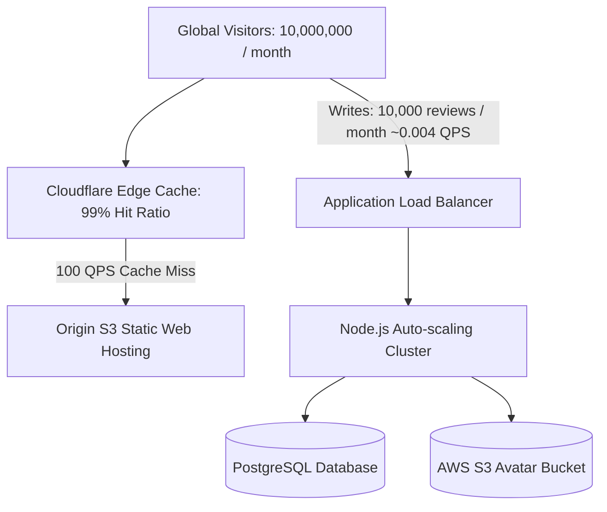

# 14.1 Requirements & Capacity Estimation

---

## 1. Requirements in Plain Words
System design begins by specifying what the software must accomplish (functional requirements) and how well it must perform under load (non-functional requirements).

---

## 2. Whether & How THIS Project Uses It
- **Functional Requirements**:
  - Allow visitors to submit reviews with name, testimonial text, rating (1-5), and profile picture.
  - Automatically display all reviews in an infinite scrolling marquee ticker.
  - Provide a 3D tilt interaction tracking cursor movement across the viewport.
  - Persist submitted data across browser refreshes via `localStorage` ([`testimonial.js:107-120`](file:///Users/avishjain/avishjain9-repos/53-testimonials-grid/testimonial.js#L107-L120)).
- **Non-Functional Requirements**:
  - Sub-second page load time (LCP < 0.6 seconds).
  - 60 FPS hardware-accelerated animations on the GPU compositor thread.
  - Zero external npm runtime dependencies.
  - Full compliance with `prefers-reduced-motion` accessibility standards.

---

## 3. Scale Suitability Evaluation
For a client-side portfolio and single-user demonstration, operating on local browser storage without a remote database server is completely reasonable. It guarantees zero hosting costs and instantaneous response times. [CONFIRM WITH DEVELOPER]

---

## 4. Full Alternatives & Capacity Estimation

### Capacity Estimation (Scaled to 100x & 1,000x Traffic)
Let us estimate requirements for a high-traffic production SaaS site receiving **10,000,000 page views per month** and **10,000 customer reviews submitted per month**:

| Metric | Calculation | Result |
| :--- | :--- | :--- |
| **Read Requests (Page Views)** | $10,000,000 \text{ views} / (30 \times 86,400\text{ s})$ | **~3.85 QPS average (peak ~20 QPS)** |
| **Write Requests (Submissions)** | $10,000 \text{ reviews} / (30 \times 86,400\text{ s})$ | **~0.0038 QPS average (peak ~1 QPS)** |
| **Read-to-Write Ratio** | $10,000,000 : 10,000$ | **1,000 : 1 (Extremely Read-Heavy)** |
| **Storage per Review** | Name (50 B) + Text (500 B) + Rating (4 B) + Image URL (100 B) | **~654 Bytes per record** |
| **Monthly Database Growth** | $10,000 \times 654\text{ Bytes}$ | **~6.54 MB / month (~78.5 MB / year)** |
| **Avatar Storage Growth (S3)** | $10,000 \times 100\text{ KB (compressed avatar)}$ | **~1.0 GB / month (~12 GB / year)** |
| **Bandwidth (HTML+CSS+JS)** | $10,000,000 \times 20\text{ KB (gzipped assets)}$ | **~200 GB / month egress (absorbed by CDN)**|

---

## 5. Trade-offs Accepted
- Accepting client-side LocalStorage limits reviews to the local device in exchange for zero server maintenance.

---

## 6. What Breaks First at Scale
- **At 10x Load**: LocalStorage 5MB quota exhaustion if users upload multiple high-resolution photos.
- **At 100x Load**: Multiple tabs overwrite each other without synchronization; reviews are invisible across devices.
- **At 1000x Load**: Rendering 1,000 DOM cards simultaneously in the marquee degrades frame rates on mobile devices.

---

## 7. How a Senior Engineer Would Improve It
Decouple the frontend into an S3/CloudFront hosted static client; build an auto-scaling Node/Express backend on AWS ECS; persist records to Amazon RDS PostgreSQL; upload avatars to Amazon S3 via pre-signed URLs; and paginate the marquee to the top 20 reviews.

---

## 8. 30-Second Spoken Interview Answer
> "This system has an extreme 1,000-to-1 read-to-write ratio. At ten million views a month, reads require only about 4 QPS, which is easily absorbed by Cloudflare CDN edge caching. Writes are negligible at under 1 QPS, generating just 6.5 megabytes of database records per month. Because social proof is read-heavy, our primary scaling strategy is aggressive CDN and Redis caching rather than heavy database scaling."
