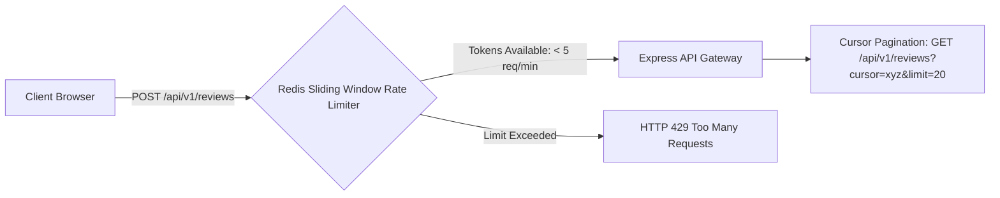

# 14.10 API Design, Pagination & Rate Limiting



---

## 1. What It Is in Plain Words
API design defines standard, predictable interfaces for client-server communication, while rate limiting protects services from abuse, credential stuffing, and DoS attacks by capping request volume.

---

## 2. Whether & How THIS Project Uses It
- **Current Implementation**:
  - The project operates locally on client memory without custom REST endpoints.
  - Button state management (`submitBtn.disabled = true` in [`testimonial.js:171`](file:///Users/avishjain/avishjain9-repos/53-testimonials-grid/testimonial.js#L171)) enforces basic client-side rate limiting against accidental double-clicks.

---

## 3. Scale Suitability Evaluation
Disabling the submit button is a necessary first line of defense on the client, but must be paired with server-side rate limiting in production. [CONFIRM WITH DEVELOPER]

---

## 4. Full Alternatives Comparison

| Rate Limiting Algorithm | Storage Medium | Burst Tolerance | Memory Footprint | Accuracy | Best Fit |
| :--- | :--- | :--- | :--- | :--- | :--- |
| **Token Bucket** | Redis Hash | High (Bucket capacity) | $O(1)$ per user | High | **General API traffic** |
| **Leaky Bucket** | Queue buffer | Low (Smooth output) | $O(N)$ queue | High | Steady backend processing |
| **Fixed Window Counter** | Redis Key | High at window edges | $O(1)$ | Low (Boundary spikes)| Primitive rate limiting |
| **Sliding Window Log** | Redis Sorted Set | Medium | $O(N)$ requests | 100% exact | High-security financial APIs |
| **Sliding Window Counter (Chosen)**| Redis Hash | Medium | $O(1)$ | ~99.5% accurate | **Production reviews endpoint** |

### Pagination Strategy Comparison
- **Offset/Limit (`OFFSET 1000 LIMIT 20`)**: Degrades on large tables as the DB must scan and discard 1,000 rows ($O(N)$ scan).
- **Cursor-Based (`WHERE id < :cursor ORDER BY id DESC LIMIT 20`) (Chosen)**: Scans directly using a B-tree index ($O(1)$ seek), providing consistent millisecond response times regardless of table depth.

---

## 5. Trade-offs Accepted
Accepting client-only throttling for local demonstration simplicity.

---

## 6. What Breaks First at Scale
- **10x Load**: No breakage.
- **100x Load**: Malicious script writing a while loop calling an un-rate-limited backend could flood the database with spam.
- **1000x Load**: Offset pagination causing high DB disk I/O on deep review history.

---

## 7. How a Senior Engineer Would Improve It
Deploy a **Sliding Window Counter** rate limiter in Redis enforcing **5 reviews per IP per hour** and return standard rate limit headers:
```http
HTTP/1.1 429 Too Many Requests
Retry-After: 3600
X-RateLimit-Limit: 5
X-RateLimit-Remaining: 0
X-RateLimit-Reset: 1711104000
```

---

## 8. 30-Second Spoken Interview Answer
> "On the client, we disable the submit button immediately upon form submission to prevent duplicate clicks. In our production cloud API, we would enforce a Redis Sliding Window Counter limiting review submissions to five requests per IP per hour, combined with cursor-based pagination for review feeds to ensure constant O(1) database seek times."
