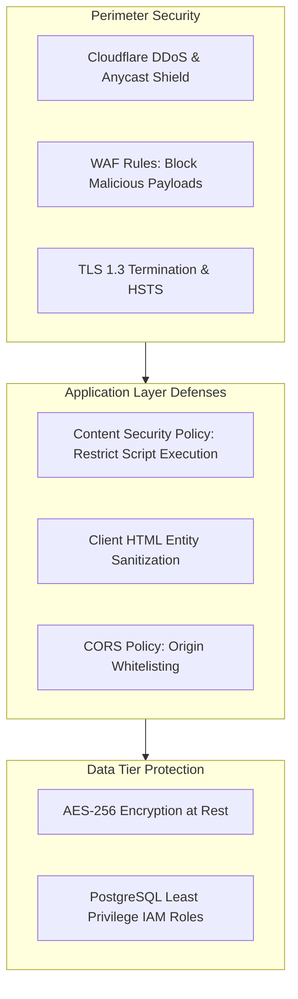

# 14.11 Security Architecture & Defense-in-Depth

---

## 1. What It Is in Plain Words
Security architecture implements multi-layered defensive controls (Defense-in-Depth) across network boundaries, web servers, application code, and data storage to safeguard assets against unauthorized access, exploitation, and data corruption.

---

## 2. Whether & How THIS Project Uses It
- **Current Defenses**:
  - **Entity Sanitization**: Replaces `<` and `>` with HTML entities to prevent direct `<script>` injection ([`testimonial.js:38-40`](file:///Users/avishjain/avishjain9-repos/53-testimonials-grid/testimonial.js#L38-L40)).
  - **File Type Enforcement**: Validates file types against an explicit whitelist (`validImageTypes` in [`testimonial.js:17`](file:///Users/avishjain/avishjain9-repos/53-testimonials-grid/testimonial.js#L17)).
  - **Zero Secrets on Client**: No API keys, credentials, or backend passwords are bundled in the client code.

---

## 3. Scale Suitability Evaluation
Treating all client-rendered text as untrusted and stripping dangerous HTML characters is an essential baseline defense. [CONFIRM WITH DEVELOPER]

---

## 4. Full Alternatives Comparison

| Security Mechanism | Layer | Primary Threat Defended | Complexity | Current Status |
| :--- | :--- | :--- | :--- | :--- |
| **HTML Entity Encoding** | Application | Stored / Reflected XSS | Very Low | **Implemented** |
| **MIME Whitelisting** | Application | Malicious executable upload | Very Low | **Implemented** |
| **Content Security Policy (CSP)**| Browser / HTTP | Injection execution & unauthorized CDNs | Low | **Recommended** |
| **Subresource Integrity (SRI)** | Browser / HTML | CDN compromise / malicious script injection| Very Low | **Recommended** |
| **Cloudflare WAF** | Network / Edge | SQL injection, automated bot scrapers | Managed | **Proposed for Cloud** |
| **JWT / OAuth2 Auth** | Application | Identity spoofing & unauthorized writes | Medium | **Proposed for Cloud** |

---

## 5. Trade-offs Accepted
Accepting client-only sanitization without server-side validation in current static demo.

---

## 6. What Breaks First at Scale
- **10x Load**: No breakage.
- **100x Load**: Malicious user bypassing client JS and posting raw HTML directly to a cloud API if server-side sanitization is absent.
- **1000x Load**: DDoS volumetric floods targeting submission endpoints.

---

## 7. How a Senior Engineer Would Improve It
1. Implement a **Zero-Trust architecture**: re-sanitize all inputs on the backend using `DOMPurify` before database persistence.
2. Deploy a **strict Content-Security-Policy (CSP)** blocking inline scripts (`script-src 'self'`).
3. Place **Cloudflare WAF** in front of the API with bot-management scoring.

---

## 8. 30-Second Spoken Interview Answer
> "We implement defense-in-depth across the entire request lifecycle. On the client, we strictly whitelist image MIME types and sanitize review text to prevent XSS injection. In our production cloud infrastructure, we enforce a strict Content Security Policy, terminate TLS 1.3 at Cloudflare edge nodes, and validate all inputs server-side before persisting records to PostgreSQL."
