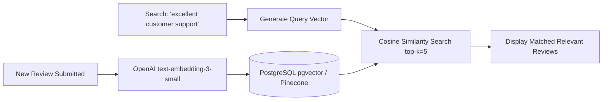

# 14.12 Search & AI Integration Architecture

---

## 1. What It Is in Plain Words
Search and AI architecture incorporates full-text search, semantic vector retrieval (embeddings), and Large Language Model (LLM) pipelines for automated content moderation, sentiment analysis, and search.

---

## 2. Whether & How THIS Project Uses It
- **Current Status**: **Not implemented in source code**.
- Detailed production architecture specification documented in [`docs/07-ai-integration.md`](file:///Users/avishjain/avishjain9-repos/53-testimonials-grid/docs/07-ai-integration.md).

---

## 3. Scale Suitability Evaluation
Omitting search and AI from a lightweight client marquee widget keeps the application lean, zero-cost, and completely private. [CONFIRM WITH DEVELOPER]

---

## 4. Full Alternatives Comparison

| Search & AI Technology | Query Type | Latency | Operational Cost | Infrastructure | Best Fit Scenario |
| :--- | :--- | :--- | :--- | :--- | :--- |
| **JS Array Filter (Local)** | Exact Substring | < 1 ms | Zero | In-Memory | **Client-side local search** |
| **PostgreSQL Full-Text (tsvector)**| Keyword / Stemming | 5-15 ms | Zero incremental | Single DB | **Standard review keyword search**|
| **Algolia / Meilisearch** | Typo-tolerant Instant Search| 20-50 ms | Medium ($/query) | Managed | Enterprise e-commerce search |
| **pgvector (Vector Search)**| Semantic Similarity | 15-40 ms | Low (RAM for index)| Single DB | **Semantic concept search** |
| **Gemini 1.5 Flash (LLM)** | Toxicity & Sentiment | 350 ms | $0.075 / 1M tokens | External API | **Automated review moderation** |

---

## 5. Trade-offs Accepted
Accepting zero search functionality in v1 in exchange for instantaneous static load times.

---

## 6. What Breaks First at Scale
- **10x Load**: No breakage.
- **100x Load**: Users struggling to find relevant reviews as total review volume reaches thousands without a search or filter interface.
- **1000x Load**: Unmoderated spam polluting the public marquee ticker.

---

## 7. How a Senior Engineer Would Improve It
1. Use **Gemini 1.5 Flash** behind a queue worker to validate review sentiment and reject profanity.
2. Store review embeddings in **PostgreSQL using `pgvector`** (`vector(1536)`) with an `HNSW` index to enable semantic natural language review search ("show me reviews praising fast delivery").

---

## 8. 30-Second Spoken Interview Answer
> "While our current client widget focuses strictly on display and local storage, our scaled search architecture utilizes PostgreSQL's native pgvector extension. By generating embeddings with OpenAI's text-embedding-3-small, users can perform semantic search across thousands of reviews using cosine similarity, paired with Gemini 1.5 Flash for sub-dollar monthly AI moderation."
