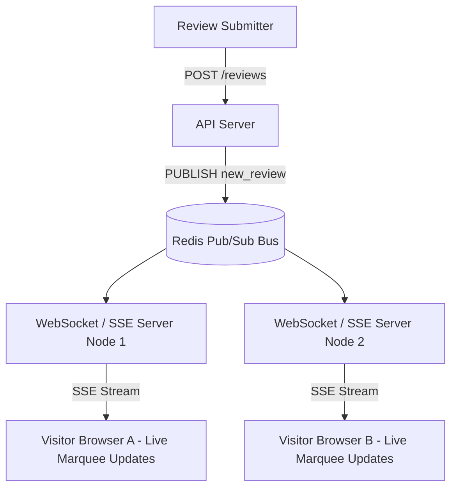

# 14.13 Real-Time Systems & Push Architectures

---

## 1. What It Is in Plain Words
Real-time systems push server events to connected client browsers instantaneously as they occur, eliminating the need for periodic client-side polling.

---

## 2. Whether & How THIS Project Uses It
- **Current Status**: **Local Instant DOM Updates**.
  - Review submissions immediately re-render the ticker on the active client device without server roundtrips ([`testimonial.js:192`](file:///Users/avishjain/avishjain9-repos/53-testimonials-grid/testimonial.js#L192)).
  - Cross-tab updates can be triggered via the `window.onstorage` event.

---

## 3. Scale Suitability Evaluation
Synchronous local DOM updates provide an instantaneous (0 ms) real-time experience for the submitting user without maintaining complex persistent network sockets. [CONFIRM WITH DEVELOPER]

---

## 4. Full Alternatives Comparison

| Real-Time Mechanism | Directionality | Protocol | Server Overhead | Connection Persistence | Best Fit Scenario |
| :--- | :--- | :--- | :--- | :--- | :--- |
| **Local DOM Update (Chosen)**| Local Client | Memory | **Zero** | **None** | **Single-user local demo** |
| **Server-Sent Events (SSE)** | Unidirectional (Server->Client)| HTTP/2 | Very Low | Persistent HTTP stream| **Live review ticker feed** |
| **WebSockets (Socket.io)** | Bidirectional (Full Duplex) | TCP WS | Medium-High | Persistent TCP socket | Two-way live chat / collaboration |
| **Short Polling** | Unidirectional | HTTP/1.1 | High (Repeated requests) | None | Legacy fallback |
| **Long Polling** | Unidirectional | HTTP/1.1 | Moderate | Held HTTP connection | Legacy firewalled environments |

---

## 5. Trade-offs Accepted
Accepting that visitors cannot see reviews submitted by other users in real time without a server infrastructure.

---

## 6. What Breaks First at Scale
- **10x Load**: No breakage.
- **100x Load**: Thousands of open WebSocket connections consuming server file descriptors if WebSockets are chosen over SSE.
- **1000x Load**: Redis Pub/Sub saturation if broadcasting millions of concurrent review events without aggregation.

---

## 7. How a Senior Engineer Would Improve It
Adopt **Server-Sent Events (SSE)** running over **HTTP/2**:
1. Browsers establish a single lightweight SSE stream (`/api/reviews/stream`).
2. When a review is approved, the API publishes to a **Redis Pub/Sub channel**.
3. All connected server nodes broadcast the new card markup to listening clients, which append it smoothly to the marquee track.

---

## 8. 30-Second Spoken Interview Answer
> "On the client, we achieve immediate real-time feedback by mutating the DOM and re-calculating the marquee velocity synchronously upon submission. For a global real-time social proof stream, I would choose Server-Sent Events over WebSockets because reviews are strictly unidirectional server-to-client broadcasts. SSE runs natively over HTTP/2 with built-in auto-reconnection and consumes a fraction of the memory of full-duplex WebSockets."
