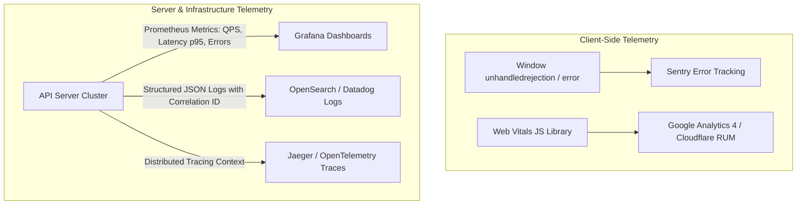

# 14.14 Observability, Monitoring & Operations

---

## 1. What It Is in Plain Words
Observability measures the internal health and performance of software based on external outputs, traditionally categorized into the three pillars: **Metrics**, **Logs**, and **Traces**.

---

## 2. Whether & How THIS Project Uses It
- **Current Implementation**:
  - Browser developer tools (`console.log`, Performance panel, Memory panel).
  - Explicit UI error messaging via `showMessage(text, 'error')` ([`testimonial.js:25-33`](file:///Users/avishjain/avishjain9-repos/53-testimonials-grid/testimonial.js#L25-L33)).

---

## 3. Scale Suitability Evaluation
For a client-side prototype, browser console diagnostics and DevTools profiling are sufficient, but production applications require automated Real User Monitoring (RUM). [CONFIRM WITH DEVELOPER]

---

## 4. Full Alternatives Comparison

| Pillar | Client-Side Implementation | Production Cloud Stack | Purpose |
| :--- | :--- | :--- | :--- |
| **Metrics (Aggregation)** | DevTools Performance Profiler | **Prometheus + Grafana** | Track submission QPS, error rates, p95 latency |
| **Logs (Event Records)** | Browser Console Output | **Vector + OpenSearch / Loki** | Structured JSON logs with unique `trace_id` |
| **Traces (Spans)** | Performance.mark() / measure() | **OpenTelemetry + Jaeger** | Trace request hops through edge, API, and DB |
| **Error Tracking** | `window.onerror` | **Sentry / Bugsnag** | Capture client-side stack traces and user sessions |

---

## 5. Trade-offs Accepted
Zero telemetry scripts bundled in client, prioritizing absolute privacy and zero script overhead.

---

## 6. What Breaks First at Scale
- **10x Load**: No breakage.
- **100x Load**: Unreported client-side browser errors on specific mobile devices (e.g. Safari backdrop-filter glitches) remaining invisible to developers.
- **1000x Load**: Inability to identify slow database queries or API bottleneck endpoints without distributed tracing.

---

## 7. How a Senior Engineer Would Improve It
1. Integrate the **`web-vitals` library** to report real-world LCP, INP, and CLS scores to a central telemetry endpoint.
2. Initialize **Sentry for browser error capture** with source maps uploaded during CI/CD.
3. Propagate `X-Correlation-ID` headers across all cloud API microservices.

---

## 8. 30-Second Spoken Interview Answer
> "Currently, our observability relies on native browser DevTools profiling and performance marks to ensure a locked sixty frames per second. In a production cloud deployment, we would implement the three pillars of observability using OpenTelemetry: structured JSON logging with correlation IDs, Prometheus and Grafana for latency percentiles, and Sentry for real-time client exception monitoring."
