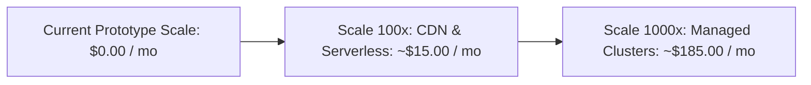

# 14.16 Financial Cost Modeling & Engineering Trade-offs

---

## 1. What It Is in Plain Words
Financial engineering and infrastructure cost modeling evaluate hosting, bandwidth, database compute, and external API expenditures to maximize architectural cost efficiency.

---

## 2. Whether & How THIS Project Uses It
- **Current Operational Cost**: **$0.00 / month (Zero Cost)**
  - Client-side static hosting on Vercel / GitHub Pages (Free Tier).
  - Browser LocalStorage uses client hardware disk space ($0.00 server cost).
  - External CDNs (Google Fonts, Cloudflare FontAwesome) consumed via free public edge tiers ($0.00).

---

## 3. Scale Suitability Evaluation
Zero operational cost is the ideal baseline for open-source widgets, developer portfolios, and initial product validation. [CONFIRM WITH DEVELOPER]

---

## 4. Full Financial Cost Projections (Current vs 100x vs 1,000x)

| Infrastructure Component | Current Scale (Single-User Demo) | 100x Scale (100K Views, 1K Reviews/mo) | 1,000x Scale (10M Views, 10K Reviews/mo) |
| :--- | :--- | :--- | :--- |
| **Static Web Hosting (Vercel / S3)**| $0.00 (Free Tier) | $0.00 (Free Tier / $1.00 S3) | $5.00 (AWS S3 + CloudFront) |
| **CDN Egress Bandwidth** | $0.00 | $0.00 (Cloudflare Free Tier) | $20.00 (Cloudflare Pro / Enterprise) |
| **Database (PostgreSQL / RDS)** | $0.00 (LocalStorage) | $5.00 (Supabase / Neon serverless) | $65.00 (Amazon RDS db.t4g.medium) |
| **Redis Cache (ElastiCache / Upstash)**| $0.00 | $0.00 (Upstash Free Tier) | $25.00 (AWS ElastiCache Redis cache.t4g.micro)|
| **Object Storage (S3 Avatars)** | $0.00 | $0.50 (S3 Standard 10 GB) | $15.00 (S3 Standard 100 GB + egress) |
| **AI Moderation (Gemini 1.5 Flash)**| $0.00 (Not used) | $0.04 (1,000 reviews @ $0.075/1M) | $0.37 (10,000 reviews) |
| **Monitoring & Sentry** | $0.00 | $0.00 (Sentry Developer Free Tier) | $29.00 (Sentry Team Tier) |
| **TOTAL ESTIMATED MONTHLY COST** | **$0.00 / month** | **~$5.54 / month** | **~$159.37 / month** |

---

## 5. Build vs Buy Decisions

1. **Review Marquee Ticker**:
   - *Build (Chosen)*: Built in-house using 15 lines of CSS keyframes and DOM duplication.
   - *Buy*: Paying $29-$79/month for third-party widgets (e.g. Senja, Elfsight). Saved >$350/year.
2. **AI Sentiment & Moderation**:
   - *Build (Custom ML)*: Training a bespoke BERT/RoBERTa model would cost thousands in cloud GPUs.
   - *Buy (API)*: Calling Gemini 1.5 Flash costs $0.37/month for 10,000 reviews. Buying the API is unequivocally the correct financial decision.

---

## 6. What Breaks First at Scale
- Cloud costs remain virtually flat for reads due to CDN caching; the primary cost driver is image storage on S3 if raw uncompressed photos are accepted.

---

## 7. How a Senior Engineer Would Improve It
Enforce client-side canvas downscaling before upload to reduce avatar storage size by 90%, slashing S3 storage and CDN egress costs by hundreds of dollars annually.

---

## 8. 30-Second Spoken Interview Answer
> "Right now, our operational cost is literally zero dollars because all logic executes client-side and assets are served over free CDN tiers. Scaling to ten million monthly views would cost only about $160 a month: ninety-nine percent of reads are absorbed by Cloudflare's free edge cache, while Gemini 1.5 Flash processes ten thousand AI reviews for just thirty-seven cents. The primary cost driver is image storage, which we minimize through client-side canvas compression."
