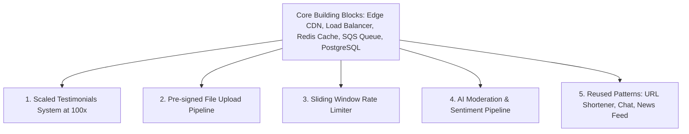
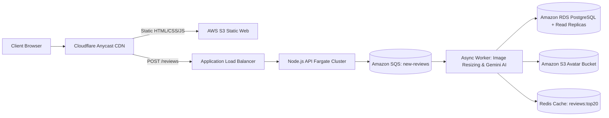
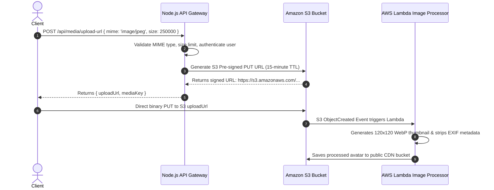
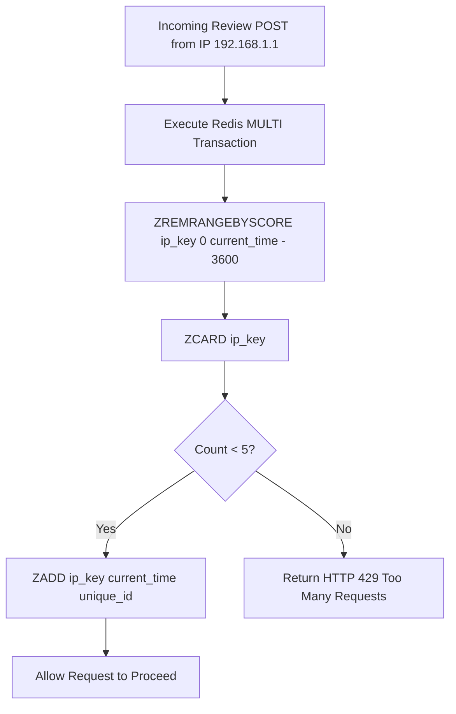
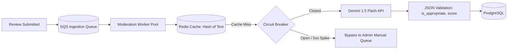

# 14.17 Classic System Design Interview Questions & Adaptations

---

## 1. Design This Project's System at 100x Scale

### Requirements & Estimation
- **Functional**: Collect customer reviews with photos; display real-time scrolling marquee; filter spam.
- **Scale**: 10M monthly views (4 QPS read avg, 25 QPS peak); 10K reviews/month (<1 QPS write).
- **Storage**: ~70 MB/year DB records; ~12 GB/year compressed images.

### High-Level Architecture Diagram

### Deep Dive & Bottlenecks
- **Bottlenecks**: S3 write latency during avatar upload; solved via pre-signed direct upload URLs.
- **Trade-offs**: Eventual consistency on public marquee (5-second cache TTL accepted for 99% CDN hit ratio).

---

## 2. Design the File & Media Upload System

### Architecture

---

## 3. Design the Rate Limiter

### Algorithm: Redis Sliding Window Counter

---

## 4. Design the AI Moderation & Sentiment Pipeline

### Architecture with Fallback Circuit Breaker

---

## 5. Classic System Design Adaptations (Reusing the Same Building Blocks)

### 5.1 Design a URL Shortener (TinyURL)
- **Mapping**: Replace review creation with URL encoding. Base62 hash of auto-incrementing ID yields 7-character alias (`https://short.io/Ab3Z9q`). Redis caches top 20% hot links with LRU eviction; PostgreSQL persists long-tail mappings.

### 5.2 Design a Real-Time Chat System (WhatsApp / Slack)
- **Mapping**: Upgrade our SSE marquee stream to bidirectional WebSockets. A Redis Pub/Sub backplane scales socket connections across multiple Node server nodes, delivering instant messages to specific chat room channels.

### 5.3 Design a News Feed (Twitter / LinkedIn)
- **Mapping**: The review submission feed uses the Fan-Out on Write pattern. High-follower users push review posts to Redis sorted sets (`ZADD user:feed:id timestamp review_id`), allowing followers to read their feed in constant $O(1)$ time.
