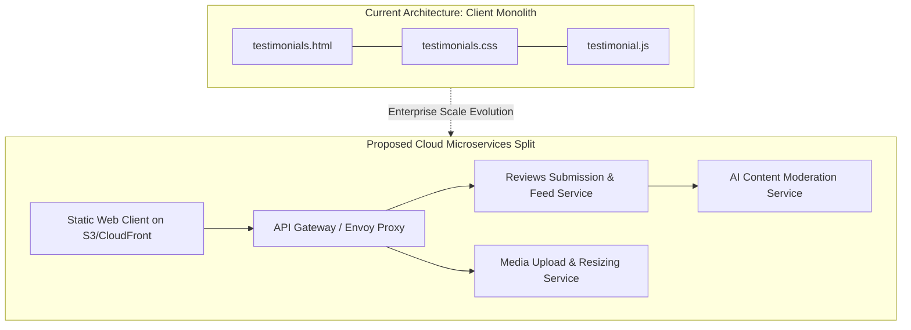

# 14.2 Architecture Styles & Topology

---

## 1. What It Is in Plain Words
Architecture style defines the structural blueprint of software components—how responsibility is partitioned between monolithic codebases, modular layers, microservices, and serverless edge functions.

---

## 2. Whether & How THIS Project Uses It
- **Current Style**: **Client-Side MVC Monolith**
  - Model: Array state in [`testimonial.js:16`](file:///Users/avishjain/avishjain9-repos/53-testimonials-grid/testimonial.js#L16).
  - View: HTML structure and CSS styling in [`testimonials.html`](file:///Users/avishjain/avishjain9-repos/53-testimonials-grid/testimonials.html) and [`testimonials.css`](file:///Users/avishjain/avishjain9-repos/53-testimonials-grid/testimonials.css).
  - Controller: Event coordination and DOM mutation in [`testimonial.js`](file:///Users/avishjain/avishjain9-repos/53-testimonials-grid/testimonial.js).

---

## 3. Scale Suitability Evaluation
A client-side monolith is the most efficient and robust architecture for this scale. Splitting a 3-file widget into microservices would introduce absurd operational overhead, network latency, and deployment complexity. [CONFIRM WITH DEVELOPER]

---

## 4. Full Alternatives Comparison

| Architectural Style | Deployment Complexity | Latency | Operational Overhead | Failure Isolation | Fit for This Project |
| :--- | :--- | :--- | :--- | :--- | :--- |
| **Client Monolith (Chosen)**| **Zero (Static Files)** | **< 1 ms (Local)** | **Zero** | **Local to tab** | **Optimal for current scope** |
| **Modular Monolith (Backend)**| Low (Single container) | 20-50 ms | Low | Shared process | Ideal for next stage |
| **Microservices** | Very High (K8s / Mesh) | 50-150 ms (RPC hops)| Very High | High per service | Overkill |
| **Serverless Edge Functions** | Medium (Cloudflare Workers)| 15-30 ms | Very Low (Managed) | Complete per invocation | Excellent cloud fit |

---

## 5. Trade-offs Accepted
Single-file script structure means all logic lives in one namespace (`testimonial.js`), accepted in exchange for zero build step.

---

## 6. What Breaks First at Scale
- **10x Load**: Client file size remains tiny; no breakage.
- **100x Load**: Multiple developers modifying `testimonial.js` simultaneously encounter git merge conflicts.
- **1000x Load**: Lack of service boundary prevents independent scaling of image processing vs review text retrieval.

---

## 7. How a Senior Engineer Would Improve It
Split the cloud backend into two decoupled services: a high-throughput **Reviews Feed Service** (serving cached JSON to the marquee) and an asynchronous **Media & Moderation Worker** (processing uploaded avatars and screening text).

---

## 8. 30-Second Spoken Interview Answer
> "Right now, the app is structured as a client-side MVC monolith, which is the most reliable and latency-free architecture for a self-contained widget. If scaling to an enterprise multi-tenant review platform, I would evolve this into an edge-cached static client talking to a modular backend split between a read-heavy Reviews Feed Service and an asynchronous Media Ingestion Worker."
