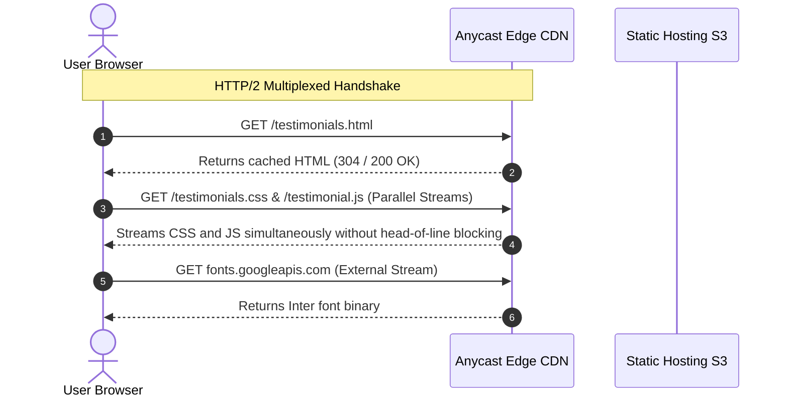

# 14.3 Networking & Communication Protocols

---

## 1. What It Is in Plain Words
Networking protocols dictate how data packets travel across the internet between client browsers, CDN edge nodes, load balancers, and backend servers.

---

## 2. Whether & How THIS Project Uses It
- **Protocols Used**:
  - **HTTP/2**: Supported by all external CDNs (Google Fonts, Cloudflare FontAwesome, Placehold.co) to download CSS, fonts, and images concurrently over a single TCP connection.
  - **HTTPS / TLS 1.3**: Secures all external CDN asset transfers.
  - **Local DOM Communication**: Intra-tab communication using native DOM Custom Events and synchronous function calls.

---

## 3. Scale Suitability Evaluation
Leveraging HTTP/2 via public CDNs is the modern industry standard for delivering frontend static assets. It eliminates HTTP/1.1 connection pooling bottlenecks. [CONFIRM WITH DEVELOPER]

---

## 4. Full Alternatives Comparison

| Protocol / Paradigm | Transport Layer | Multiplexing | Real-time Capabilities | Overhead | Fit for Reviews Feed |
| :--- | :--- | :--- | :--- | :--- | :--- |
| **REST over HTTP/2 (Chosen)**| TCP + TLS | Yes (Binary streams) | Polling required | Low | **Optimal for static asset delivery** |
| **HTTP/3 (QUIC)** | UDP + TLS 1.3 | Yes (Zero head-of-line blocking)| Polling required | Very Low | Ideal next evolution |
| **WebSockets** | TCP (Bi-directional) | No (Full duplex socket) | Instant push (< 5 ms) | High (Idle connection state) | Overkill unless live chat |
| **Server-Sent Events (SSE)** | HTTP/2 | Yes | One-way server push | Very Low | Excellent for live review ticker |
| **gRPC** | HTTP/2 (Protobuf) | Yes | Streaming supported | Binary schema | Backend-to-backend only |

---

## 5. Trade-offs Accepted
Using REST/HTTP means the client does not receive real-time pushes of reviews submitted on other devices without polling or page refreshes.

---

## 6. What Breaks First at Scale
- **10x Load**: Zero issues; CDNs absorb requests.
- **100x Load**: Browser connection limit if many unbundled HTTP/1.1 requests were used (mitigated by HTTP/2).
- **1000x Load**: TCP handshake latency for users on high-latency mobile networks (resolved via HTTP/3).

---

## 7. How a Senior Engineer Would Improve It
Deploy the frontend over **HTTP/3 (QUIC)** to eliminate transport-layer head-of-line blocking on flaky mobile networks, and use **Server-Sent Events (SSE)** for lightweight live review push notifications.

---

## 8. 30-Second Spoken Interview Answer
> "We currently serve static assets over HTTP/2, which gives us multiplexed parallel downloading of stylesheets, fonts, and scripts over a single TCP connection. For a multi-user cloud expansion, I would choose Server-Sent Events over WebSockets for live review feeds because reviews are one-way server-to-client updates that run natively over HTTP/2 without maintaining expensive persistent socket state."
