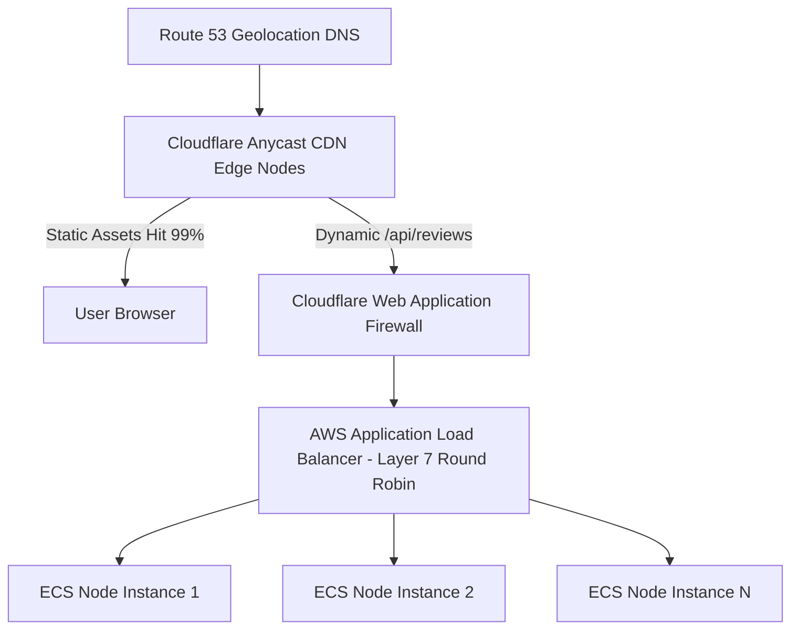

# 14.4 Load Balancing & Scaling Architecture

---

## 1. What It Is in Plain Words
Load balancing distributes incoming traffic across multiple servers to prevent any single machine from becoming a bottleneck, ensuring high availability and zero downtime.

---

## 2. Whether & How THIS Project Uses It
- **Current Status**: **Client Execution / Infinite Edge Scaling**
  - Because all computational logic (form validation, 3D math, ticker rendering) runs on the client device, the client itself provides 100% horizontal scaling.
  - Static asset distribution scales infinitely across Anycast edge networks (Cloudflare/Vercel).

---

## 3. Scale Suitability Evaluation
Offloading computational execution to the client's GPU and CPU is the ultimate form of horizontal scaling, completely freeing server infrastructure from rendering overhead. [CONFIRM WITH DEVELOPER]

---

## 4. Full Alternatives Comparison

| Load Balancing Strategy | Layer | Algorithm | State Handling | Health Checks | Best Fit Scenario |
| :--- | :--- | :--- | :--- | :--- | :--- |
| **Anycast CDN Edge (Chosen)**| Layer 7 | BGP Anycast Routing | Stateless | Built-in | **Static web client distribution** |
| **Application Load Balancer (ALB)**| Layer 7 | Round Robin / Least Conns | Sticky Sessions optional| HTTP `/health` | Cloud API cluster scaling |
| **Network Load Balancer (NLB)** | Layer 4 | TCP Hash / Flow Hash | Pure TCP | TCP ping | Extreme throughput (millions QPS) |
| **DNS Round Robin** | DNS | Circular record rotation | Stateless | None (Slow TTL) | Primitive DNS distribution |

---

## 5. Trade-offs Accepted
Zero central coordination between clients; each client manages its own isolated view.

---

## 6. What Breaks First at Scale
- **10x Load**: Zero breakage.
- **100x Load**: Zero breakage on client; cloud backend would require Layer 7 ALB.
- **1000x Load**: Origin server storage exhaustion if static hosting bandwidth exceeds tier limits.

---

## 7. How a Senior Engineer Would Improve It
Deploy an **AWS Application Load Balancer (ALB)** using **Least Outstanding Requests** routing across an ECS Fargate cluster with automated Target Tracking Autoscaling based on 70% CPU utilization.

---

## 8. 30-Second Spoken Interview Answer
> "Because this is a client-side web application, our frontend inherently scales horizontally: every user’s browser executes its own 3D math and ticker animations on their local GPU. For static asset distribution, we leverage Anycast CDN routing, which terminates TLS at the nearest geographical edge node and absorbs traffic spikes without touching an origin server."
