# 14.5 Databases & Storage Architecture

```mermaid
erDiagram
    USERS {
        uuid id PK
        string full_name
        string email UK
        string avatar_url
        timestamp created_at
    }

    REVIEWS {
        uuid id PK
        uuid user_id FK
        text review_text
        int rating
        string moderation_status "approved | pending | flagged"
        timestamp created_at
    }

    USERS ||--o{ REVIEWS : writes
```

---

## 1. What It Is in Plain Words
The data tier manages the durable storage, indexing, querying, and retrieval of application data across relational (SQL), document (NoSQL), key-value, and cloud object stores.

---

## 2. Whether & How THIS Project Uses It
- **Current Implementation**: **Web Storage API (`Window.localStorage`)**
  - Key: `user_testimonials` ([`testimonial.js:15`](file:///Users/avishjain/avishjain9-repos/53-testimonials-grid/testimonial.js#L15)).
  - Encoding: JSON string serialization of array `{ name, text, rating, imageSrc }`.

---

## 3. Scale Suitability Evaluation
LocalStorage is suitable for a single-user demo but unsuitable for multi-tenant production due to its 5 MB storage limit and domain isolation. [CONFIRM WITH DEVELOPER]

---

## 4. Full Database Alternatives Comparison

| Database / Store | Data Model | ACID Compliance | Query Flexibility | Horizontal Sharding | Storage Quota | Fit for Scaled System |
| :--- | :--- | :--- | :--- | :--- | :--- | :--- |
| **LocalStorage (Chosen)**| Key-Value String | Atomic per key | None (JSON.parse only) | None | **~5 MB** | **Optimal for client demo** |
| **PostgreSQL (Proposed)**| Relational (SQL) | Full ACID | High (Joins, Full-text) | Partitioning / Citus| Terabytes | **Best for production** |
| **MongoDB (Atlas)** | Document (BSON) | Multi-document ACID | High (Aggregation) | Native Sharding | Petabytes | Good fit for JSON feeds |
| **Amazon DynamoDB** | Key-Value / Doc | Single-item ACID | Key lookups only | Native Auto-sharding| Unlimited | Overkill for 4 QPS |
| **Amazon S3** | Object Blob | Read-after-write | Key-based fetch | Unlimited | Unlimited | **Essential for avatar images**|

---

## 5. Trade-offs Accepted
Accepting synchronous disk writes and 5 MB storage limits in exchange for eliminating database provisioning and hosting costs.

---

## 6. What Breaks First at Scale
- **10x Load**: QuotaExceededError if multiple Base64 images are stored.
- **100x Load**: Inability for users to see reviews submitted on different devices.
- **1000x Load**: Lack of indexing causes slow queries on large databases.

---

## 7. How a Senior Engineer Would Improve It
Transition to **PostgreSQL** with a `reviews` table indexed on `(moderation_status, created_at DESC)` and store uploaded avatar images in an **AWS S3 Bucket** with CloudFront CDN distribution.

---

## 8. 30-Second Spoken Interview Answer
> "Right now, we persist data to browser LocalStorage, which provides zero-latency offline persistence for our demonstration. In a production multi-user system, I would migrate to PostgreSQL: review data is relational, structured, and benefits from ACID guarantees. Avatars would be stripped from the database records and stored directly in an AWS S3 bucket, saving database storage and serving images via a global CDN."
