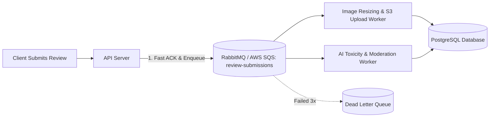

# 14.7 Messaging, Queues & Asynchronous Processing

---

## 1. What It Is in Plain Words
Asynchronous queues decouple slow, unpredictable tasks (image compression, AI moderation, email sending) from user-facing request paths, returning instant feedback to the user while background workers handle heavy computation.

---

## 2. Whether & How THIS Project Uses It
- **Current Implementation**: **Browser Event Loop Task Queue**
  - Uses `setTimeout(..., 1000)` to simulate asynchronous processing on the client ([`testimonial.js:176`](file:///Users/avishjain/avishjain9-repos/53-testimonials-grid/testimonial.js#L176)).
  - Offloads file streaming to native background I/O via `FileReader.prototype.readAsDataURL()`.

---

## 3. Scale Suitability Evaluation
Simulating asynchronous latency via `setTimeout` is ideal for front-end demonstration, giving users realistic visual feedback without spinning up cloud message brokers. [CONFIRM WITH DEVELOPER]

---

## 4. Full Alternatives Comparison

| Queue / Broker | Delivery Semantics | Latency | Backpressure | Persistence | Best Fit Scenario |
| :--- | :--- | :--- | :--- | :--- | :--- |
| **JS Event Queue (Chosen)** | Run-to-completion | < 1 ms | Native browser | Memory only | **Client UI state transitions** |
| **AWS SQS** | At-least-once | 10-20 ms | Managed | Managed cloud | Serverless review processing |
| **RabbitMQ** | At-least-once / Routing | 2-5 ms | Built-in | Disk backed | Complex multi-worker routing |
| **Apache Kafka** | At-least-once / Stream | 5-10 ms | High | Distributed log | High-throughput analytics stream |
| **Redis Streams / BullMQ** | At-least-once | 1-2 ms | Manual | Redis RDB/AOF | Fast Node.js background jobs |

---

## 5. Trade-offs Accepted
Client queue state is lost if the user abruptly closes the browser tab during the 1-second simulated delay.

---

## 6. What Breaks First at Scale
- **10x Load**: No breakage.
- **100x Load**: Synchronous cloud submission architecture times out during image processing spikes.
- **1000x Load**: Downstream AI moderation API rate limits drop user reviews without a message queue buffer.

---

## 7. How a Senior Engineer Would Improve It
In the cloud architecture, route submissions to an **AWS SQS queue**:
1. API immediately returns `202 Accepted` with a tracking ID.
2. An asynchronous worker pool pulls messages from SQS, compresses images, calls Gemini for moderation, writes to PostgreSQL, and pushes a notification via SSE.
3. Unprocessable messages route to a **Dead Letter Queue (DLQ)** for human review.

---

## 8. 30-Second Spoken Interview Answer
> "On the client, we use the browser’s asynchronous macrotask queue via setTimeout to provide realistic submission states without blocking the main UI thread. In a production backend, I would introduce an AWS SQS queue with an image worker and an AI moderation worker. This decouples slow AI screening from the submission path, guaranteeing sub-100-millisecond response times to the user."
