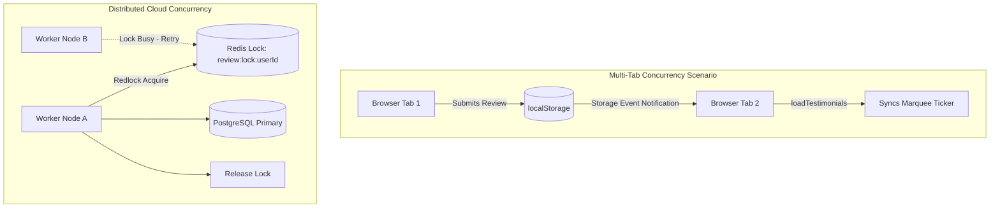

# 14.8 Consistency, Concurrency & Distributed Systems

---

## 1. What It Is in Plain Words
Distributed systems must coordinate multiple concurrent processes to ensure data consistency, prevent race conditions, and recover gracefully from network partitions.

---

## 2. Whether & How THIS Project Uses It
- **Current Model**: **Single-Threaded Run-to-Completion Concurrency**
  - JavaScript's single-threaded event loop guarantees that in-memory array operations (`testimonials.push()`) are non-preemptive and free from thread race conditions.
  - Multi-tab synchronization across browser processes is coordinated via the `storage` event.

---

## 3. Scale Suitability Evaluation
The single-threaded execution model provides bulletproof memory safety for client code without manual mutexes or thread locks. [CONFIRM WITH DEVELOPER]

---

## 4. Full Alternatives Comparison

| Consistency Model | Description | Latency Overhead | Complexity | Fit for Reviews System |
| :--- | :--- | :--- | :--- | :--- |
| **Strict Serializability** | Global real-time ordering | Very High (2PC / Consensus) | Extremely High | Overkill for reviews |
| **Read-Your-Writes (Chosen)**| User sees their own writes immediately| Very Low | Low | **Optimal for user feedback** |
| **Eventual Consistency** | Nodes converge over time | Minimal | Medium | Ideal for global marquee feeds |
| **Causal Consistency** | Causally related operations ordered | Low | Medium | Good for review comment threads |

---

## 5. Trade-offs Accepted
Accepting client-side domain isolation in exchange for avoiding complex distributed consensus protocols (e.g. Raft or Paxos).

---

## 6. What Breaks First at Scale
- **10x Load**: Multiple open browser tabs overwriting each other's in-memory arrays if not listening to the `storage` event.
- **100x Load**: Double-submission race conditions if two cloud API instances process duplicate requests simultaneously.
- **1000x Load**: Database write contention on auto-incrementing ID sequences during traffic surges.

---

## 7. How a Senior Engineer Would Improve It
1. Use client-generated **UUIDv4** idempotency keys to deduplicate submissions across retries.
2. Employ **Optimistic Concurrency Control (OCC)** with version numbers on backend review records.
3. Synchronize open client browser tabs using the modern **`BroadcastChannel` API**.

---

## 8. 30-Second Spoken Interview Answer
> "On the client, JavaScript's single-threaded event loop guarantees that state mutations and LocalStorage writes are atomic and race-condition free. For a distributed cloud backend, we would adopt an eventual consistency model with read-your-writes guarantees: the reviewer sees their review immediately, while other users across the globe receive the updated marquee within a few seconds via CDN cache invalidation."
