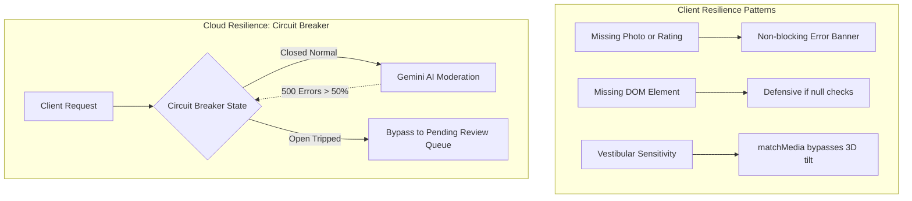

# 14.9 Reliability, Resilience & Fault Tolerance

---

## 1. What It Is in Plain Words
Reliability is the probability that a system will perform its required functions without failure under stated conditions for a specified period of time. Resilience is how gracefully the system recovers when failures inevitably occur.

---

## 2. Whether & How THIS Project Uses It
- **Defensive Null Guards**: Explicit checking of optional or commented DOM elements ([`testimonial.js:206`](file:///Users/avishjain/avishjain9-repos/53-testimonials-grid/testimonial.js#L206)).
- **Graceful Motion Degradation**: Bypassing cursor listeners when `prefers-reduced-motion` is active ([`testimonial.js:247-252`](file:///Users/avishjain/avishjain9-repos/53-testimonials-grid/testimonial.js#L247-L252)).
- **MIME Whitelisting**: Preventing script or binary payload crashes by enforcing image extensions ([`testimonial.js:129`](file:///Users/avishjain/avishjain9-repos/53-testimonials-grid/testimonial.js#L129)).

---

## 3. Scale Suitability Evaluation
Defensive checks are critical in vanilla JavaScript because unhandled exceptions terminate script execution and kill subsequent event listeners. [CONFIRM WITH DEVELOPER]

---

## 4. Full Alternatives Comparison

| Pattern | Purpose | Implementation Location | Failure Mitigated |
| :--- | :--- | :--- | :--- |
| **Defensive Null Guards (Chosen)**| Check DOM nodes before attaching | [`testimonial.js:206`](file:///Users/avishjain/avishjain9-repos/53-testimonials-grid/testimonial.js#L206) | `TypeError: Cannot read properties of null` |
| **Fallback Assets (Chosen)** | System font and placeholder avatar | [`testimonials.html:27`](file:///Users/avishjain/avishjain9-repos/53-testimonials-grid/testimonials.html#L27) | Broken image glyphs during network drops |
| **Circuit Breakers (Proposed)** | Trip requests to failing AI APIs | API Gateway / Edge Proxy | Cascading server timeouts and 504 errors |
| **Bulkhead Pattern (Proposed)** | Isolate connection thread pools | Cloud Node server | Heavy image uploads starving review reads |
| **Retry with Jitter (Proposed)**| Exponential backoff with randomness | Fetch utility wrapper | Thundering herd during temporary CDN glitches |

---

## 5. Trade-offs Accepted
Handling errors locally in UI banners without automated telemetry alerting (e.g. Sentry).

---

## 6. What Breaks First at Scale
- **10x Load**: Browser memory exhaustion if users upload multi-megabyte files repeatedly.
- **100x Load**: Downstream cloud database connection exhaustion without connection pooling.
- **1000x Load**: Third-party AI API 429 rate limit errors cascading into frontend 500 errors.

---

## 7. How a Senior Engineer Would Improve It
Wrap all cloud integrations in an **Opossum Circuit Breaker**:
- If AI moderation API fails 5 times consecutively, trip the circuit to `OPEN`.
- Route incoming reviews directly to a `status: 'pending_moderation'` database queue.
- Return immediate success to the user so review submission never fails from an external API outage.

---

## 8. 30-Second Spoken Interview Answer
> "We practice progressive enhancement and defensive resilience. In our code, we explicitly guard against missing DOM elements with null checks, and query prefers-reduced-motion to degrade 3D animations gracefully. In our cloud design, we implement circuit breakers around third-party AI APIs so that even if the AI moderation provider experiences an outage, reviews are saved to a pending queue without failing the user experience."
