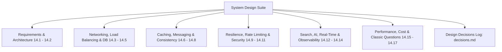

# System Design Deep Dive Suite

---

## System Design Navigation Index

| Topic File | Title & Core Subject | Current Client Usage | Cloud Scale Evolution |
| :--- | :--- | :--- | :--- |
| **[`14.1`](file:///Users/avishjain/avishjain9-repos/53-testimonials-grid/docs/system-design/14.1-requirements-and-estimation.md)** | Requirements & Capacity Estimation | Single-user client metrics | 100x & 1000x traffic capacity arithmetic |
| **[`14.2`](file:///Users/avishjain/avishjain9-repos/53-testimonials-grid/docs/system-design/14.2-architecture-styles.md)** | Architecture Styles | Client-Side MVC Monolith | Microservices / Serverless Edge decomposition |
| **[`14.3`](file:///Users/avishjain/avishjain9-repos/53-testimonials-grid/docs/system-design/14.3-networking-and-communication.md)** | Networking & Protocols | HTTP/2 CDN asset fetching | HTTP/3, WebSockets, REST vs gRPC |
| **[`14.4`](file:///Users/avishjain/avishjain9-repos/53-testimonials-grid/docs/system-design/14.4-load-balancing-and-scaling.md)** | Load Balancing & Scaling | Client execution (Infinite edge scale)| Layer 7 ALB, autoscaling groups |
| **[`14.5`](file:///Users/avishjain/avishjain9-repos/53-testimonials-grid/docs/system-design/14.5-databases-and-storage.md)** | Databases & Storage | Browser LocalStorage (~5 MB) | PostgreSQL, MongoDB, S3 Object Storage |
| **[`14.6`](file:///Users/avishjain/avishjain9-repos/53-testimonials-grid/docs/system-design/14.6-caching.md)** | Caching Architectures | Browser HTTP Cache & LocalStorage | Redis Cluster, Cache-Aside, CDN Caching |
| **[`14.7`](file:///Users/avishjain/avishjain9-repos/53-testimonials-grid/docs/system-design/14.7-messaging-queues-async.md)** | Messaging & Queues | Asynchronous JS Event Loop | RabbitMQ / SQS review ingestion queues |
| **[`14.8`](file:///Users/avishjain/avishjain9-repos/53-testimonials-grid/docs/system-design/14.8-consistency-concurrency-distributed.md)**| Consistency & Distributed Systems | Client single-threaded atomicity | Distributed locks, Raft, multi-tab sync |
| **[`14.9`](file:///Users/avishjain/avishjain9-repos/53-testimonials-grid/docs/system-design/14.9-reliability-and-resilience.md)** | Reliability & Resilience | Graceful degradation on motion | Circuit breakers, bulkhead, SLIs/SLOs |
| **[`14.10`](file:///Users/avishjain/avishjain9-repos/53-testimonials-grid/docs/system-design/14.10-api-design-and-rate-limiting.md)**| API Design & Rate Limiting | Not used locally (No API endpoint) | Token bucket / Sliding window rate limits |
| **[`14.11`](file:///Users/avishjain/avishjain9-repos/53-testimonials-grid/docs/system-design/14.11-security-architecture.md)**| Security Architecture | Client XSS entity encoding | Zero Trust, CSP, WAF, OAuth2 |
| **[`14.12`](file:///Users/avishjain/avishjain9-repos/53-testimonials-grid/docs/system-design/14.12-search-and-ai-architecture.md)**| Search & AI Architecture | Not used locally | Full-text search, Gemini AI moderation |
| **[`14.13`](file:///Users/avishjain/avishjain9-repos/53-testimonials-grid/docs/system-design/14.13-real-time-systems.md)**| Real-Time Systems | Local instant DOM updates | WebSockets live review feed with Redis pub/sub |
| **[`14.14`](file:///Users/avishjain/avishjain9-repos/53-testimonials-grid/docs/system-design/14.14-observability-and-operations.md)**| Observability & Operations | DevTools Performance & Console | OpenTelemetry, Prometheus, Grafana, Sentry |
| **[`14.15`](file:///Users/avishjain/avishjain9-repos/53-testimonials-grid/docs/system-design/14.15-performance-engineering.md)**| Performance Engineering | GPU compositor transforms | Profiling, Little's Law, memory limits |
| **[`14.16`](file:///Users/avishjain/avishjain9-repos/53-testimonials-grid/docs/system-design/14.16-cost-and-tradeoffs.md)**| Cost & Trade-offs | $0.00 / month static hosting | Financial modeling for 100x traffic |
| **[`14.17`](file:///Users/avishjain/avishjain9-repos/53-testimonials-grid/docs/system-design/14.17-classic-system-design-questions.md)**| Classic System Design Questions | Domain adaptations | Chat system, URL shortener, news feed |
| **[`decisions`](file:///Users/avishjain/avishjain9-repos/53-testimonials-grid/docs/system-design/decisions.md)**| Design Decisions Log | Complete architectural log table | 100% of codebase technical decisions |
