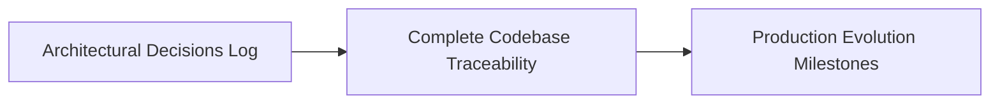

# Architectural Design Decisions Log

This table documents every major architectural and implementation decision made across the codebase, complete with alternatives evaluated, deciding factors, trade-offs accepted, and triggers for revisiting each decision.

---

## Complete Decisions Matrix

| Decision | Chosen Option | Alternatives Considered | Deciding Factors | Trade-off Accepted | Revisit When |
| :--- | :--- | :--- | :--- | :--- | :--- |
| **D1: Framework Selection** | Pure Vanilla JavaScript (ES6+) | React 18, Vue 3, Svelte 4, Angular | 0 KB bundle overhead, instant script execution, perfect Web Vitals, zero build step required. | Manual DOM mutation and template string interpolation. | Porting to a multi-page SaaS application with complex client-side routing. |
| **D2: Styling Architecture** | CSS Custom Properties (Design Tokens) | Tailwind CSS, Sass/SCSS, CSS Modules, Styled-Components | Native CSSOM runtime updates, zero PostCSS build pipeline, clean semantic HTML markup. | Manual prefix management and lack of compile-time variable typo detection. | Team expands to 5+ engineers requiring standardized cross-component design tokens. |
| **D3: Client Persistence** | Browser `Window.localStorage` | IndexedDB, Cookies, Remote Backend DB (Postgres/Mongo) | Zero configuration, synchronous reads on boot, 100% serverless, offline-ready. | Domain isolation (device-bound reviews) and ~5 MB origin storage quota. | Reviews must be aggregated and visible across multiple users and devices. |
| **D4: Image Storage Format** | In-Memory Base64 DataURL | Blob URLs (`createObjectURL`), Cloud S3 Upload, Local Server FS | Base64 strings can be serialized directly into JSON and saved to LocalStorage across reloads. | 33% payload size inflation consuming LocalStorage quota faster. | Introducing an AWS S3 bucket with pre-signed direct upload URLs. |
| **D5: Ticker Carousel Engine**| CSS Keyframes with DOM Duplication | JavaScript `requestAnimationFrame`, Swiper.js, Slick Carousel | Runs entirely on GPU compositor thread at 60 FPS without main-thread jank; native hover pause. | Duplicating rendered card nodes in DOM (`trackHTML + trackHTML`). | Users require touch-swipe gestures or slide snapping pagination. |
| **D6: 3D Perspective Math** | Native Normalized MouseEvent Math | Vanilla-Tilt.js, Three.js, CSS hover transitions | Zero third-party library overhead, 15 lines of code, seamless integration with accessibility guards. | Manual reset listeners required on `mouseleave`. | Introducing complex WebGL shaders, directional lighting, or particle physics. |
| **D7: Accessibility Guard** | `window.matchMedia` query | Unconditional animation, Manual user toggle switch | Fully respects OS-level accessibility toggles automatically without user intervention. | Complete bypass of 3D tilt feature for motion-reduced users. | Never; accessibility compliance is a permanent core requirement. |
| **D8: Input Sanitization** | Regex Angle Bracket Entity Encoding | `DOMPurify`, Unescaped `innerHTML`, `textContent` | Lightweight inline utility with zero external dependencies. | Does not sanitize attribute quotes or protocol escapes. | Migrating to enterprise production where untrusted users can submit arbitrary HTML. |
| **D9: Dynamic Scroll Speed** | Arithmetic Duration Scaling | Fixed duration, Static CSS keyframe speed | Maintains constant, comfortable physical reading velocity regardless of review count. | Re-calculates and re-applies style property on each render. | Reviews exceed 100 items (requires DOM virtualization). |
| **D10: Star Rating Control** | CSS Flex Inversion (`row-reverse`) | JavaScript click handlers per star, SVG rating library | High-performance CSS-driven hover states at 60 FPS without 10 JS event listeners. | DOM order (#star5 down to #star1) is inverted relative to visual display order. | Screen-reader keyboard navigation requires explicit ARIA enhancement. |
| **D11: Floating Label Fields**| CSS `:not(:placeholder-shown)` | JavaScript `focus`/`blur` listeners, Static labels | Clean modern UX without JS listeners; label never obscures entered text. | Requires single whitespace character in HTML `placeholder=" "`. | Supporting legacy browsers lacking `:placeholder-shown` support. |
| **D12: Documentation Tool** | VitePress (Vue.js Docs Engine) | Docusaurus, MkDocs, GitBook, Nextra | Lightning-fast Vite HMR, pure black dark mode, native Mermaid diagram plugin support. | Node.js dev dependency required for building documentation. | Never; VitePress provides industry-leading documentation aesthetics. |
